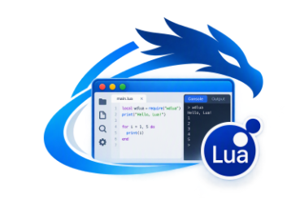

CC BY-NC-SA 4.0 - jean-marc "jihem" quere 2026\
LPCS, Lab'Oratoire (metalab at sonaliwan.fr)

[]()

# wdlua — Documentation complète

wdlua est un environnement de programmation écrit par Jean-Marc Quéré,construit sur **wdgui** comportant :
- un **interpréteur Lua** écrit en Nim (Lua 5.4 et des raccourcis décrits dans ce manuel) ;
- un **IDE** : éditeur, analyse en continu, exécution directe ou **pas à pas** ;
- un **runtime autonome**, `wdluart`, pour exécuter les programmes sans l'IDE ;
- des **paquets** écrits en Nim qui étendent le langage : fichiers, CSV, JSON, réseau,
  SQLite, multitâche et **interfaces graphiques wdgui**.

---

## Sommaire

1. [Prise en main](#1-prise-en-main)
2. [L'IDE](#2-lide)
3. [Le runtime wdluart](#3-le-runtime-wdluart)
4. [Le langage](#4-le-langage)
5. [Fonctions de base](#5-fonctions-de-base)
6. [string — chaînes et motifs](#6-string--chaînes-et-motifs)
7. [table](#7-table)
8. [math](#8-math)
9. [coroutine](#9-coroutine)
10. [utf8](#10-utf8)
11. [io — entrées/sorties](#11-io--entréessorties)
12. [os — système](#12-os--système)
13. [file — fichiers et dossiers](#13-file--fichiers-et-dossiers)
14. [bin — données binaires](#14-bin--données-binaires)
15. [csv](#15-csv)
16. [json](#16-json)
17. [net — sockets](#17-net--sockets)
18. [http](#18-http)
19. [ftp](#19-ftp)
20. [ssh et sftp](#20-ssh-et-sftp)
21. [sqlite](#21-sqlite)
22. [task — tâches coopératives](#22-task--tâches-coopératives)
23. [thread — threads système](#23-thread--threads-système)
24. [ui — interfaces graphiques](#24-ui--interfaces-graphiques)
25. [Écrire un paquet en Nim](#25-écrire-un-paquet-en-nim)
26. [Limites et remarques](#26-limites-et-remarques)

---

## 1. Prise en main

### Compilation

wdlua se place dans `apps/wdlua` du dépôt nim.wdgui, à côté de wdnim.

```sh
cd apps/wdlua
nim c -d:release wdlua.nim       # l'IDE
nim c -d:release wdluart.nim     # le runtime autonome
```

Bibliothèques chargées au lancement :

| Bibliothèque | Utilisée par |
|---|---|
| SDL3, SDL3_ttf | wdgui (IDE et paquet `ui`) |
| OpenSSL | HTTPS et sockets TLS |
| SQLite 3 | paquet `sqlite` |
| client OpenSSH (`ssh`, `scp`, `sftp`) | paquets `ssh` et `sftp` |

### Premier programme

```lua
print("Bonjour, monde !")
```

Dans l'IDE : *Fichier > Nouveau fichier*, tapez la ligne, puis **Ctrl+R**.
En ligne de commande :

```sh
./wdluart bonjour.lua
```

### Premier programme graphique

```lua
local ui = require "ui"

local win = ui.window{title = "Bonjour", width = 420, height = 200}
local lbl = win:add(ui.label("Cliquez sur le bouton", "center"))
local btn = win:add(ui.button("Compter", {default = true}))
local nb = 0

btn.onclick = function(ev)
  nb += 1
  lbl.caption = "Clics : " .. nb            -- texte d'un libellé : caption
  btn.value = "Compter (" .. nb .. ")"      -- texte d'un bouton : value
end

ui.run()
```

---

## 2. L'IDE

```sh
./wdlua                  # rouvre le dernier projet
./wdlua mon_projet/      # ouvre un dossier
./wdlua script.lua       # ouvre un fichier (et son dossier comme projet)
```

### Projets

Un projet est un **dossier**. Son point d'entrée est `main.lua`. Vous pouvez en choisir un
autre dans *Exécuter > Arguments et fichier principal*.

- *Fichier > Nouveau projet* crée le dossier et un `main.lua` d'exemple.
- `require "outils"` charge `outils.lua` du projet.
- `require "lib.maths"` charge `lib/maths.lua`, ou `lib/maths/init.lua`.
- Les fichiers ouverts sont exécutés **tels qu'affichés**, même non enregistrés.

### Panneaux

| Panneau | Contenu |
|---|---|
| Projet | arborescence du dossier ; un clic ouvre le fichier |
| Structure | fonctions et variables globales du fichier ; un clic y conduit |
| Paquets | documentation de toutes les fonctions ; double-clic : insère l'appel |
| Problèmes | erreurs de syntaxe, avertissements, erreurs d'exécution |
| Console | sortie du programme, saisie pour `io.read`, boutons Copier / Effacer |
| Variables | variables locales, upvalues et globales en pause |
| Pile d'appels | fonctions en cours en pause ; un clic affiche leurs variables |

### Éditeur

- Coloration Lua. Les extensions du manuel (`+=`, `!=`, `\`, `?`) ont leur propre couleur.
- Diagramme de structure dans la marge (blocs `function`, `if`, `for`, `while`, `repeat`, `do`).
- Minicarte, appariement des parenthèses, numéros de ligne.
- Complétion (**Ctrl+Espace** ou automatique) :
  - fonctions et paquets disponibles ;
  - membres après `.` (`string.`, `json.`…) ;
  - méthodes après `:` ;
  - propriétés et gestionnaires `on…` des objets `ui` ;
  - symboles du projet.
- Aide à la signature dans la barre d'état pendant que vous tapez les arguments.
- Analyse en continu : les erreurs de syntaxe viennent de l'analyseur même de
  l'interpréteur ; un avertissement signale les appels de fonctions définies nulle part.

### Raccourcis

| Touche | Action |
|---|---|
| Ctrl+N / Ctrl+O / Ctrl+S | nouveau / ouvrir / enregistrer (Maj : enregistrer sous) |
| Ctrl+Z / Ctrl+Y | annuler / rétablir |
| Ctrl+X / C / V / A | couper / copier / coller / tout sélectionner |
| Ctrl+D | dupliquer la ligne |
| Ctrl+/ ou Ctrl+B | commenter / décommenter |
| Tab / Maj+Tab | indenter / désindenter |
| Ctrl+F / Ctrl+K | rechercher / remplacer |
| Ctrl+H, F3 / Maj+F3 | occurrence suivante / précédente |
| Ctrl+L, F2 | aller à la ligne |
| F12, Ctrl+clic | aller à la définition |
| Ctrl+Espace | complétion |
| Ctrl+Tab | document suivant |
| **Ctrl+R** | exécuter (sans débogueur) |
| **F5** | déboguer / continuer |
| **F9**, clic sur un numéro de ligne | point d'arrêt |
| **F10** | pas principal (passe par-dessus les appels) |
| **F11** | pas à pas (entre dans les fonctions) |
| **Maj+F11** | sortir de la fonction |
| **Maj+F5** | arrêter |

### Débogage

1. Posez un point d'arrêt (F9 ou clic sur le numéro de ligne : un point rouge apparaît).
2. Lancez avec **F5**. Le programme s'arrête sur la ligne marquée, surlignée avec une flèche.
3. Consultez l'onglet **Variables** et la **Pile d'appels**.
4. Continuez avec F5, F10, F11 ou Maj+F11.

```lua
local function factorielle(n)
  if n <= 1 then return 1 end
  return n * factorielle(n - 1)   -- point d'arrêt ici, puis F11 pour suivre la récursion
end
print(factorielle(5))
```

Les points d'arrêt fonctionnent aussi dans les gestionnaires d'événements des fenêtres.

### Console et saisie

`print` et `io.write` écrivent dans la console. `io.read()` met le programme en attente :
tapez la réponse dans le champ en bas de la console, puis Entrée.

```lua
io.write("Votre prénom : ")
local nom = io.read()
print("Bonjour " .. nom)
```

---

## 3. Le runtime wdluart

```sh
wdluart programme.lua [arguments...]   # exécute un programme
wdluart --check programme.lua          # vérifie la syntaxe sans exécuter
wdluart -e "print(2 ^ 10)"             # exécute une ligne de code
wdluart --packages                     # liste les paquets disponibles
```

Les arguments sont accessibles dans `arg` et `os.args`. `arg[0]` contient le chemin du programme.

```lua
-- somme.lua :  wdluart somme.lua 3 4 5
local total = 0
for i = 1, #arg do total += tonumber(arg[i]) end
print("somme :", total)
```

Si le programme ouvre des fenêtres sans appeler `ui.run()`, la boucle d'événements démarre
à la fin du programme et dure jusqu'à la fermeture des fenêtres.

Codes de sortie :

| Code | Signification |
|---|---|
| 0 | succès |
| 1 | erreur d'exécution |
| 2 | erreur de syntaxe |
| *n* | valeur passée à `os.exit(n)` |

---

## 4. Le langage

### 4.1 Commentaires

```lua
-- commentaire jusqu'à la fin de la ligne

--[[ commentaire
     sur plusieurs lignes ]]

--[==[ un commentaire long peut contenir ]] grâce
       au même nombre de signes = de part et d'autre ]==]
```

### 4.2 Mots réservés

```
and  break  do  else  elseif  end  false  for  function  if  in
local  nil  not  or  repeat  return  then  true  until  while
```

`goto` est réservé mais refusé (voir §4.17).

### 4.3 Types de valeurs

| Type | Exemples |
|---|---|
| `nil` | `nil` |
| `boolean` | `true`, `false` |
| `number` (entier) | `42`, `-7`, `0xff`, `0b1010` |
| `number` (flottant) | `3.14`, `1e-3`, `0x1p4` |
| `string` | `"texte"`, `'texte'`, `[[texte]]` |
| `table` | `{1, 2, 3}`, `{nom = "Ada"}` |
| `function` | `function(x) return x * 2 end` |
| `thread` | coroutine |
| `userdata` | objet natif (fichier, socket, base, contrôle ui…) |

```lua
print(type(42), type("a"), type({}), type(print))   --> number  string  table  function
print(math.type(3), math.type(3.0))                  --> integer  float
```

Seuls `nil` et `false` sont faux ; `0` et `""` sont vrais.

```lua
if 0 then print("0 est vrai") end
```

### 4.4 Nombres

Les entiers sont sur 64 bits et **bouclent** en cas de dépassement. Les flottants sont en double précision.

```lua
print(10 // 3, 10 / 3)            --> 3   3.3333333333333
print(0xff, 0b1010, 1e3)          --> 255  10  1000.0
print(math.maxinteger + 1 == math.mininteger)   --> true
print(7 // 2, -7 // 2, 7 % -3)    --> 3  -4  -2
print(3 == 3.0)                   --> true
```

Une chaîne numérique est convertie automatiquement dans un calcul :

```lua
print("10" + 5)    --> 15
print(10 .. "")    --> "10"
```

### 4.5 Chaînes

```lua
local a = "guillemets doubles"
local b = 'guillemets simples'
local c = [[chaîne longue
sur plusieurs lignes]]
local d = [==[peut contenir ]] sans souci]==]
```

Séquences d'échappement :

| Séquence | Signification |
|---|---|
| `\n` `\t` `\r` | saut de ligne, tabulation, retour chariot |
| `\\` `\"` `\'` | barre oblique inverse, guillemets |
| `\a` `\b` `\f` `\v` | sonnerie, retour arrière, saut de page, tabulation verticale |
| `\x41` | octet en hexadécimal |
| `\65` | octet en décimal (jusqu'à 3 chiffres) |
| `\u{263A}` | caractère Unicode (UTF-8) |
| `\z` | ignore les blancs qui suivent (y compris les sauts de ligne) |

```lua
print("A\tB\nC", "\u{2764}", "\x48\x69")
```

### 4.6 Variables et portée

Une variable est **globale** par défaut, **locale** avec `local`.
Une locale est visible jusqu'à la fin de son bloc.

```lua
x = 10              -- globale
local y = 20        -- locale au fichier
do
  local y = 30      -- autre y, local au bloc
  print(y)          --> 30
end
print(y)            --> 20

local a, b, c = 1, 2      -- c vaut nil
a, b = b, a               -- échange
local MAX <const> = 100   -- constante (attribut <const>)
```

### 4.7 Opérateurs

| Catégorie | Opérateurs |
|---|---|
| arithmétiques | `+  -  *  /  //  %  ^`  et `-` unaire |
| comparaison | `==  ~=  <  <=  >  >=` |
| logiques | `and  or  not` |
| bit à bit (entiers) | `&  \|  ~  <<  >>`  et `~` unaire |
| concaténation | `..` |
| longueur | `#` |

```lua
print(2 ^ 10, 17 % 5, -17 // 5)     --> 1024.0  2  -4
print(5 & 3, 5 | 3, 5 ~ 3, ~0)      --> 1  7  6  -1
print(1 << 4, 256 >> 4)             --> 16  16
print("ab" .. "cd", #"abc", #{1, 2, 3})
print(nil or "défaut", false and 1) --> défaut  false
```

`and` et `or` renvoient l'un de leurs opérandes, d'où l'idiome :

```lua
local nom = arg[1] or "anonyme"
local signe = x >= 0 and "positif" or "négatif"
```

Priorités, de la plus faible à la plus forte :

```
or
and
<  >  <=  >=  ~=  ==
|
~
&
<<  >>
..                  (associatif à droite)
+  -
*  /  //  %
not  #  -  ~        (unaires)
^                   (associatif à droite)
```

### 4.8 Extensions décrites par le manuel

| Forme | Équivalent Lua |
|---|---|
| `a += 1` | `a = a + 1` |
| `a -= 1`, `a *= 2`, `a /= 2` | soustraction, multiplication, division |
| `a //= 2`, `a \= 2` | division entière |
| `a %= 3`, `a ^= 2` | modulo, puissance |
| `s ..= "x"` | `s = s .. "x"` |
| `m &= 0xff`, `m \|= 4`, `m <<= 1`, `m >>= 1` | opérations bit à bit |
| `a \ b` | `a // b` |
| `a != b` | `a ~= b` |
| `if (cond) instr` | `if cond then instr end` |
| `if (cond) instr else instr` | `if cond then instr else instr end` |
| `while (cond) instr` | `while cond do instr end` |
| `?expr, ...` | `print(expr, ...)` |
| `0b1010` | littéral binaire |

```lua
local score = 10
score += 5             -- 15
score \= 2             -- 7
local s = "ab"
s ..= "cd"             -- "abcd"
local t = {n = 1}
t.n *= 10              -- les champs de table fonctionnent aussi

if (score > 5) print("grand") else print("petit")
local i = 0
while (i < 3) i += 1
?"i vaut", i           -- affiche : i vaut  3
if (1 != 2) print("différents")
```

Les formes courtes de `if` et `while` tiennent sur **une seule ligne**, et la condition doit
être **entre parenthèses**. Sans `then` (ou `do`) sur la ligne, c'est la forme courte qui
s'applique.

### 4.9 Conditions

```lua
local note = 14
if note >= 16 then
  print("très bien")
elseif note >= 12 then
  print("bien")
else
  print("à revoir")
end
```

### 4.10 Boucles

```lua
-- boucle numérique : début, fin, pas (facultatif)
for i = 1, 5 do io.write(i, " ") end          --> 1 2 3 4 5
for i = 10, 1, -3 do io.write(i, " ") end     --> 10 7 4 1
for x = 0, 1, 0.25 do io.write(x, " ") end    --> 0.0 0.25 0.5 0.75 1.0

-- boucle générique sur une table
local fruits = {"pomme", "poire", "kiwi"}
for i, f in ipairs(fruits) do print(i, f) end
for cle, valeur in pairs({a = 1, b = 2}) do print(cle, valeur) end

-- while et repeat
local n = 0
while n < 3 do n += 1 end
repeat n -= 1 until n == 0     -- until voit les locales du bloc

-- sortie anticipée
for i = 1, 100 do
  if i * i > 50 then print("premier carré > 50 :", i) break end
end
```

La variable d'une boucle `for` est locale à chaque tour : une fonction créée dans la boucle
garde sa propre valeur.

```lua
local f = {}
for i = 1, 3 do f[i] = function() return i end end
print(f[1](), f[3]())    --> 1  3
```

### 4.11 Fonctions

```lua
-- déclaration
function carre(x) return x * x end
local function cube(x) return x * x * x end
local double = function(x) return 2 * x end

-- plusieurs résultats
local function minmax(t)
  local mn, mx = math.huge, -math.huge
  for _, v in ipairs(t) do mn = math.min(mn, v) mx = math.max(mx, v) end
  return mn, mx
end
local a, b = minmax({4, 9, 1})        --> 1  9

-- nombre variable d'arguments
local function somme(...)
  local s = 0
  for _, v in ipairs({...}) do s += v end
  return s, select("#", ...)
end
print(somme(1, 2, 3))                 --> 6  3

-- fermetures (closures)
local function compteur()
  local n = 0
  return function() n += 1 return n end
end
local c = compteur()
print(c(), c(), c())                  --> 1  2  3

-- arguments nommés : une table en paramètre
local function rect(o) return (o.largeur or 1) * (o.hauteur or 1) end
print(rect{largeur = 3, hauteur = 4}) --> 12
```

Un appel avec une seule chaîne ou une seule table peut omettre les parenthèses :
`print "salut"`, `rect{largeur = 2}`.

Un `return` doit être la dernière instruction de son bloc. La récursion est limitée à
200 niveaux d'appels imbriqués.

### 4.12 Tables

La table est la seule structure de données : tableau, dictionnaire, objet, module.

```lua
local t = {10, 20, 30}               -- tableau : t[1], t[2], t[3]
local p = {nom = "Ada", age = 36}    -- dictionnaire : p.nom, p["age"]
local m = {[1] = "a", ["clé avec espace"] = true, [3.0] = "trois"}

t[#t + 1] = 40                       -- ajout en fin
p.ville = "Londres"                  -- nouveau champ
p.age = nil                          -- suppression
print(#t, p.nom, m[3])               --> 4  Ada  trois

local grille = {{1, 2}, {3, 4}}      -- tables imbriquées
print(grille[2][1])                  --> 3
```

Les clés flottantes à valeur entière sont normalisées : `t[3.0]` et `t[3]` sont la même case.

### 4.13 Méthodes et objets

`obj:f(x)` équivaut à `obj.f(obj, x)`. Dans `function T:f()`, `self` désigne l'objet.

```lua
local Compte = {}
Compte.__index = Compte

function Compte.nouveau(solde)
  return setmetatable({solde = solde or 0}, Compte)
end
function Compte:deposer(v) self.solde += v return self end
function Compte:__tostring() return "Compte(" .. self.solde .. ")" end

local c = Compte.nouveau(100):deposer(50)
print(c.solde, tostring(c))          --> 150  Compte(150)
```

### 4.14 Métatables

`setmetatable(t, mt)` associe une métatable. Métaméthodes prises en charge :

| Clé | Rôle |
|---|---|
| `__index` | champ absent (table ou fonction) |
| `__newindex` | affectation d'un champ absent |
| `__call` | appel de la table comme une fonction |
| `__add` `__sub` `__mul` `__div` `__idiv` `__mod` `__pow` `__unm` | arithmétique |
| `__band` `__bor` `__bxor` `__shl` `__shr` `__bnot` | bit à bit |
| `__concat` | `..` |
| `__len` | `#` |
| `__eq` `__lt` `__le` | comparaisons |
| `__tostring` `__name` | conversion en chaîne |
| `__pairs` | personnalise `pairs` |
| `__metatable` | protège la métatable |

```lua
local V = {}
V.__index = V
V.__add = function(a, b) return setmetatable({x = a.x + b.x, y = a.y + b.y}, V) end
V.__eq = function(a, b) return a.x == b.x and a.y == b.y end
V.__tostring = function(v) return "(" .. v.x .. ", " .. v.y .. ")" end
local function vec(x, y) return setmetatable({x = x, y = y}, V) end

print(tostring(vec(1, 2) + vec(3, 4)))   --> (4, 6)
print(vec(1, 1) == vec(1, 1))            --> true

-- valeurs par défaut
local defaut = setmetatable({}, {__index = function(_, k) return 0 end})
print(defaut.inconnu)                    --> 0
```

### 4.15 Erreurs

```lua
local function diviser(a, b)
  if b == 0 then error("division par zéro") end
  return a / b
end

local ok, err = pcall(diviser, 1, 0)
print(ok, err)        --> false   main.lua:2: division par zéro

-- valeur d'erreur quelconque (table)
local ok2, e = pcall(error, {code = 404})
print(e.code)         --> 404

-- assert : erreur si la condition est fausse
local f = assert(io.open("donnees.txt"), "fichier manquant")

-- xpcall : gestionnaire appelé avec l'erreur
xpcall(function() error("oups") end, function(m) print("intercepté :", m) end)
```

`error(msg, 0)` n'ajoute pas la position `fichier:ligne` au message.

### 4.16 Coroutines

```lua
local gen = coroutine.create(function(a)
  local b = coroutine.yield(a * 2)    -- suspend et renvoie a * 2
  return a + b
end)
print(coroutine.resume(gen, 5))      --> true  10
print(coroutine.resume(gen, 1))      --> true  6
print(coroutine.status(gen))         --> dead

-- générateur avec wrap
local function compte(n)
  return coroutine.wrap(function() for i = 1, n do coroutine.yield(i) end end)
end
for i in compte(3) do print(i) end
```

### 4.17 Modules

```lua
-- outils.lua
local M = {}
function M.moyenne(t)
  local s = 0
  for _, v in ipairs(t) do s += v end
  return s / #t
end
return M
```

```lua
-- main.lua
local outils = require "outils"
print(outils.moyenne({2, 4, 6}))      --> 4.0
```

`require` cherche d'abord un **paquet** (`json`, `ui`…), puis `nom.lua` dans le dossier du
programme, puis dans le dossier courant. Un module n'est chargé qu'une fois.

### 4.18 Non pris en charge

| Élément | Raison |
|---|---|
| `goto` et les étiquettes `::nom::` | hors du langage décrit |
| attribut `<close>` | seul `<const>` est accepté |
| `_ENV` | les globales sont dans `_G` |

---

## 5. Fonctions de base

Disponibles sans `require`.

### Affichage et conversion

| Fonction | Rôle |
|---|---|
| `print(...)` | affiche les valeurs séparées par des tabulations, puis un saut de ligne |
| `printh(texte)` | écrit sur la sortie d'erreur (console de l'IDE) |
| `type(v)` | `"nil"`, `"boolean"`, `"number"`, `"string"`, `"table"`, `"function"`, `"thread"`, `"userdata"` |
| `tostring(v)` | conversion en chaîne (utilise `__tostring`) |
| `tonumber(v, [base])` | conversion en nombre, `nil` si impossible ; base de 2 à 36 |
| `tostr(v, [hex])` | comme `tostring`, `""` pour `nil` ; `hex` = vrai : entier en `0x…` |
| `tonum(v)` | comme `tonumber`, sans résultat si impossible |

```lua
print(tonumber("42"), tonumber("ff", 16), tonumber("1010", 2), tonumber("x"))
--> 42  255  10  nil
print(tostring(3.0), tostr(255, true))       --> 3.0  0x000000ff
```

### Parcours de tables

| Fonction | Rôle |
|---|---|
| `pairs(t)` | toutes les paires clé/valeur |
| `ipairs(t)` | `t[1]`, `t[2]`… jusqu'au premier `nil` |
| `next(t, [k])` | paire suivant la clé `k` |
| `select(n, ...)` | arguments à partir du n-ième ; `select("#", ...)` : leur nombre |
| `unpack(t, [i], [j])` | renvoie `t[i] … t[j]` |

```lua
local t = {"a", "b", "c"}
for i, v in ipairs(t) do io.write(i, "=", v, " ") end   --> 1=a 2=b 3=c
print(next({}))                    --> nil  (table vide)
print(select(2, "x", "y", "z"))    --> y  z
print(unpack({1, 2, 3}))           --> 1  2  3
```

### Accès bruts et métatables

| Fonction | Rôle |
|---|---|
| `rawget(t, k)` / `rawset(t, k, v)` | lecture / écriture sans métaméthode |
| `rawequal(a, b)` / `rawlen(v)` | égalité / longueur sans métaméthode |
| `setmetatable(t, mt)` / `getmetatable(v)` | métatables |

### Erreurs et chargement

| Fonction | Rôle |
|---|---|
| `error(msg, [niveau])` | lève une erreur |
| `assert(v, [msg])` | erreur si `v` est faux ; sinon renvoie ses arguments |
| `pcall(f, ...)` | appel protégé : `true, résultats` ou `false, erreur` |
| `xpcall(f, gestionnaire, ...)` | appel protégé avec gestionnaire d'erreur |
| `load(code, [nom])` | compile du code : fonction, ou `nil, message` |
| `dofile(chemin)` | exécute un fichier Lua |
| `require(nom)` | charge un paquet ou un module |
| `collectgarbage([opt])` | `"count"` : mémoire utilisée en Ko |

```lua
local f = load("return 6 * 7")
print(f())                                 --> 42
print(load("x = = 1"))                     --> nil   suivi du message d'erreur de syntaxe
```

### Fonctions décrites par le manuel (§10.5, §10.6)

| Fonction | Rôle |
|---|---|
| `add(t, v, [index])` | ajoute `v` à la fin (ou à l'index) ; renvoie `v` |
| `del(t, v)` | supprime la première occurrence de `v` et décale la suite |
| `deli(t, [index])` | supprime l'élément à l'index (le dernier par défaut) et le renvoie |
| `count(t, [v])` | longueur de `t`, ou nombre d'occurrences de `v` |
| `all(t)` | itérateur sur les valeurs : `for v in all(t) do` |
| `foreach(t, f)` | appelle `f(v)` pour chaque élément |
| `split(s, [sep], [conversion])` | découpe une chaîne (`","` par défaut) |
| `chr(n1, n2, …)` | chaîne à partir de codes de caractères |
| `ord(s, [index], [nombre])` | codes des caractères |
| `flr(x)` / `ceil(x)` | partie entière inférieure / supérieure |
| `rnd([x])` | nombre aléatoire dans [0, x[ ; avec une table : élément au hasard |
| `srand(graine)` | initialise le générateur aléatoire |
| `mid(x, y, z)` | valeur médiane |
| `sgn(x)` | signe : -1 ou 1 |
| `time()` / `t()` | secondes écoulées depuis le lancement |
| `min`, `max`, `abs`, `sqrt`, `sin`, `cos` | alias de `math.min`… (angles en radians) |
| `atan2(dx, dy)` | angle du vecteur (dx, dy), en radians |

```lua
local pile = {}
add(pile, "a") add(pile, "b") add(pile, "z", 1)   -- {"z", "a", "b"}
print(deli(pile), count(pile))                    --> b  2
del(pile, "z")                                    -- {"a"}

for v in all({3, 1, 2}) do io.write(v, " ") end  --> 3 1 2
foreach({"x", "y"}, print)

local champs = split("12,abc,3.5")       --> {12, "abc", 3.5}  (nombres convertis)
local brut = split("12,abc", ",", false) --> {"12", "abc"}
local morceaux = split("abcdef", 2)      --> {"ab", "cd", "ef"}

print(chr(72, 105), ord("Hi", 1, 2))     --> Hi  72  105
print(flr(2.7), ceil(2.1), mid(1, 9, 5), sgn(-3))   --> 2  3  5  -1
print(rnd(10))                           -- par exemple 7.381...
print(rnd({"pile", "face"}))
```

---

## 6. string — chaînes et motifs

Disponible sans `require`. Chaque fonction s'appelle aussi en méthode :
`s:upper()` équivaut à `string.upper(s)`.

| Fonction | Rôle |
|---|---|
| `string.len(s)` | longueur en octets (comme `#s`) |
| `string.sub(s, i, [j])` | sous-chaîne de i à j inclus ; indices négatifs depuis la fin |
| `string.upper(s)` / `string.lower(s)` | majuscules / minuscules (ASCII) |
| `string.rep(s, n, [sep])` | répétition |
| `string.reverse(s)` | inversion |
| `string.byte(s, [i], [j])` | codes des octets |
| `string.char(...)` | chaîne à partir de codes |
| `string.format(fmt, ...)` | formatage à la printf |
| `string.find(s, motif, [init], [simple])` | position : début, fin, captures |
| `string.match(s, motif, [init])` | captures de la première correspondance |
| `string.gmatch(s, motif)` | itérateur sur les correspondances |
| `string.gsub(s, motif, remplacement, [n])` | remplacement ; renvoie la chaîne et le nombre |
| `string.pack` / `unpack` / `packsize` | voir le paquet `bin` (chargé par `require "bin"`) |

```lua
local s = "Bonjour le monde"
print(s:sub(1, 7), s:sub(-5), #s)          --> Bonjour  monde  16
print(s:upper(), ("ab"):rep(3, "-"))       --> BONJOUR LE MONDE  ab-ab-ab
print(("abc"):byte(1, -1))                 --> 97  98  99
print(string.char(76, 117, 97))            --> Lua
```

### string.format

| Conversion | Effet |
|---|---|
| `%d` `%i` | entier |
| `%x` `%X` `%o` | hexadécimal, octal |
| `%f` `%e` `%g` (et `%F` `%E` `%G` `%a` `%A`) | flottants |
| `%s` | chaîne (`tostring`) |
| `%q` | chaîne entre guillemets, échappée (relisible par Lua) |
| `%c` | caractère |
| `%%` | signe % |

Drapeaux, largeur et précision : `%-10s`, `%05d`, `%8.2f`, `%+d`…

```lua
print(string.format("%-8s|%5d|%8.3f|%x", "nom", 42, math.pi, 255))
--> nom     |   42|   3.142|ff
print(string.format("%q", 'il a dit "oui"\n'))
--> "il a dit \"oui\"\n"
```

### Motifs Lua

| Élément | Correspond à |
|---|---|
| `.` | n'importe quel caractère |
| `%a` `%d` `%l` `%u` `%s` `%w` `%x` `%p` `%c` `%g` | lettre, chiffre, minuscule, majuscule, blanc, alphanumérique, hexadécimal, ponctuation, contrôle, imprimable |
| `%A`, `%D`… (majuscule) | complément de la classe |
| `[abc]`, `[a-z]`, `[^0-9]` | ensemble, intervalle, complément |
| `*` `+` `-` `?` | 0 ou plus (le plus long), 1 ou plus, 0 ou plus (le plus court), 0 ou 1 |
| `^` `$` | début, fin de la chaîne |
| `( )` | capture ; `()` capture la position |
| `%1` … `%9` | répétition d'une capture |
| `%b()` | texte équilibré entre deux caractères |
| `%f[set]` | frontière |
| `%.` `%%` | caractère spécial littéral |

```lua
print(("tel: 01-23-45"):find("%d+"))               --> 6  7
print(("2026-10-05"):match("(%d+)-(%d+)-(%d+)"))  --> 2026  10  05
print(("cle = valeur"):match("^(%w+)%s*=%s*(.+)$")) --> cle  valeur

for mot in ("un deux trois"):gmatch("%a+") do io.write("[", mot, "]") end
--> [un][deux][trois]

print(("hello world"):gsub("o", "0"))              --> hell0 w0rld  2
print(("x=1, y=2"):gsub("(%w+)=(%w+)", "%2=%1"))   --> 1=x, 2=y  2
print(("$nom a $age ans"):gsub("%$(%w+)", {nom = "Ada", age = 36}))
print(("a b c"):gsub("%a", string.upper))          --> A B C  3
print(("f(a(b)c)d"):match("%b()"))                 --> (a(b)c)
print(("THE (quick) fox"):find("%f[%a]%a+%f[%A]")) --> 1  3
```

Remarque : les classes `%a`, `%w`… ne connaissent que l'ASCII. Les lettres accentuées UTF-8
(comme le « é » de « clé ») ne sont pas des `%w` : utilisez par exemple `[^%s=]+`, ou le
paquet `utf8`.

---

## 7. table

Disponible sans `require`.

| Fonction | Rôle |
|---|---|
| `table.insert(t, [pos], v)` | insère (à la fin par défaut) |
| `table.remove(t, [pos])` | retire et renvoie (le dernier par défaut) |
| `table.concat(t, [sep], [i], [j])` | concatène des chaînes ou nombres |
| `table.sort(t, [comparaison])` | trie sur place |
| `table.unpack(t, [i], [j])` | renvoie les éléments |
| `table.pack(...)` | table des arguments, avec le champ `n` |
| `table.move(a1, f, e, t, [a2])` | copie `a1[f..e]` vers `a2[t..]` |

```lua
local t = {5, 2, 8}
table.insert(t, 1)            -- {5, 2, 8, 1}
table.insert(t, 1, 0)         -- {0, 5, 2, 8, 1}
print(table.remove(t))        --> 1
table.sort(t)                 -- {0, 2, 5, 8}
table.sort(t, function(a, b) return a > b end)   -- {8, 5, 2, 0}
print(table.concat(t, ", "))  --> 8, 5, 2, 0

local personnes = {{nom = "Bob", age = 30}, {nom = "Ada", age = 36}}
table.sort(personnes, function(a, b) return a.nom < b.nom end)
print(personnes[1].nom)       --> Ada

local p = table.pack(1, nil, 3)
print(p.n)                    --> 3
```

---

## 8. math

Disponible sans `require`.

| Fonction | Rôle |
|---|---|
| `math.abs(x)` `math.floor(x)` `math.ceil(x)` | valeur absolue, entiers inférieur / supérieur |
| `math.sqrt(x)` `math.exp(x)` `math.log(x, [base])` | racine, exponentielle, logarithme |
| `math.sin` `math.cos` `math.tan` `math.asin` `math.acos` | trigonométrie (radians) |
| `math.atan(y, [x])` | arc tangente (quadrant correct avec deux arguments) |
| `math.fmod(x, y)` `math.modf(x)` | reste tronqué ; parties entière et fractionnaire |
| `math.max(...)` `math.min(...)` | maximum, minimum |
| `math.random([m], [n])` | flottant dans [0, 1[, entier dans [1, m] ou [m, n] |
| `math.randomseed([x])` | initialise le générateur |
| `math.tointeger(x)` `math.type(x)` | conversion exacte ; `"integer"`, `"float"` ou `nil` |
| `math.ult(a, b)` | comparaison d'entiers non signés |
| `math.pi` `math.huge` `math.maxinteger` `math.mininteger` | constantes |

```lua
print(math.floor(-2.5), math.ceil(-2.5), math.abs(-3))   --> -3  -2  3
print(math.max(3, 9, 4), math.log(100, 10), math.sqrt(2))
print(math.random(1, 6))            -- dé à six faces
print(math.tointeger(4.0), math.tointeger(4.5))           --> 4  nil
local deg = math.atan(1, 1) * 180 / math.pi               --> 45.0
```

---

## 9. coroutine

Disponible sans `require`.

| Fonction | Rôle |
|---|---|
| `coroutine.create(f)` | crée une coroutine |
| `coroutine.resume(co, ...)` | démarre ou reprend : `true, valeurs` ou `false, erreur` |
| `coroutine.yield(...)` | suspend la coroutine courante |
| `coroutine.status(co)` | `"suspended"`, `"running"`, `"normal"`, `"dead"` |
| `coroutine.wrap(f)` | fonction qui reprend la coroutine à chaque appel |
| `coroutine.running()` | coroutine courante, et vrai dans le programme principal |
| `coroutine.isyieldable()` | vrai dans une coroutine |
| `coroutine.close(co)` | termine une coroutine suspendue |

```lua
local producteur = coroutine.wrap(function()
  for _, mot in ipairs({"un", "deux", "trois"}) do coroutine.yield(mot) end
end)
print(producteur(), producteur())   --> un  deux
```

Pour faire tourner plusieurs traitements en parallèle de façon coopérative, voir le
paquet `task`.

---

## 10. utf8

Disponible sans `require`.

| Fonction | Rôle |
|---|---|
| `utf8.char(...)` | chaîne à partir de points de code |
| `utf8.len(s)` | nombre de caractères (ou `nil, position` si invalide) |
| `utf8.codepoint(s, [i], [j])` | points de code |
| `utf8.offset(s, n)` | position en octets du n-ième caractère |
| `utf8.codes(s)` | itérateur (position, point de code) |
| `utf8.charpattern` | motif d'un caractère UTF-8 |

```lua
local s = "café"
print(#s, utf8.len(s))                 --> 5  4
print(utf8.char(72, 233, 8364))        --> Hé€
for pos, cp in utf8.codes("né") do print(pos, cp) end   --> 1 110 / 2 233
for c in s:gmatch(utf8.charpattern) do io.write("[", c, "]") end  --> [c][a][f][é]
```

---

## 11. io — entrées/sorties

Disponible sans `require`.

| Fonction | Rôle |
|---|---|
| `io.write(...)` | écrit sans saut de ligne |
| `io.read([format])` | lit l'entrée : `"l"` ligne (défaut), `"n"` nombre, `"L"` ligne avec fin de ligne |
| `io.lines([chemin])` | itérateur sur les lignes d'un fichier, ou de l'entrée |
| `io.open(chemin, [mode])` | ouvre un fichier ; `nil, message` en cas d'échec |
| `io.type(v)` | `"file"`, `"closed file"` ou `nil` |
| `io.stdout`, `io.stderr`, `io.stdin` | flux standard |

Modes d'ouverture : `"r"` lecture, `"w"` écriture (remplace), `"a"` ajout, `"r+"`
lecture/écriture d'un fichier existant, `"w+"`, `"a+"`. Un `b` (`"rb"`, `"wb"`) est accepté.

Méthodes d'un fichier :

| Méthode | Rôle |
|---|---|
| `f:read(...)` | formats `"l"`, `"L"`, `"n"`, `"a"` (tout) ou un nombre d'octets |
| `f:write(...)` | écrit chaînes et nombres ; renvoie le fichier |
| `f:lines([format])` | itérateur de lecture |
| `f:seek([depuis], [décalage])` | `"set"`, `"cur"`, `"end"` ; renvoie la position |
| `f:flush()` / `f:close()` | vide les tampons / ferme |

```lua
local f = assert(io.open("notes.txt", "w"))
f:write("ligne 1\n", "ligne ", 2, "\n")
f:close()

for ligne in io.lines("notes.txt") do print(ligne) end

local g = io.open("notes.txt")
print(g:read("l"))          --> ligne 1
print(g:read("a"))          --> ligne 2  (le reste)
print(g:seek("end"))        --> 16  (taille)
g:close()

io.write("Âge ? ")
local age = io.read("n")
io.stderr:write("avertissement\n")
```

---

## 12. os — système

Disponible sans `require`.

| Fonction | Rôle |
|---|---|
| `os.time([t])` | secondes Unix maintenant, ou date d'une table |
| `os.clock()` | temps écoulé en secondes (précis) |
| `os.date([format], [t])` | date formatée ; `"*t"` : table ; `"!"` en tête : UTC |
| `os.difftime(t2, t1)` | différence en secondes |
| `os.getenv(nom)` / `os.setenv(nom, v)` | variables d'environnement |
| `os.execute(cmd)` | commande système : `true` ou `nil`, puis `"exit"`, code |
| `os.capture(cmd)` | commande système : sortie, code |
| `os.remove(chemin)` / `os.rename(a, b)` | supprimer / renommer |
| `os.tmpname()` | nom de fichier temporaire |
| `os.exit([code])` | termine le programme |
| `os.sleep(secondes)` | pause (les fenêtres restent réactives) |
| `os.platform()` | `"linux"`, `"macosx"`, `"windows"`… |
| `os.args` | arguments du programme (aussi la globale `arg`) |

Codes de `os.date` : `%Y` année, `%y` année sur 2 chiffres, `%m` mois, `%d` jour, `%H` heure,
`%I` heure 12 h, `%M` minutes, `%S` secondes, `%p` AM/PM, `%A`/`%a` jour (anglais),
`%B`/`%b` mois (anglais), `%j` jour de l'année, `%w` jour de la semaine (0 = dimanche),
`%c` date et heure, `%x` date, `%X` heure, `%F` AAAA-MM-JJ, `%T` HH:MM:SS, `%Z` fuseau, `%%`.

```lua
print(os.date("%d/%m/%Y %H:%M"))             --> 05/10/2026 09:30
local d = os.date("*t")
print(d.year, d.month, d.day, d.wday)
local noel = os.time{year = 2026, month = 12, day = 25}
print(("Noël dans %d jours"):format(os.difftime(noel, os.time()) // 86400))

local debut = os.clock()
for i = 1, 1e6 do end
print("durée :", os.clock() - debut)

local sortie, code = os.capture("ls")
print(code, sortie)
os.sleep(0.5)
print(os.getenv("HOME"), os.platform())
```

---

## 13. file — fichiers et dossiers

```lua
local file = require "file"
```

Les chaînes Lua sont des suites d'octets : `file.read` convient aussi bien au texte qu'au
binaire. Les fonctions renvoient `nil, message` en cas d'échec.

| Fonction | Rôle |
|---|---|
| `file.read(chemin)` / `file.readbytes(chemin)` | contenu complet |
| `file.write(chemin, données)` / `file.writebytes(...)` | remplace le contenu |
| `file.append(chemin, données)` | ajoute à la fin |
| `file.lines(chemin)` | table des lignes |
| `file.writelines(chemin, lignes)` | écrit une table de lignes |
| `file.exists(p)` `file.isfile(p)` `file.isdir(p)` | tests d'existence |
| `file.size(p)` | taille en octets |
| `file.stat(p)` / `file.fstat(p)` | `{size, kind, modified, created}` ; `kind` vaut `"file"` ou `"folder"` |
| `file.list([dossier], [récursif])` / `file.ls(...)` | noms (les dossiers finissent par `/`) |
| `file.mkdir(p)` | crée un dossier et ses parents |
| `file.remove(p)` / `file.rm(p)` | supprime un fichier ou un dossier (récursif) |
| `file.copy(a, b)` / `file.cp(a, b)` | copie (dossiers compris) |
| `file.move(a, b)` / `file.mv(a, b)` | déplace ou renomme |
| `file.cwd()` / `file.pwd()` / `file.cd(p)` | dossier courant |
| `file.join(a, b, ...)` | assemble un chemin |
| `file.basename(p)` `file.dirname(p)` `file.ext(p)` `file.abs(p)` | parties d'un chemin |
| `file.tmpdir()` `file.home()` | dossiers temporaire et personnel |

```lua
local dossier = file.join(file.tmpdir(), "essai")
file.mkdir(dossier)
local chemin = file.join(dossier, "a.txt")
file.write(chemin, "un\ndeux\n")
file.append(chemin, "trois\n")
print(#file.lines(chemin), file.size(chemin))      --> 3  14
print(file.basename(chemin), file.ext(chemin))     --> a.txt  .txt

for _, nom in ipairs(file.list(dossier)) do print(nom) end
local info = file.stat(chemin)
print(info.kind, os.date("%c", info.modified))

file.copy(chemin, file.join(dossier, "b.txt"))
file.rm(dossier)                                   -- supprime tout le dossier

local ok, err = file.read("/inexistant")
print(ok, err)                                     --> nil  /inexistant : lecture impossible
```

---

## 14. bin — données binaires

```lua
local bin = require "bin"
```

| Fonction | Rôle |
|---|---|
| `bin.pack(format, ...)` | code des valeurs en binaire |
| `bin.unpack(format, données, [position])` | décode ; renvoie les valeurs puis la position suivante |
| `bin.size(format)` | taille d'un format fixe |
| `bin.tohex(données)` / `bin.fromhex(hex)` | conversion hexadécimale |

Après `require "bin"`, `string.pack`, `string.unpack` et `string.packsize` sont aussi
disponibles.

| Code | Valeur |
|---|---|
| `<` / `>` | petit-boutiste (défaut) / gros-boutiste |
| `b` / `B` | entier 8 bits signé / non signé |
| `h` / `H` | 16 bits |
| `i` / `I` | 32 bits (`i2`, `I8`… : taille explicite) |
| `l` `L` `j` `J` | 64 bits |
| `f` / `d` | flottant 32 / 64 bits |
| `z` | chaîne terminée par un zéro |
| `s` | chaîne précédée de sa longueur (8 octets ; `s2` : 2 octets) |
| `c10` | chaîne de longueur fixe (complétée par des zéros) |
| `x` | octet nul de remplissage |

```lua
local paquet = bin.pack("<I2 z d", 513, "wdlua", 2.5)
print(bin.tohex(paquet))          --> 010277646c7561000000000000000440
local n, nom, x, suite = bin.unpack("<I2 z d", paquet)
print(n, nom, x, suite)           --> 513  wdlua  2.5  17
print(bin.size("<I4 h c8"))       --> 14

-- en-tête d'un fichier PNG
local entete = file.read("image.png"):sub(1, 24)
local largeur, hauteur = bin.unpack(">I4 I4", entete, 17)
```

---

## 15. csv

```lua
local csv = require "csv"
```

| Fonction | Rôle |
|---|---|
| `csv.parse(texte, [options])` | lignes d'un texte CSV |
| `csv.read(chemin, [options])` | lit un fichier CSV |
| `csv.encode(lignes, [options])` | produit le texte CSV |
| `csv.write(chemin, lignes, [options])` | écrit un fichier CSV |

| Option | Lecture | Écriture |
|---|---|---|
| `sep` | séparateur (`","` par défaut) | séparateur |
| `header` | `true` : lignes = tables par nom de colonne, et `rows.header` | table des colonnes, ou `true` pour les déduire |
| `convert` | `true` (défaut) : nombres convertis | — |

```lua
local texte = "nom;age\nAda;36\nBob;30\n"

local brut = csv.parse(texte, {sep = ";"})
print(brut[2][1], brut[2][2])               --> Ada  36

local lignes = csv.parse(texte, {sep = ";", header = true})
for _, l in ipairs(lignes) do print(l.nom, l.age + 1) end
print(table.concat(lignes.header, ","))     --> nom,age

csv.write("sortie.csv", lignes, {header = {"nom", "age"}})
print(csv.encode({{"a", "b,c"}, {1, 'dit "oui"'}}))
--> a,"b,c"
--> 1,"dit ""oui"""
```

---

## 16. json

```lua
local json = require "json"
```

| Fonction | Rôle |
|---|---|
| `json.encode(valeur, [indenté])` | texte JSON |
| `json.decode(texte)` | valeur Lua (ou `nil, message`) |
| `json.read(chemin)` | lit et décode un fichier |
| `json.write(chemin, valeur, [indenté])` | encode et écrit (indenté par défaut) |
| `json.null` | représente `null` |

Une table à index 1..n devient un **tableau** JSON, les autres un **objet**. `null`
devient `json.null`, pour ne pas perdre la clé.

```lua
local donnees = {nom = "Ada", langages = {"Lua", "Nim"}, actif = true, chef = json.null}
local texte = json.encode(donnees)
print(texte)       --> {"nom":"Ada","langages":["Lua","Nim"],"actif":true,"chef":null}

local v = json.decode('{"points": [1, 2.5, 3], "ok": false}')
print(v.points[2], v.ok)                   --> 2.5  false
print(v.chef == nil, json.decode("null") == json.null)

json.write("config.json", {largeur = 800, hauteur = 600})
local cfg = json.read("config.json")
print(json.encode(cfg, true))              -- indenté
```

---

## 17. net — sockets

```lua
local net = require "net"
```

| Fonction | Rôle |
|---|---|
| `net.connect(hôte, port, [options])` | connexion TCP ; options : `tls = true`, `timeout` (s) |
| `net.listen(port, [hôte])` | socket serveur TCP |
| `net.udp([port], [hôte])` | socket UDP (lié à un port si donné) |
| `net.resolve(hôte)` | adresse IP |
| `net.hostname()` | nom de la machine |

| Méthode | Rôle |
|---|---|
| `s:send(données)` | envoie ; renvoie le nombre d'octets |
| `s:receive([quoi])` | `"l"` une ligne (défaut), `"a"` jusqu'à la fermeture, ou un nombre d'octets ; `nil, "closed"` ou `nil, "timeout"` |
| `s:settimeout(secondes)` | délai des réceptions (`nil` = aucun) |
| `s:accept()` | attend un client : socket, adresse |
| `s:sendto(données, port, hôte)` / `s:receivefrom([taille])` | UDP |
| `s:peer()` | adresse et port distants |
| `s:close()` | ferme |

```lua
-- client : requête HTTP « à la main »
local s = assert(net.connect("example.com", 80))
s:send("GET / HTTP/1.0\r\nHost: example.com\r\n\r\n")
print(s:receive("l"))                 --> HTTP/1.0 200 OK
s:close()

-- TLS
local t = assert(net.connect("example.com", 443, {tls = true, timeout = 5}))

-- serveur d'écho minimal (un client)
local srv = assert(net.listen(7000))
local client, adresse = srv:accept()
print("connexion de", adresse)
client:send("écho : " .. client:receive("l") .. "\n")
client:close()
srv:close()

-- UDP
local u = net.udp(9999)
u:sendto("ping", 9999, "127.0.0.1")
print(u:receivefrom())                --> ping  127.0.0.1  9999
```

Les attentes (connexion, réception, `accept`) laissent les fenêtres et les autres
gestionnaires réactifs.

---

## 18. http

```lua
local http = require "http"
```

| Fonction | Rôle |
|---|---|
| `http.get(url, [entêtes])` | corps, statut, entêtes ; `nil, message` en cas d'échec |
| `http.post(url, corps, [entêtes])` | idem en POST |
| `http.request{method=, url=, headers=, body=, timeout=}` | `{status, reason, body, headers}` |
| `http.download(url, chemin)` | enregistre dans un fichier |
| `http.urlencode(s \| table)` / `http.urldecode(s)` | encodage d'URL |

```lua
local corps, statut, entetes = http.get("https://example.com")
print(statut, entetes["content-type"], #corps)

local json = require "json"
local r = http.request{
  method = "POST",
  url = "https://httpbin.org/post",
  headers = {["Content-Type"] = "application/json"},
  body = json.encode({x = 1}),
  timeout = 10,
}
print(r.status, json.decode(r.body).json.x)

print(http.urlencode({q = "lua nim", page = 2}))    --> q=lua+nim&page=2 (ordre libre)
http.download("https://example.com/logo.png", "logo.png")
```

Les noms des entêtes de réponse sont en minuscules.

---

## 19. ftp

```lua
local ftp = require "ftp"
```

| Fonction / méthode | Rôle |
|---|---|
| `ftp.connect{host=, port=21, user="anonymous", password=""}` | ouvre une session (mode passif) |
| `c:list([chemin], [détaillé])` | noms (ou lignes détaillées `LIST`) |
| `c:get(distant, [local])` | télécharge : renvoie les données, ou les écrit dans `local` |
| `c:put(local_ou_données, [distant], [sontDesDonnées])` | envoie un fichier local (ou des données) |
| `c:cd(p)` `c:pwd()` `c:mkdir(p)` `c:rmdir(p)` `c:delete(p)` `c:rename(a, b)` | gestion distante |
| `c:close()` | ferme la session |

```lua
local c = assert(ftp.connect{host = "ftp.exemple.org", user = "moi", password = "secret"})
print(c:pwd())
for _, nom in ipairs(c:list()) do print(nom) end
c:put("rapport.pdf", "archives/rapport.pdf")
c:put("contenu en mémoire", "note.txt", true)
local texte = c:get("note.txt")
c:get("archives/rapport.pdf", "copie.pdf")
c:close()
```

---

## 20. ssh et sftp

```lua
local ssh = require "ssh"      -- require "sftp" donne les mêmes sessions
```

Ces paquets utilisent le client OpenSSH installé (`ssh`, `scp`, `sftp`).
L'authentification se fait par clé. Avec `password=`, l'outil `sshpass` doit être installé.

| Fonction / méthode | Rôle |
|---|---|
| `ssh.connect{host=, user=, port=, key=, password=, options={}}` | ouvre une session (vérifie la connexion) |
| `ssh.exec{host=, user=, command=, ...}` | commande ponctuelle : sortie, code |
| `s:exec(commande)` | sortie, code de retour |
| `s:get(distant, [local])` / `s:put(local, [distant])` | transferts (fichiers ou dossiers) |
| `s:list([chemin])` | noms d'un dossier distant |
| `s:mkdir(p)` `s:rmdir(p)` `s:remove(p)` `s:rename(a, b)` | gestion distante (sftp) |

```lua
local s = assert(ssh.connect{host = "serveur.local", user = "admin",
                             key = os.getenv("HOME") .. "/.ssh/id_ed25519"})
local sortie, code = s:exec("df -h /")
print(code, sortie)
s:put("deploiement.tar.gz", "/tmp/deploiement.tar.gz")
s:exec("tar xzf /tmp/deploiement.tar.gz -C /srv/app")
for _, f in ipairs(s:list("/srv/app")) do print(f) end
s:get("/var/log/app.log", "app.log")
```

---

## 21. sqlite

```lua
local sqlite = require "sqlite"
```

| Fonction / méthode | Rôle |
|---|---|
| `sqlite.open(chemin)` | ouvre ou crée une base ; `":memory:"` pour une base en mémoire |
| `sqlite.version()` | version de SQLite |
| `db:exec(sql, ...)` | exécute (paramètres `?`) ; renvoie le nombre de lignes modifiées |
| `db:query(sql, ...)` | table des lignes (chaque ligne : table colonne → valeur) |
| `db:first(sql, ...)` | première ligne ou `nil` |
| `db:rows(sql, ...)` | itérateur sur les lignes |
| `db:lastid()` / `db:changes()` | dernier identifiant inséré / lignes modifiées |
| `db:transaction(f)` | exécute `f(db)` dans une transaction (annulée en cas d'erreur) |
| `db:close()` | ferme la base |

Les paramètres peuvent être donnés un par un ou dans une table. Sans paramètre, `exec`
accepte plusieurs instructions séparées par `;`. Les colonnes `NULL` sont absentes des lignes.

```lua
local db = assert(sqlite.open(":memory:"))
db:exec([[
  create table livres(id integer primary key, titre text, annee integer);
  create index i_annee on livres(annee);
]])

db:exec("insert into livres(titre, annee) values (?, ?)", "Dune", 1965)
db:exec("insert into livres(titre, annee) values (?, ?)", {"Fondation", 1951})
print(db:lastid())                                   --> 2

db:transaction(function(d)
  for i = 1, 100 do d:exec("insert into livres(titre, annee) values (?, ?)", "Tome " .. i, 2000 + i) end
end)

for _, l in ipairs(db:query("select * from livres where annee < ? order by annee", 1970)) do
  print(l.id, l.titre, l.annee)
end
for l in db:rows("select count(*) as n from livres") do print(l.n) end   --> 102
local plus_recent = db:first("select titre from livres order by annee desc")
print(plus_recent.titre)                             --> Tome 100
db:close()
```

---

## 22. task — tâches coopératives

```lua
local task = require "task"
```

Des tâches légères (coroutines) s'exécutent à tour de rôle dans le même programme :
elles partagent les variables, et chacune rend la main en attendant (`sleep`, réception
sur un canal…).

| Fonction / méthode | Rôle |
|---|---|
| `task.spawn(f, ...)` | crée une tâche (elle démarre au prochain `run`, `sleep` ou attente) |
| `task.run()` | fait tourner les tâches jusqu'à ce qu'elles soient toutes terminées |
| `task.sleep(s)` | dans une tâche : la suspend ; ailleurs : attend en faisant tourner les tâches |
| `task.yield()` | rend la main |
| `task.channel([capacité])` | canal de communication (0 = illimité) |
| `task.count()` / `task.now()` | tâches en cours / heure précise |
| `t:wait()` | attend la fin et renvoie les résultats |
| `t:status()` | `"suspended"`, `"running"`, `"dead"`, `"error"` |
| `t:cancel()` | arrête une tâche suspendue |
| `ch:send(v)` | envoie (attend si le canal est plein) |
| `ch:receive([délai])` | reçoit (attend si vide) ; `nil, "timeout"` après le délai |
| `ch:count()` | valeurs en attente |

```lua
local function horloge(nom, periode, n)
  for i = 1, n do
    print(string.format("%.2f %s %d", task.now() % 100, nom, i))
    task.sleep(periode)
  end
  return nom .. " fini"
end

local a = task.spawn(horloge, "rapide", 0.1, 5)
local b = task.spawn(horloge, "lent", 0.25, 2)
task.run()
print(a:wait(), b:status())          --> rapide fini  dead

-- producteur / consommateur
local ch = task.channel(2)
task.spawn(function()
  for i = 1, 5 do ch:send(i) end
  ch:send("fin")
end)
task.spawn(function()
  while true do
    local v = ch:receive()
    if v == "fin" then break end
    print("reçu", v)
  end
end)
task.run()
```

---

## 23. thread — threads système

```lua
local thread = require "thread"
```

Un thread exécute du code Lua **en parallèle** (sur un autre cœur), dans son propre
interpréteur : il ne partage pas les variables du programme. Il communique par messages.
Les messages sont des valeurs simples (nombres, chaînes, booléens, tables de ces valeurs).

| Fonction / méthode | Rôle |
|---|---|
| `thread.start(code_ou_fichier, ...)` | lance un thread (code source, ou fichier `.lua`) avec des arguments |
| `th:send(v)` / `th:receive([délai])` | échange avec le thread |
| `th:alive()` | vrai tant qu'il s'exécute |
| `th:join()` | attend la fin : `true`, ou `false, message d'erreur` |
| `th:stop()` | demande l'arrêt |
| `thread.send(v)` / `thread.receive([délai])` | dans le thread : échange avec le parent |
| `thread.ischild()` | vrai dans un thread |

```lua
local th = thread.start([[
  local n = ...                    -- arguments reçus comme chaînes
  local premiers = {}
  for i = 2, tonumber(n) do
    local ok = true
    for d = 2, math.floor(math.sqrt(i)) do
      if i % d == 0 then ok = false break end
    end
    if ok then premiers[#premiers + 1] = i end
  end
  thread.send({nombre = #premiers, derniers = {premiers[#premiers - 1], premiers[#premiers]}})
]], 100000)

print("calcul en cours…")
local r = th:receive()
print(r.nombre, r.derniers[2])        --> 9592  99991
th:join()

-- un fichier comme thread, avec dialogue
local worker = thread.start("worker.lua")
worker:send({tache = "compresser", fichier = "data.bin"})
print(worker:receive(30))             -- délai de 30 s
```

`print` dans un thread écrit dans la même console que le programme. L'arrêt du programme
arrête aussi ses threads.

---

## 24. ui — interfaces graphiques

```lua
local ui = require "ui"
```

Le paquet `ui` donne accès à wdgui : fenêtres, contrôles, propriétés, événements et
boîtes de dialogue.

### 24.1 Principe

1. Créer une fenêtre avec `ui.window{...}`.
2. Créer des contrôles (`ui.label`, `ui.button`…) et les ajouter avec `:add(...)`.
3. Associer des gestionnaires : `btn.onclick = function(ev) ... end`.
4. Appeler `ui.run()`, qui rend la main quand toutes les fenêtres sont fermées.

```lua
local ui = require "ui"
local win = ui.window{title = "Addition", width = 360, height = 220}
local a = win:add(ui.edit{placeholder = "premier nombre"})
local b = win:add(ui.edit{placeholder = "second nombre"})
local ok = win:add(ui.button("Calculer", {default = true}))
local res = win:add(ui.label("", "center"))

ok.onclick = function()
  local x, y = tonumber(a.value), tonumber(b.value)
  if x and y then res.caption = "Somme : " .. (x + y)
  else res.caption = "Saisissez deux nombres" end
end
ui.run()
```

`:add` renvoie le contrôle ajouté, ce qui permet de créer et d'ajouter en une ligne. On
peut aussi ajouter plusieurs contrôles d'un coup : `win:add(c1, c2, c3)`.

### 24.2 Fenêtres

```lua
local win = ui.window{
  title  = "Mon application",
  width  = 800, height = 600,
  layout = "border",        -- vertical (défaut), horizontal, grid, flow, border, stack, absolute
  theme  = "native",        -- native (défaut), macos, linux, windows
  dark   = true,            -- thème sombre
}
```

| Méthode / propriété | Rôle |
|---|---|
| `win:add(c, ...)` | ajoute des contrôles |
| `win:close()` | ferme la fenêtre |
| `win:settheme(nom, [sombre])` | change le thème |
| `win.caption` / `win.title` | titre de la fenêtre |
| `win.onwindowclose` | appelé à la fermeture |

`ui.window("Titre")` est un raccourci quand seul le titre est utile.

### 24.3 Propriétés communes

Les propriétés se lisent et s'écrivent comme des champs : `c.value = "x"`, `print(c.visible)`.

| Propriété | Type | Rôle |
|---|---|---|
| `value` | chaîne | valeur du contrôle (voir le tableau suivant) |
| `num` | nombre | valeur numérique (jauge, potentiomètre, spin…) |
| `caption`, `title` | chaîne | légende : texte d'un libellé, titre d'une fenêtre ou d'un cadre |
| `text` | chaîne | légende pour libellé / fenêtre / cadre / page ; `value` pour les autres |
| `visible` | booléen | affiché ou masqué |
| `enabled` | booléen | actif ou grisé |
| `state` | chaîne | `"active"`, `"grayed"` ou `"readonly"` |
| `tooltip` | chaîne | bulle d'aide |
| `name` | chaîne | nom du contrôle |
| `x`, `y`, `width`, `height` | nombre | position et taille |
| `color` (ou `textcolor`), `background` | `"#RRGGBB"` | couleurs du texte et du fond |
| `bordercolor`, `accent`, `radius` | | selon la version de wdgui |
| `checked` | booléen | case unique cochée |
| `min`, `max` | nombre | bornes (jauges, potentiomètres) |
| `family`, `kind` | chaîne (lecture) | famille du contrôle : `"button"`, `"list"`… |
| `type` | chaîne (lecture) | type wdgui du contrôle |

Propriétés de mise en page (en écriture) :

| Propriété | Rôle |
|---|---|
| `dock` | `"top"`, `"bottom"`, `"left"`, `"right"`, `"center"` (fenêtres et conteneurs `border`) |
| `weight` | part de l'espace restant (1 = s'étire) |
| `fixedwidth`, `fixedheight` | taille fixe |
| `stretch` | s'étire dans le sens transversal |
| `margin`, `spacing`, `columns` | marges, espacement, colonnes (conteneurs) |

**Texte d'un bouton ou d'un libellé :**

| Contrôle | Lire / modifier son texte |
|---|---|
| bouton | `btn.value` |
| libellé | `lbl.caption` (ou `lbl.text`) |
| fenêtre | `win.caption` |
| champ de saisie | `ed.value` |

```lua
btn.value = "Valider"          -- texte du bouton
lbl.caption = "Prêt"           -- texte du libellé
win.caption = "Document 1"     -- titre de la fenêtre
lbl.color = "#E5484D"
btn.enabled = false
ed.tooltip = "Votre adresse électronique"
```

Signification de `value` selon le contrôle :

| Contrôle | `value` |
|---|---|
| bouton | son texte |
| champ de saisie | le texte saisi |
| liste, combo | index de l'élément sélectionné (à partir de 1, en chaîne) |
| boutons radio | index du choix |
| cases à cocher | masque de bits des cases cochées |
| onglets | index de la page affichée |
| calendrier | date `"AAAAMMJJ"` |
| arbre | chemin du nœud sélectionné |

### 24.4 Événements

Un gestionnaire est une fonction affectée à une propriété `on` + nom de l'événement wdgui
en minuscules. `onevent` reçoit tous les événements.

| Gestionnaire | Déclenché par |
|---|---|
| `onclick`, `ondoubleclick`, `onrightclick`, `onmiddleclick` | clics |
| `onbuttondown`, `onbuttonup` | bouton de souris enfoncé / relâché |
| `onmouseenter`, `onmouseleave`, `onmousemove`, `onwheel` | souris |
| `onkeydown`, `onkeyup`, `ontextinput` | clavier |
| `onfocusgained`, `onfocuslost` | focus |
| `onchange` | valeur modifiée (saisie, case, potentiomètre…) |
| `onselection` | sélection (liste, table, arbre, menu, onglets…) |
| `onexpand`, `oncollapse` | nœud d'arbre déplié / replié |
| `onvalidate` | validation (Entrée dans un champ…) |
| `onwindowopen`, `onwindowclose`, `onwindowresize`, `onwindowactivate`, `onwindowdeactivate` | fenêtre |
| `onevent` | tous les événements |

Champs de l'événement `ev` reçu :

| Champ | Contenu |
|---|---|
| `ev.kind` | nom de l'événement (`"click"`…) |
| `ev.id` | contrôle visé (objet Lua) |
| `ev.current` | contrôle en cours de traitement (propagation) |
| `ev.x`, `ev.y` | position de la souris |
| `ev.button` | `"left"`, `"right"` ou `"middle"` |
| `ev.dx`, `ev.dy` | défilement de la molette |
| `ev.key`, `ev.modifiers`, `ev.repeat` | touche (code SDL), modificateurs, répétition |
| `ev.text` | texte associé (saisie, élément de menu…) |
| `ev.path` | élément de menu ou nœud d'arbre, en table de segments |
| `ev.index`, `ev.column` | ligne / élément et colonne concernés |
| `ev:stop()` | arrête la propagation vers les conteneurs parents |

Un événement est d'abord traité par le contrôle visé, puis par ses parents jusqu'à la
fenêtre. Un gestionnaire sur un conteneur reçoit donc les événements de ses enfants.

```lua
btn.onclick = function(ev) print("clic en", ev.x, ev.y, "bouton", ev.button) end
ed.onchange = function(ev) compteur.caption = #ed.value .. " caractères" end
ed.onkeydown = function(ev)
  if ev.key == 27 then ed.value = "" ev:stop() end    -- Échap : efface
end
win.onwindowclose = function() print("au revoir") end

-- gestionnaire sur la fenêtre pour tous les boutons
win.onclick = function(ev)
  if ev.id and ev.id.family == "button" then print("bouton :", ev.id.value) end
end
```

Pour voir les événements reçus et leurs noms exacts, ajoutez `ui.trace(true)` : chaque
événement s'affiche dans la console.

Les gestionnaires s'exécutent **un par un**. Un gestionnaire long fige l'interface :
confiez les calculs longs à un `thread`, ou découpez-les.

### 24.5 Conteneurs et mise en page

| Constructeur | Rôle |
|---|---|
| `ui.vbox()` / `ui.hbox()` | empilement vertical / horizontal |
| `ui.container([disposition], [colonnes])` | conteneur avec marges |
| `ui.supercontrol([disposition])` | conteneur sans marge |
| `ui.cell(titre, [disposition])` | cadre de groupe avec titre |
| `ui.panel{layout=, scrollbars=, columns=}` | conteneur défilant ; `scrollbars` : `"always"`, `"automatic"`, `"hidden"` |
| `ui.splitter{vertical=, position=}` | deux zones séparées par une barre déplaçable (`position` de 0 à 1) |
| `ui.tab()` | onglets ; `tab:addpage(titre, [disposition])` renvoie la page |

Dispositions : `"vertical"`, `"horizontal"`, `"grid"`, `"flow"`, `"border"`, `"stack"`,
`"absolute"`.

```lua
local win = ui.window{title = "Mise en page", width = 700, height = 450, layout = "border"}

local barre = win:add(ui.hbox())
barre.dock = "top"
barre:add(ui.button("Nouveau"), ui.button("Ouvrir"), ui.button("Enregistrer"))

local etat = win:add(ui.label("Prêt"))
etat.dock = "bottom"

local sep = win:add(ui.splitter{vertical = true, position = 0.3})
sep.dock = "center"
local liste = sep:add(ui.list())
local onglets = sep:add(ui.tab())
local page1 = onglets:addpage("Général")
local page2 = onglets:addpage("Détails", "grid")
page1:add(ui.label("Nom :"), ui.edit{placeholder = "votre nom"})

local groupe = page1:add(ui.cell("Options"))
groupe:add(ui.checkbox("Notifications", "Mode sombre"))

onglets.value = "2"       -- affiche la page « Détails »
```

`weight` répartit l'espace : un contrôle de poids 1 prend toute la place restante.

```lua
local ligne = win:add(ui.hbox())
local champ = ligne:add(ui.edit{placeholder = "rechercher"})
champ.weight = 1                     -- le champ s'étire
ligne:add(ui.button("OK")).fixedwidth = 80
```

### 24.6 Contrôles simples

| Constructeur | Contrôle |
|---|---|
| `ui.label(texte, [alignement])` | libellé ; alignement `"left"`, `"center"`, `"right"` |
| `ui.button(texte, [{default=, cancel=}])` | bouton ; `default` : activé par Entrée, `cancel` : par Échap |
| `ui.edit(texte)` ou `ui.edit{text=, placeholder=, multiline=}` | champ de saisie |
| `ui.checkbox(option, ...)` | cases à cocher |
| `ui.radio(option, ...)` | boutons radio |
| `ui.progress()` | jauge |
| `ui.slider()`, `ui.rangeslider()`, `ui.scrollbar()`, `ui.spin()`, `ui.rating()` | réglages numériques |
| `ui.image(chemin)` | image |
| `ui.barcode(texte)` | code-barres |
| `ui.calendar(["AAAAMMJJ"])` | calendrier ; `cal:show(année, mois)` |

```lua
local nom = win:add(ui.edit{placeholder = "Nom"})
local notes = win:add(ui.edit{multiline = true, text = "Ligne 1\nLigne 2"})
notes.weight = 1

local opts = win:add(ui.checkbox("Gras", "Italique", "Souligné"))
opts:setchecked(2, true)                 -- coche « Italique »
print(opts:checked(1), opts:checked(2))  --> false  true
opts:addoption("Barré")

local taille = win:add(ui.radio("Petit", "Moyen", "Grand"))
taille.value = "2"
taille.onchange = function() print("choix", taille.value) end

local jauge = win:add(ui.progress())
jauge.num = 40                           -- valeur numérique

local cal = win:add(ui.calendar("20261005"))
cal.onchange = function() print("date choisie :", cal.value) end
```

### 24.7 Listes et combos

| Méthode | Rôle |
|---|---|
| `l:add(élément, ...)` | ajoute (ou une table d'éléments) ; renvoie l'index du dernier |
| `l:insert(index, élément)` | insère |
| `l:delete(index)` / `l:clear()` | supprime un élément / tout |
| `l:modify(index, texte)` | modifie |
| `l:item(index)` / `l:count()` | texte d'un élément / nombre |
| `l:select(index)` / `l:unselect(index)` / `l:selected()` | sélection |
| `l:seek(texte)` | index d'un élément (0 si absent) |

`ui.list([multi])` crée une liste, avec sélection multiple si `multi` vaut `true`.
`ui.combo(élément, ...)` crée une liste déroulante.

```lua
local villes = win:add(ui.list())
villes:add("Paris", "Lyon", "Nantes")
villes:add({"Lille", "Brest"})
villes:select(villes:seek("Nantes"))
villes.onselection = function(ev)
  print("choisi :", villes:item(villes:selected()))
end

local pays = win:add(ui.combo("France", "Belgique", "Suisse"))
pays.onchange = function() print(pays:item(tonumber(pays.value))) end
```

### 24.8 Tables

| Méthode | Rôle |
|---|---|
| `t:addcolumn(titre, [largeur], [alignement])` | ajoute une colonne |
| `t:addline(cellule, ...)` | ajoute une ligne (ou une table de cellules) |
| `t:insertline(index, cellule, ...)` | insère une ligne |
| `t:delete(index)` / `t:clear()` | supprime une ligne / tout |
| `t:cell(ligne, colonne)` / `t:setcell(ligne, colonne, texte)` | lecture / écriture d'une cellule |
| `t:line(ligne)` | table des cellules d'une ligne |
| `t:count()` | nombre de lignes |
| `t:selected()` / `t:select(ligne)` | ligne sélectionnée / sélectionner |
| `t:sort(colonne, [croissant])` | trie |

```lua
local tab = win:add(ui.table())
tab:addcolumn("Produit", 200)
tab:addcolumn("Prix", 80, "right")
tab:addline("Café", "3.50")
tab:addline({"Thé", "2.80"})
tab:sort(2, false)
tab.ondoubleclick = function(ev)
  local l = tab:line(tab:selected())
  ui.alert(l[1] .. " coûte " .. l[2] .. " €")
end
```

### 24.9 Arbres

Un chemin d'arbre s'écrit en plusieurs arguments (`"Europe", "France"`), en table
(`{"Europe", "France"}`) ou avec des barres (`"Europe/France"`).

| Méthode | Rôle |
|---|---|
| `a:add(chemin)` | ajoute un nœud (et ses parents) |
| `a:delete(chemin)` / `a:clear()` | supprime |
| `a:expand(chemin)` / `a:collapse(chemin)` / `a:isexpanded(chemin)` | dépliage |
| `a:select(chemin)` / `a:count()` | sélection / nombre de nœuds |

```lua
local arbre = win:add(ui.tree())
arbre:add("Europe", "France", "Paris")
arbre:add("Europe/France/Lyon")
arbre:add({"Asie", "Japon"})
arbre:expand("Europe", "France")
arbre.onselection = function(ev)
  print("sélection :", table.concat(ev.path or {ev.text}, " > "))
end
```

### 24.10 Menus

```lua
local menu = win:add(ui.menubar())
menu.dock = "top"
menu:add("Fichier", "Ouvrir…")
menu:add("Fichier", "Quitter")
menu:add("Aide/À propos")

menu.onselection = function(ev)
  local choix = ev.path and ev.path[#ev.path] or ev.text
  if choix == "Quitter" then win:close()
  elseif choix == "À propos" then ui.alert("Démo wdlua", "information", "À propos")
  end
end

-- menu contextuel sur un contrôle : le choix arrive dans onselection
liste.onrightclick = function() liste:contextmenu("Renommer", "Supprimer") end
```

`ui.SEP` est le séparateur interne des chemins de menu et d'arbre.

### 24.11 Grille de saisie

| Méthode | Rôle |
|---|---|
| `g:addcolumn{name=, title=, kind=, width=, choices=, decimals=}` | colonne typée ; renvoie l'objet colonne |
| `g:addline(...)`, `g:insertline(i, ...)`, `g:modifyline(i, ...)`, `g:deleteline(i)`, `g:clear()` | lignes |
| `g:cell(ligne, colonne)` / `g:setcell(ligne, colonne, valeur)` | cellule ; colonne par nom ou index |
| `g:line(ligne)`, `g:count()`, `g:columncount()`, `g:column(colonne)` | lecture |
| `g:selected([n])`, `g:selectcount()`, `g:select(i)`, `g:unselect(i)`, `g:selectall()` | sélection |
| `g:sort(colonne, [croissant])`, `g:seek(colonne, valeur, [exact], [début])`, `g:find(texte)` | tri et recherche ; `find` renvoie ligne, colonne |
| `g:setfooter(colonne, type)` / `g:footervalue(colonne, [type])` | pied de colonne : `"sum"`, `"average"`, `"min"`, `"max"`, `"count"` |
| `g:addformat(colonne, opérateur, valeur, {background=, text=, wholerow=})` / `g:clearformats()` | mise en forme conditionnelle |
| `g:setbreak(colonne)` | ruptures (regroupement) |
| `g:seteditable([b])`, `g:setcolumnedit(colonne, mode)`, `g:setlineedit(ligne, mode)`, `g:startedit(ligne, colonne)` | saisie ; mode : `"inherit"`, `"readonly"`, `"editable"` |
| `g:setfillmode(mode)` | `"programmed"`, `"manual"`, `"automatic"` |
| `g:setbuttoncaption(colonne, texte)` | texte des boutons d'une colonne `button` |
| `g:tocsv([sep], [entête])`, `g:fromcsv(texte, [ajout])`, `g:loadcsv(chemin, [sep])`, `g:savecsv(chemin, [sep])` | CSV |
| `g:tojson([indenté])`, `g:loadjson(chemin)`, `g:savejson(chemin)` | JSON |

Types de colonnes : `"text"`, `"number"`, `"date"`, `"image"`, `"button"`, `"combo"`, `"check"`.
Opérateurs de mise en forme : `"=="`, `"~="`, `"<"`, `"<="`, `">"`, `">="`, `"contains"`,
`"empty"`, `"notempty"`.

```lua
local g = win:add(ui.grid{multi = true})
g.weight = 1
g:addcolumn{name = "client", title = "Client", width = 180}
g:addcolumn{name = "pays", title = "Pays", kind = "combo", choices = {"FR", "BE", "CH"}}
g:addcolumn{name = "montant", title = "Montant", kind = "number", decimals = 2}
g:addcolumn{name = "paye", title = "Payé", kind = "check", width = 60}

g:addline("Dupont", "FR", 1200.5, "1")
g:addline("Martin", "BE", 830, "0")
g:setfooter("montant", "sum")
g:addformat("montant", ">", "1000", {background = "#FFF3B0"})
g:seteditable(true)

print(g:cell(1, "client"), g:footervalue("montant"))   --> Dupont  2030.5
g:savecsv("clients.csv", ";")
```

### 24.12 Graphes, Kanban, TreeMap, Gantt

```lua
-- graphe : "column" (défaut), "line", "area", "pie"
local gr = win:add(ui.chart("column", "Ventes"))
gr:serieslabel(1, "2025") gr:serieslabel(2, "2026")
for m, nom in ipairs({"Jan", "Fév", "Mar"}) do
  gr:categorylabel(m, nom)
  gr:adddata(1, m, 100 + m * 10)
  gr:adddata(2, m, 120 + m * 15)
end
gr:settype("line")

-- kanban
local k = win:add(ui.kanban())
local afaire = k:addlist("À faire")
k:add(afaire, "Écrire la documentation")

-- treemap
local tm = win:add(ui.treemap())
tm:add("Paris", 2100) tm:add("Lyon", 520)

-- gantt
local gt = win:add(ui.gantt())
local t1 = gt:addtask("Conception", 0, 5, 0.6)    -- début, durée, avancement
gt:setprogress(t1, 0.8)
```

### 24.13 Panneau défilant et PDF

```lua
local p = win:add(ui.panel{scrollbars = "automatic", layout = "vertical"})
local dernier
for i = 1, 50 do dernier = p:add(ui.label("Ligne " .. i)) end
p:scrollto(0, 0)
p:scrollby(0, 200)
p:ensurevisible(dernier)            -- fait apparaître un contrôle

local pdf = win:add(ui.pdf())
pdf:open("manuel.pdf")
print(pdf:pagecount(), pdf:page())
pdf:goto(3)
pdf:zoom(1.5)
pdf:addtext(1, 400, 800, "APPROUVÉ", 18)
pdf:save("manuel_signe.pdf")
```

| Méthode PDF | Rôle |
|---|---|
| `open(chemin, [motdepasse])`, `new([largeur], [hauteur])`, `save([chemin])`, `close()` | fichiers |
| `pagecount()`, `page()`, `goto(n)`, `zoom(facteur)` | navigation |
| `addtext(page, x, y, texte, [taille])` | annotation |
| `importpages(fichier, [pages], [avant])` | insère des pages d'un autre PDF |

### 24.14 Boîtes de dialogue

| Fonction | Résultat |
|---|---|
| `ui.alert(message, [icône], [titre])` | — |
| `ui.confirm(message, [icône])` | `true` (OK) ou `false` |
| `ui.prompt(message, [défaut])` | texte saisi |
| `ui.openfile{title=, filter=, folder=}` | chemin, ou `nil` si annulé |
| `ui.savefile{name=, filter=}` | chemin, ou `nil` |
| `ui.color(["#RRGGBB"])` | couleur choisie, ou `nil` |
| `ui.font([famille], [taille])` | `{family, size, bold, italic, path}`, ou `nil` |

Icônes : `"information"` (défaut), `"question"`, `"exclamation"`, `"stop"`, `"none"`.
Filtres : `"Images|*.png;*.jpg\nTous les fichiers|*"`.

```lua
if ui.confirm("Supprimer le fichier ?", "exclamation") then
  local nom = ui.prompt("Nom de la sauvegarde :", "copie.txt")
  local chemin = ui.savefile{name = nom, filter = "Texte|*.txt"}
  if chemin then file.write(chemin, "...") end
end
local couleur = ui.color("#005FB8")
if couleur then lbl.color = couleur end
```

### 24.15 Fonctions générales

| Fonction | Rôle |
|---|---|
| `ui.run()` | attend la fermeture des fenêtres du programme |
| `ui.quit()` | ferme toutes les fenêtres du programme |
| `ui.windows()` | nombre de fenêtres ouvertes |
| `ui.trace([actif])` | affiche les événements reçus dans la console |
| `c:focus()` | donne le focus à un contrôle |
| `c:redraw()` | force le rafraîchissement |
| `c:contextmenu(élément, ...)` | ouvre un menu contextuel |

### 24.16 Exemple complet : liste de tâches

```lua
local ui = require "ui"
local json = require "json"
local file = require "file"

local fichier = file.join(file.home(), "taches_wdlua.json")
local taches = json.read(fichier) or {}

local win = ui.window{title = "Tâches", width = 420, height = 480}
local ligne = win:add(ui.hbox())
local saisie = ligne:add(ui.edit{placeholder = "Nouvelle tâche"})
saisie.weight = 1
local ajouter = ligne:add(ui.button("Ajouter", {default = true}))
local liste = win:add(ui.list())
liste.weight = 1
local bas = win:add(ui.hbox())
local suppr = bas:add(ui.button("Supprimer"))
local info = bas:add(ui.label(""))
info.weight = 1

local function rafraichir()
  liste:clear()
  for _, t in ipairs(taches) do liste:add(t) end
  info.caption = #taches .. " tâche(s)"
  suppr.enabled = #taches > 0
  json.write(fichier, taches)
end

ajouter.onclick = function()
  local t = saisie.value:match("^%s*(.-)%s*$")
  if t ~= "" then add(taches, t) saisie.value = "" rafraichir() end
end
suppr.onclick = function()
  local i = liste:selected()
  if i > 0 then deli(taches, i) rafraichir() end
end
liste.ondoubleclick = function()
  local i = liste:selected()
  local nouveau = ui.prompt("Modifier la tâche :", taches[i])
  if nouveau ~= "" then taches[i] = nouveau rafraichir() end
end

rafraichir()
ui.run()
```

---

## 25. Écrire un paquet en Nim

Un paquet est un module Nim qui s'enregistre au démarrage. Il apparaît alors dans
`require`, dans la complétion, dans l'aide et dans le panneau *Paquets* de l'IDE.

```nim
# packages/pkg_geo.nim
import std/math
import ../lua/api

proc openGeo(L: Interp): Value =
  let m = newLib()
  m.set "rayon_terre", numV(6371.0)
  m.fn "distance", proc (L: Interp, a: seq[Value]): seq[Value] =
    ## distance en km entre deux points (lat1, lon1, lat2, lon2) en degrés
    let (la1, lo1) = (degToRad(L.checkNum(a, 1, "distance")), degToRad(L.checkNum(a, 2, "distance")))
    let (la2, lo2) = (degToRad(L.checkNum(a, 3, "distance")), degToRad(L.checkNum(a, 4, "distance")))
    let h = sin((la2 - la1) / 2) ^ 2 + cos(la1) * cos(la2) * sin((lo2 - lo1) / 2) ^ 2
    ret numV(2 * 6371.0 * arcsin(sqrt(h)))
  tableV(m)

registerPackage PackageDef(name: "geo", open: openGeo,
  description: "Calculs géographiques",
  docs: docs("geo", [
    "geo.distance(lat1, lon1, lat2, lon2)", "Distance en kilomètres (formule de haversine).",
    "geo.rayon_terre", "Rayon moyen de la Terre en km."]))
```

Ajoutez `pkg_geo` à la ligne `import` de `packages/all.nim`, puis recompilez :

```lua
local geo = require "geo"
print(geo.distance(48.85, 2.35, 45.76, 4.84))   --> environ 392
```

### API utile (`lua/api.nim`)

| Élément | Rôle |
|---|---|
| `newLib()`, `t.fn nom, proc`, `t.set nom, valeur`, `t.get nom` | construire la table du paquet |
| `nilV`, `boolV`, `intV`, `numV`, `strV`, `tableV`, `fnV`, `toV(...)` | créer des valeurs |
| `ret(v1, v2, ...)`, `fail(message)` | résultats ; `fail` renvoie `nil, message` |
| `arg(a, i)` | i-ème argument (ou `nil`) |
| `L.checkStr/checkInt/checkNum/checkTable/checkFunc(a, i, nom)` | arguments obligatoires typés |
| `L.optStr/optInt/optNum(a, i, nom, défaut)`, `optBool(a, i, défaut)` | arguments facultatifs |
| `optField(table, "champ", défaut)` | options passées en table |
| `L.call(f, args)` | appeler une fonction Lua |
| `L.wrap(objet, "type", méthodes)`, `checkUser[T](L, a, i, nom, "type")` | objets natifs avec méthodes (`obj:m()`) |
| `rtError(message)` | lever une erreur Lua (avec la position) |
| `L.blocking: ...` | libérer l'interpréteur pendant une attente (réseau, disque…) |
| `L.closers.add proc() = ...` | libération de ressources à la fin du programme |
| `global: true` dans `PackageDef` | paquet installé comme variable globale |

Exemple d'objet natif :

```nim
type Compteur = ref object of LUser
  n: int

var methodes: LTable

proc openCompteur(L: Interp): Value =
  methodes = newLib()
  methodes.fn "inc", proc (L: Interp, a: seq[Value]): seq[Value] =
    let c = checkUser[Compteur](L, a, 1, "inc", "compteur")
    c.n += int(L.optInt(a, 2, "inc", 1))
    ret intV(c.n)
  let m = newLib()
  m.fn "nouveau", proc (L: Interp, a: seq[Value]): seq[Value] =
    ret L.wrap(Compteur(), "compteur", methodes)
  tableV(m)
```

```lua
local c = require("compteur").nouveau()
c:inc() c:inc(5)
print(c:inc())     --> 7
```

---

## 26. Limites et remarques

- **Langage** : pas de `goto`, d'étiquettes ni de `<close>`. La récursion est limitée
  à 200 niveaux.
- **Motifs** : les classes `%a`, `%w`… ne reconnaissent que l'ASCII.
- **Interface graphique** :
  - les gestionnaires s'exécutent un par un ; un calcul long fige les fenêtres ;
  - dans le runtime autonome, les fenêtres s'affichent quand la boucle démarre, c'est-à-dire
    à `ui.run()` ou à la fin du programme ;
  - certaines propriétés (`radius`, `accent`…) dépendent de la version de wdgui ; une
    propriété absente provoque une erreur claire ;
  - le texte d'un **bouton** se lit et se modifie avec `value`, celui d'un **libellé** avec
    `caption`.
- **Réseau** : un arrêt (Maj+F5) pendant une attente réseau sans délai prend effet à la fin
  de l'attente ; utilisez `timeout` ou `settimeout`.
- **SSH** : authentification par clé ; mot de passe uniquement avec `sshpass`.
- **Threads** : chaque thread a ses propres variables ; seules des valeurs simples
  (nombres, chaînes, booléens, tables) passent dans les messages.
- **Coroutines** : chaque coroutine utilise un thread du système. Préférez des coroutines
  qui se terminent, ou fermez-les avec `coroutine.close`.
