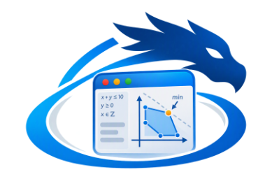

```
   _._
 o|- -|o This file is licensed under CC BY-NC-SA 4.0 international license.
  ( l )  To view a copy of this license, visit http://creativecommons.org/licenses/by-nc-sa/4.0/
    =    Author: jean-marc "jihem" quere 2026
```

# wdreka - visual CP-SAT constraint editor

**wdreka** lets you model scheduling problems graphically.

- **availabilities** (time windows);
- **resources**: material in stock, places, consumables;
- **agents**: equipment and staff, which use, produce or consume these resources under time constraints.

The graph is **compiled** into an **NCP** text model, the language of the `cpsat` solver written in Nim. That text can then be edited by hand and **imported back** into the visual. The solver runs on the document, and progress and results are displayed live.

```
┌ Library ──────┐┌ Canvas (constraint graph) ──────────────────────┐┌ Properties ─┐
│ Schedules     ││  [Schedule]──h──▶[Staff]◀──u──[Uses]◀──┐         ││ parameters  │
│ Tasks         ││  [Task]──task──▶[Produces]──f──▶[Material]       ││ NCP code of │
│ Agents        ││      └────task─────────────────┘                 ││ the node    │
│ Resources…    │├ NCP model │ Solving │ Variables │ Log ───────────┤│             │
└───────────────┘└─────────────────────────────────────────────────┘└─────────────┘
```

---

## 1. Installing into wdgui

To run the application, from the wdgui root folder:

```sh
nimble wdreka
# or
nim c -r --threads:on --mm:atomicArc -d:sdlttf -o:apps/wdreka/wdreka apps/wdreka/wdreka.nim
```

At startup, `wdreka` loads the library `library/*.wdrk`, then the example `examples/workshop.wdreka`. The solver is embedded in `cpsat/`: it is the CP-SAT solver presented earlier, extended for this application (see § 6).

---

## 2. Getting started

**1. Place a component.** Click a component in the library on the left, then click on the canvas. You can also double-click the component to drop it at the center of the view. The search field filters the library.

**2. Link.** Drag an **output** (dot on the right of a node) onto an **input** (dot on the left). The color of the dots shows the type, and incompatible types are refused with a message.
- A **multiple** input (surrounded by a ring) accepts several links.
- Dragging from an input that is already linked picks the link up again, to move or delete it.

**3. Set up.** Select a node: its parameters appear in the **Properties** panel, and the **NCP code generated** by this node is shown below them.
- This code is editable. A node whose code was edited shows the `</>` badge.
- The "Original code" button restores the component template.
- With no selection, the panel shows the document settings: title, horizon, time unit, time limit, maximum number of solutions.

**4. Compile.** "Visual → NCP" produces the text model, visible in the **NCP model** tab. With "Automatic compilation" checked, every change to the graph updates the text. While the graph is incomplete, the nodes concerned are outlined in red and the reason is displayed.

**5. Go back to the visual.** "NCP → Visual" rebuilds the graph from the text.
- Node blocks edited by hand become custom code.
- Code written outside the blocks is gathered in an "NCP block" node.
- An NCP model written entirely by hand is imported as a single NCP block.

**6. Solve.** The **▶ Solve** button (or `Ctrl+R`) compiles if needed, then runs the solver in a thread: the interface stays responsive. The **Solving** tab shows:
- the **animated status**: compiling, searching, proven optimal, infeasible, stopped, time limit reached;
- the **indicators**: solutions, objective, bound, conflicts, decisions, model size;
- the **objective curve**: each improvement, the bound as a dashed line and the relative gap;
- the **time bar**, which fills up relative to the time limit;
- the **schedule**: Gantt chart of the tasks, load of agents and places with their shaded time windows (capacity overruns in red), and stock level curves with their min/max bounds.

After solving, every node on the canvas shows a result badge, for example `start 8 · end 11` or `peak 2 / 2`. The **Variables** tab lists every value and the **Log** tab keeps the history. **■ Stop** interrupts the search and keeps the best solution found.

**7. Save.** The `.wdreka` format is the NCP text itself, with the description of the graph in comments (see § 4). A `.wdreka` file therefore runs as is with `cpsat`. "Export NCP model…" writes the current text to a `.ncp` file.

### Shortcuts

Shortcuts marked "canvas" only work when the canvas has the focus.

| Action | Command |
|---|---|
| Delete the selection (canvas) | `Del` / `Backspace`, context menu |
| Cancel placement, deselect (canvas) | `Esc` |
| Duplicate (canvas) | `Ctrl+D` |
| Save | `Ctrl+S` |
| Solve | `Ctrl+R` |
| Multiple selection | `Shift` + click, or `Shift` + drag on the background |
| Pan the view | drag the background |
| Zoom | wheel, `−` / `+` / Fit buttons |

---

## 3. Component library

The library is read at startup:

- `library/base.wdrk` holds the base components;
- the other `library/*.wdrk` files, such as `user.wdrk`, hold your components.

The *Library › Reload library* menu reads these files again without restarting the application.

### Base components

| Category | Components |
|---|---|
| Schedules | Time windows, Daily schedule |
| Tasks | Task, Variable-duration task, Precedence, No overlap, Start of, End of |
| Agents | Uses (usage by a task), Staff, Equipment |
| Resources | Place, Produces, Consumes, Material (stock), Consumable |
| Logic | Constraint, Comparison, AND, OR, NOT, Implies |
| Arithmetic | Constant, Integer variable, Sum, Maximum, Expression |
| Objectives | Minimize the end, Minimize the sum of ends, Minimize, Maximize, All solutions |
| Outputs | Display, Display a task |
| Advanced | NCP block (free code) |

Here is the typical pattern:

```
Schedule ──h──▶ Staff / Equipment / Place ◀──u── Uses ◀──task── Task
Task ──task──▶ Produces / Consumes ──f──▶ Material / Consumable
Task ──task──▶ ("After" input of another task)      Tasks ──▶ Minimize the end
```

### Port types and naming conventions

An output `s` of node `n7` defines the prefix `n7_s`. The port type fixes the names derived from that prefix:

| Type | Color | Names defined |
|---|---|---|
| `task` | blue | `_s` start, `_d` duration, `_e` end |
| `usage` | orange | `_s` start, `_d` duration, `_q` quantity |
| `flow` | magenta | `_t` time, `_dq` stock change |
| `time` | green | `_a` array of window starts, `_b` array of window ends |
| `int`, `bool` | cyan, red | the prefix itself |
| `agent`, `stock`, `any` | - | free |

A `bool` port can be linked to an `int` input (true = 1). An `any` input accepts everything.

### Creating or editing a component

To create a component, use *Library › New component…* or the "+ Component" button. The window that opens lets you define:

- the component **identity**: identifier, label, category, color (with a picker), glyph and documentation;
- its **inputs / outputs**: direction, name, type, label, and whether the input is multiple;
- its **parameters**: name, type, default value, label. The types are `int`, `expr` (NCP expression), `text` (escaped inside strings) and `code` (multiline block);
- its **CP-SAT code template** in NCP.

"**Test the template**" creates stub inputs for each port, generates the code and compiles it with the solver, then shows the result or the error with the offending line. "**Save to the library**" adds the component to `library/user.wdrk` and updates the palette.

A base component cannot be edited, but *Edit…* offers to create a customized copy of it.

### Template tags

| Tag | Replaced by |
|---|---|
| `{{id}}` | node identifier (`n7`), prefix of all your names |
| `{{titre}}` | node title (safe inside an NCP string) |
| `{{p:name}}` | value of parameter `name` |
| `{{in:port}}` | prefix of the output linked to `port` (error if not linked) |
| `{{in:port?default}}` | same, `default` if the input is not linked |
| `{{list:port:_s}}` | `a_s, b_s, …` for every output linked to a multiple input |
| `{{count:port}}` | number of links of the input |
| `{{expr:param}}` | parameter value in which input names (`a`, `b`…) are replaced by the linked outputs |
| `{{if:port}} … {{fi}}` | block kept only if `port` is linked |
| `{{ifnot:port}} … {{fi}}` | block kept only if `port` is not linked |

Here is the format of a `.wdrk` file, which is also what the component editor writes. The keywords of the format (`composant`, `libelle`, `categorie`, `couleur`, `glyphe`, `doc`, `param`, `entree`, `entrees`, `sortie`) are kept unchanged for compatibility with existing files:

```
[composant delai_encadre]
libelle   = Bounded delay
categorie = My components
couleur   = #00B8A9
glyphe    = D
doc       = "After" starts between min and max after "Before" ends.
param   min | expr | 1 | Minimum delay
param   max | expr | 4 | Maximum delay
entree  avant | task | Before
entree  apres | task | After
code <<<
constraint {{in:avant}}_e + {{p:min}} <= {{in:apres}}_s;
constraint {{in:apres}}_s <= {{in:avant}}_e + {{p:max}};
>>>
```

| Keyword | Meaning |
|---|---|
| `libelle` | label |
| `categorie` | category |
| `couleur` | color |
| `glyphe` | glyph |
| `param name \| type \| default \| label` | parameter |
| `entree name \| type \| label` | input |
| `entrees name \| type \| label` | multiple input |
| `sortie name \| type \| label` | output |

---

## 4. From the visual to the text, and back

The compiled text first describes the graph in `//@` comments, which the solver ignores. The annotation keys (`titre` = title, `unite` = unit) are kept unchanged for compatibility:

```
//@wdreka 1
//@doc titre="Manufacturing workshop" horizon="48" unite="h" timeout="30" solutions="0"
//@node n10 tache x="340" y="40" titre="Receiving" duree="2" debut_min="0" echeance="HORIZON"
//@link n10.task -> n20.tache
```

The code blocks follow, one per node, in the topological order of the graph (definitions before their uses):

```
//@begin n10 tache
var n10_task_s : 0..HORIZON;
let n10_task_d = 2;
...
//@end n10
```

On import, the annotations rebuild the nodes, their positions, their parameters and the links.
- A block whose content differs from the template becomes **custom code** of the node.
- The rest of the text becomes an **NCP block** node.

When the solver reports an error at "line N", wdreka finds the block that contains this line, outlines the corresponding node in red on the canvas and names this node in the message.

---

## 5. Architecture

| File | Role |
|---|---|
| `wdreka.nim` | window, menus, toolbar, palette, properties, event handler |
| `model.nim` | components, `.wdrk` library, document, graph, shared state `gApp` and lock `gLock` |
| `codegen.nim` | templates, graph → annotated NCP compilation, NCP → graph import, error location |
| `canvas.nim` | `GraphCanvas` control (drawing, links, drag and drop, zoom, selection) |
| `views.nim` | `SolveDashboard` (progress) and `ScheduleView` (schedule) controls |
| `runner.nim` | compilation, solving in a thread, progress and solution callbacks, result extraction |
| `compeditor.nim` | window for creating and editing components |
| `uistate.nim` | control identifiers, log, repaint requests |
| `gfx.nim` | **drawing adapter** towards the wdgui `Drawing` API |
| `compat.nim` | wdgui constructors with variable signatures (multiline edit, flat button, splitter) |
| `cpsat/` | CP-SAT solver (CDCL + lazy clause generation) and NCP language |

For threads, wdreka follows the wdgui model. The canvas and the views draw on the UI thread, and each event handler runs in its own thread, so solving never freezes the interface. The shared state (`gApp`) is protected by `gLock` through the `withApp` template.

One rule prevents any deadlock: **never call the wdgui API while holding `gLock`.**

To force hand-drawn controls to repaint, the other threads write a counter into their `value`.

---

## 6. Solver extensions (`cpsat/`)

Compared with the solver delivered earlier, two changes were made.

**`solver.nim`** gets a `progress` callback (called periodically, it returns `false` to stop the search) and a `startTime` timestamp.

**`lang.nim`** adds four global constraints, available in NCP:

| Constraint | Meaning | Decomposition |
|---|---|---|
| `cumulative(S, D, Q, cap)` | at any time, the sum of the quantities `Q[i]` of the running tasks (`S[i] ≤ t < S[i]+D[i]`) is `≤ cap` | load checked at the start of each task, reified overlaps |
| `disjunctive(S, D)` | the tasks do not overlap | pairwise half-reified disjunction |
| `reservoir(T, DQ, init, min, max)` | level = `init` + sum of the `DQ[j]` of the events `T[j] ≤ t`, always within `[min, max]` | level checked after each event |
| `windows(S, D, A, B)` | each task fits entirely in a window `[A[w], B[w]]` | clause over half-reified literals |

```
constraint cumulative([a_s, b_s], [3, 4], [1, 2], 2);
constraint disjunctive([a_s, b_s], [3, 4]);
constraint reservoir([p_t, c_t], [5, -3], 0, 0, 10);
constraint windows([a_s], [3], [8, 32], [18, 42]);
```

In `reservoir`, simultaneous events are counted together.

`lang.nim` also provides an API for applications:

- `runInteractive`, which triggers a callback at each solution or improvement;
- `valueOf`, `intValueOf`, `intListOf`, `topLevelNames` to read the results;
- `objectiveBounds` for the objective bound;
- `errorLine` to find the line of an error.

These additions remain compatible with the `cpsat` command line.

---

## 7. What to check on the first build

wdreka was written from the public wdgui documentation (README and TUTORIAL), **without access to the library source code or to a Nim compiler**. The documented calls (id-based API, `Grid`, `TreeView`, `Tab`, `Panel`, dialogs, `Control` methods) are used as they are. The undocumented points are grouped together and protected by `when compiles(...)`, with a fallback or an explicit compile error. Here is where to look in case of trouble:

- **`gfx.nim`**: exact signatures of `fillRect`, `fillRoundRect`, `strokeRoundRect`, `line`, `triangle`, `textHeight`, `pushClip`. All adapter primitives are prefixed with `g` (`gFillRect`, `gEllipsize`…) to avoid clashes with procedures of the same name in wdgui.
- **`canvas.nim`**: position and modifier fields of `MouseEvent` (`mousePos` and `shiftDown` templates) and the signature of `onWheel`. If it differs, the wheel has no effect; the zoom buttons remain available.
- **`compat.nim`**: "multiline" parameter of `newEdit`, flat button, and orientation of `newSplitter(vertical = …)`. If the panes appear stacked instead of side by side, invert the boolean in `newSplit`.
- **Repaint**: if a hand-drawn control does not update from another thread, replace the `id.value = counter` mechanism in `uistate.nim` with the invalidation function of your wdgui version.
- **Type names**: `Node`, `Link` and `Document` are defined in `model.nim`. In case of a clash with wdgui, qualify them (`model.Node`).

### One more thing!
A small gesture that can - greatly - help us... \[Caffeine matters a lot for a team of neurodivergent folks: ASD, ADHD, GAD, HPI and/or THPI (members of **mensa.fr** and **triplenine.org**).\]

[](https://buymeacoffee.com/sonaliwan.fr)
