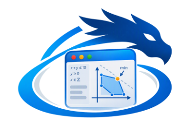

# wdreka - Mode d'emploi pas à pas

*Guide pour débutants. Le logiciel est en anglais : chaque libellé de l'interface est cité **tel qu'il apparaît à l'écran**, suivi de sa traduction.*

---

## Sommaire

1. [À quoi sert wdreka ?](#1-à-quoi-sert-wdreka-)
2. [Les idées de base en cinq minutes](#2-les-idées-de-base-en-cinq-minutes)
3. [Installer et lancer le logiciel](#3-installer-et-lancer-le-logiciel)
4. [Visite guidée de l'interface](#4-visite-guidée-de-linterface)
5. [Manipuler le canevas](#5-manipuler-le-canevas)
6. [Cas pratique 1 - Une seule tâche](#cas-pratique-1--une-seule-tâche)
7. [Cas pratique 2 - Deux tâches qui s'enchaînent](#cas-pratique-2--deux-tâches-qui-senchaînent)
8. [Cas pratique 3 - Un four pour deux cuissons](#cas-pratique-3--un-four-pour-deux-cuissons)
9. [Cas pratique 4 - Respecter des horaires de travail](#cas-pratique-4--respecter-des-horaires-de-travail)
10. [Cas pratique 5 - Une équipe de plusieurs personnes](#cas-pratique-5--une-équipe-de-plusieurs-personnes)
11. [Cas pratique 6 - Produire et consommer un stock](#cas-pratique-6--produire-et-consommer-un-stock)
12. [Cas pratique 7 - Une salle de réunion](#cas-pratique-7--une-salle-de-réunion)
13. [Cas pratique 8 - Une règle sur mesure avec la logique](#cas-pratique-8--une-règle-sur-mesure-avec-la-logique)
14. [Cas pratique 9 - Comprendre les erreurs et l'infaisabilité](#cas-pratique-9--comprendre-les-erreurs-et-linfaisabilité)
15. [Cas pratique 10 - Passer du visuel au texte (et retour)](#cas-pratique-10--passer-du-visuel-au-texte-et-retour)
16. [Cas pratique 11 - Créer son propre composant](#cas-pratique-11--créer-son-propre-composant)
17. [Cas pratique 12 - Enregistrer, ouvrir, exporter](#cas-pratique-12--enregistrer-ouvrir-exporter)
18. [Le langage NCP pour débutants](#18-le-langage-ncp-pour-débutants)
19. [Référence des composants](#19-référence-des-composants)
20. [Raccourcis clavier et souris](#20-raccourcis-clavier-et-souris)
21. [Questions fréquentes et dépannage](#21-questions-fréquentes-et-dépannage)
22. [Glossaire anglais → français](#22-glossaire-anglais--français)

---

## 1. À quoi sert wdreka ?

wdreka vous aide à **organiser des activités dans le temps** en respectant des règles :

- ces deux tâches ne peuvent pas avoir lieu en même temps ;
- le four n'est disponible qu'en un exemplaire ;
- l'équipe ne travaille que de 8 h à 12 h ;
- il faut avoir pétri la pâte avant de la cuire ;
- le stock de farine ne doit jamais devenir négatif.

Vous ne calculez rien vous-même : vous **décrivez** la situation en assemblant des **blocs** reliés par des **fils**, à la manière d'un schéma. wdreka transforme ensuite ce schéma en un petit programme, le **modèle**. Un **solveur** cherche alors un planning qui respecte toutes les règles. Si vous lui donnez un objectif (« finir le plus tôt possible »), il cherche le **meilleur** planning possible.

Ce type d'outil s'appelle un solveur de **programmation par contraintes**. Le solveur de wdreka est de la famille « CP-SAT ».

> **Exemples de problèmes que wdreka sait traiter**
> - Planifier la journée d'une boulangerie (pétrissage, cuisson, four, boulangers).
> - Organiser des réunions dans une salle unique, aux heures d'ouverture.
> - Ordonnancer un atelier : machines, opérateurs, stocks de pièces brutes et usinées.

---

## 2. Les idées de base en cinq minutes

Lisez cette section une fois ; tout le reste du guide en découle.

### 2.1 Le temps est un nombre entier

wdreka compte le temps en **unités** : des heures, des minutes, des jours… Vous choisissez l'unité, qui n'est qu'un libellé ; le solveur, lui, ne manipule que des nombres entiers.

- Une tâche qui **commence à 8** et **dure 2** **se termine à 10**.
- L'**horizon** (*horizon*) est la date maximale de votre planning. Par défaut, il vaut **48** (deux jours si l'unité est l'heure). Aucune tâche ne peut finir après l'horizon.

### 2.2 Les nœuds (*nodes*)

Un **nœud** est un bloc rectangulaire posé sur la zone de dessin. Chaque nœud représente un élément de votre problème : une tâche, une équipe, un stock, un horaire, une règle, un objectif…

Un nœud possède :
- une **barre de titre colorée**, avec une pastille contenant une lettre (le *glyphe*), son titre et son identifiant (`n1`, `n2`…) ;
- des **entrées** (*inputs*), petites pastilles sur le **bord gauche** ;
- des **sorties** (*outputs*), petites pastilles sur le **bord droit** ;
- des **paramètres** (*parameters*), des valeurs réglables comme une durée ou une capacité, dont un résumé s'affiche en bas du nœud.

### 2.3 Les liens (*links*)

Un **lien** est un fil qui part d'une **sortie** et arrive sur une **entrée**. Il signifie : « ce nœud-ci utilise l'information de ce nœud-là ». Par exemple, une **tâche** reliée à un nœud **Uses** (« utilise ») veut dire que cette tâche mobilise quelque chose.

### 2.4 Les types et leurs couleurs

Chaque pastille a un **type**, reconnaissable à sa couleur. On ne peut relier que des pastilles **compatibles**. La légende est rappelée en bas à gauche du canevas.

| Couleur | Type affiché | Signification |
|---|---|---|
| bleu | `task` | une tâche (début, durée, fin) |
| orange | `usage` | l'utilisation d'un agent ou d'un lieu par une tâche |
| magenta | `flow` | un flux : une entrée ou une sortie de stock |
| vert | `schedule` | un horaire, c'est-à-dire des plages de disponibilité |
| violet | `agent` | un agent |
| jaune | `stock` | un stock |
| cyan | `integer` | un nombre entier |
| rouge | `boolean` | une condition vraie ou fausse |

Deux règles complètent ce tableau :
- une sortie **booléenne** peut aller dans une entrée **entière** (vrai = 1, faux = 0) ;
- une entrée de type `any` (« quelconque ») accepte tout.

### 2.5 Résoudre

Quand le schéma est prêt, vous cliquez sur **▶ Solve** (« Résoudre »). Le solveur répond par l'un de ces résultats :

| Résultat | Signification |
|---|---|
| **Solution found** | une solution trouvée |
| **Proven optimal** | la meilleure solution, et c'est prouvé |
| **Infeasible** | impossible : les règles se contredisent |
| **Time limit reached** | le temps maximal est écoulé |

---

## 3. Installer et lancer le logiciel

wdreka est une application de démonstration de la bibliothèque graphique **wdgui**, écrite en langage **Nim**.

1. Installez **Nim** (version 2 recommandée) et la bibliothèque **SDL3** (avec SDL3_ttf), comme indiqué dans le README de wdgui.
2. Récupérez le dépôt **wdgui**.
3. Copiez le dossier `apps/wdreka` dans le dossier `apps/` du dépôt.
4. Ajoutez la tâche `wdreka` au fichier `wdgui.nimble` (voir le fichier `wdgui.nimble.patch` fourni).
5. Ouvrez un terminal **à la racine du dépôt wdgui** et tapez :

```sh
nimble wdreka
```

ou, sans nimble :

```sh
nim c -r --threads:on --mm:atomicArc -d:sdlttf -o:apps/wdreka/wdreka apps/wdreka/wdreka.nim
```

6. La fenêtre **wdreka · CP-SAT constraints** s'ouvre. Au premier démarrage, elle affiche déjà un exemple complet : **Manufacturing workshop** (« Atelier de fabrication »). Vous pouvez l'explorer librement : rien n'est enregistré tant que vous ne le demandez pas.

> **Astuce.** Pour commencer chaque cas pratique sur une page blanche, cliquez sur **New** (« Nouveau ») dans la barre d'outils. Si le modèle en cours a été modifié, wdreka demande confirmation : *The current model is not saved. Continue without saving?* (« Le modèle en cours n'est pas enregistré. Continuer sans enregistrer ? »).

---

## 4. Visite guidée de l'interface

```
┌──────────────────────────────────────────────────────────────────────────────┐
│ File  Edit  Model  Library  View  Help                      ← barre de menus │
├──────────────────────────────────────────────────────────────────────────────┤
│ New Op. Sa.│ Visual → NCP  NCP → Visual   │ ▶ Solve ■ Stop │ − + Fit  wdreka │ ← barre d'outils
├────────────┬───────────────────────────────────────────────┬─────────────────┤
│ Library    │                                               │ Properties      │
│ [Search…]  │            CANEVAS (zone de dessin)           │  titre du nœud  │
│ ▸ Schedules│                                               │  description    │
│ ▸ Tasks    │                                               │  Parameter|Value│
│ ▸ Agents   │                                               │  Node NCP code  │
│ ...        ├───────────────────────────────────────────────┤  (code du nœud) │
│ description│ NCP model │ Solving │ Variables │ Log         │                 │
│ +Component │  (onglets du bas)                             │ Duplicate Delete│
│ Edit…      │                                               │ Original code   │
├────────────┴───────────────────────────────────────────────┴─────────────────┤
│ message d'état                                 [barre de progression]  100 % │ ← barre d'état
└──────────────────────────────────────────────────────────────────────────────┘
```

### 4.1 La barre de menus

**File** (Fichier) :

| Libellé | Action |
|---|---|
| New | nouveau modèle vide |
| Open… | ouvrir un fichier `.wdreka` ou `.ncp` |
| Open the "Workshop" example | rouvrir l'exemple de l'atelier |
| Save | enregistrer |
| Save as… | enregistrer sous un autre nom |
| Export NCP model… | exporter le modèle texte |
| Quit | quitter |

**Edit** (Édition) :

| Libellé | Action |
|---|---|
| Duplicate | dupliquer la sélection |
| Delete | supprimer la sélection |
| Select all | tout sélectionner |
| Reset node code | rétablir le code d'origine du nœud |

**Model** (Modèle) :

| Libellé | Action |
|---|---|
| Compile visual → text | compiler le schéma en texte |
| Import text → visual | reconstruire le schéma depuis le texte |
| Solve | résoudre |
| Stop solving | arrêter la résolution |

**Library** (Bibliothèque) :

| Libellé | Action |
|---|---|
| New component… | créer un nouveau composant |
| Edit / duplicate component… | modifier ou dupliquer un composant |
| Reload library | recharger la bibliothèque |

**View** (Affichage) :

| Libellé | Action |
|---|---|
| Fit view | cadrer tout le schéma |
| Zoom in | zoom avant |
| Zoom out | zoom arrière |
| Light / dark theme | thème clair ou sombre |

**Help** (Aide) : **About wdreka** (à propos de wdreka).

### 4.2 La barre d'outils

| Bouton | Traduction | Effet |
|---|---|---|
| **New** | Nouveau | crée un modèle vide |
| **Open** | Ouvrir | ouvre un modèle |
| **Save** | Enregistrer | enregistre le modèle |
| **Visual → NCP** | Visuel → NCP | traduit le schéma en texte NCP |
| **NCP → Visual** | NCP → Visuel | reconstruit le schéma à partir du texte |
| **▶ Solve** | Résoudre | lance le solveur (bouton violet) |
| **■ Stop** | Arrêter | interrompt la recherche (bouton rouge, actif seulement pendant une résolution) |
| **−** / **+** | Zoom arrière / avant | change le zoom du canevas |
| **Fit** | Ajuster | cadre tout le schéma dans la fenêtre |

### 4.3 Le panneau « Library » (Bibliothèque), à gauche

Ce panneau contient tous les composants que vous pouvez poser sur le canevas.

- **Search a component…** (« Rechercher un composant… ») : tapez un mot, par exemple `stock` ou `task`, pour filtrer la liste.
- **L'arbre des catégories** : les catégories sont décrites dans le tableau ci-dessous. Les composants marqués **★** sont des composants **utilisateur**.
- **La zone de description**, sous l'arbre : quand vous cliquez sur un composant, son rôle, ses entrées (*Inputs*) et ses sorties (*Outputs*) y sont expliqués.
- **+ Component** (« + Composant ») et **Edit…** (« Modifier… ») : créer un nouveau composant ou en modifier un (voir le cas pratique 11).

| Catégorie | Contenu |
|---|---|
| **Schedules** | horaires |
| **Tasks** | tâches |
| **Agents** | personnel et équipements |
| **Resources** | lieux et stocks |
| **Logic** | logique |
| **Arithmetic** | calcul |
| **Objectives** | objectifs |
| **Outputs** | affichages |
| **Advanced** | code libre |
| **My components** | vos composants |

### 4.4 Le canevas, au centre

C'est votre **feuille de dessin**, quadrillée.

- **En haut à gauche** : le titre du document et le niveau de zoom (par exemple `100 %`). Un point **•** après le titre signale des modifications non enregistrées.
- **En bas à gauche** : la légende des couleurs des types.
- **Au centre, si le canevas est vide**, un message d'accueil vous guide : *Build your constraint model* (« Construisez votre modèle de contraintes »).

### 4.5 Le panneau « Properties » (Propriétés), à droite

**Si un nœud est sélectionné**, le panneau affiche :
1. en haut, le titre du nœud, le nom du composant et l'identifiant (`n3`…) ;
2. une zone de description du composant ;
3. une grille à trois colonnes, **Parameter** (paramètre), **Value** (valeur, modifiable) et **Type** (`int` : nombre entier ; `expr` : expression ; `text` : texte). La première ligne, **Title**, est le titre libre du nœud ;
4. **Node NCP code (editable)** : le code produit par ce nœud, modifiable ;
5. trois boutons :
   - **Duplicate** : dupliquer le nœud ;
   - **Delete** : le supprimer ;
   - **Original code** : rétablir le code d'origine si vous l'avez modifié.

**Si rien n'est sélectionné**, la grille montre les **réglages du document** :

| Ligne | Signification | Valeur par défaut |
|---|---|---|
| **Title** | titre du document | `Untitled` (« Sans titre ») |
| **Horizon** | date maximale | 48 |
| **Time unit** | unité de temps (simple libellé) | `h` |
| **Time limit (s)** | temps maximal de recherche, en secondes | 30 |
| **Max solutions (0 = all)** | nombre maximal de solutions (0 = toutes) | 0 |

### 4.6 Les onglets du bas

| Onglet | Traduction | Contenu |
|---|---|---|
| **NCP model** | Modèle NCP | le texte du modèle, avec les boutons **⬇ Compile the visual** (compiler le visuel) et **⬆ Text → visual** (texte vers visuel), et la case **Automatic compilation** (compilation automatique) |
| **Solving** | Résolution | le tableau de bord de la recherche et le planning obtenu |
| **Variables** | Variables | toutes les valeurs trouvées (colonnes **Node**, **NCP name**, **Value**) |
| **Log** | Journal | l'historique horodaté des actions et des messages |

### 4.7 La barre d'état, tout en bas

À gauche, le dernier message (par exemple *Visual compiled to NCP (24 lines)* : « Visuel compilé en NCP (24 lignes) »). À droite, une barre de progression et le niveau de zoom.

---

## 5. Manipuler le canevas

Prenez dix minutes pour vous entraîner à ces gestes : ils servent dans tous les cas pratiques.

### 5.1 Poser un nœud

**Méthode 1 (précise)**
1. Dans la bibliothèque, **cliquez une fois** sur un composant, par exemple **Tasks › Task**.
2. Un bandeau coloré apparaît en haut du canevas : *Click on the canvas to place "Task" - Esc: cancel* (« Cliquez sur le canevas pour placer "Task" - Échap : annuler »).
3. **Cliquez** à l'endroit voulu du canevas : le nœud apparaît à cet endroit.

**Méthode 2 (rapide).** **Double-cliquez** sur le composant dans la bibliothèque : il apparaît au centre de la vue.

### 5.2 Sélectionner

- **Clic** sur un nœud : il est entouré d'un halo violet.
- **Maj + clic** : ajoute un nœud à la sélection, ou l'en retire.
- **Maj + glisser** sur une zone vide : trace un rectangle de sélection.
- **Clic sur un fil** : sélectionne ce lien (il devient plus épais et plus clair).
- **Clic sur une zone vide** : tout désélectionner. Le panneau Properties affiche alors les réglages du document.

### 5.3 Déplacer

- **Glisser un nœud** : le déplace, avec tous les nœuds sélectionnés. À la fin du geste, les nœuds s'alignent automatiquement sur une grille invisible.
- **Glisser le fond** (zone vide) : fait défiler toute la vue.

### 5.4 Relier deux nœuds

1. Placez la souris sur une **pastille de sortie**, sur le **bord droit** d'un nœud. Elle grossit au survol.
2. **Maintenez le bouton** et **glissez** : un fil de la couleur du type suit la souris.
3. **Relâchez sur une pastille d'entrée**, sur le **bord gauche** d'un autre nœud.

Le fil se termine par une petite flèche. La pastille d'entrée, jusque-là creuse, devient **pleine**.

Deux précisions :
- Une entrée entourée d'un **anneau** est une **entrée multiple** : elle accepte plusieurs fils. Une entrée simple ne garde que le dernier fil branché.
- Si les types sont incompatibles, un message rouge s'affiche quelques secondes, par exemple *incompatible types: task → schedule* (« types incompatibles : tâche → horaire »). Il est aussi noté dans l'onglet **Log**.

### 5.5 Débrancher ou rebrancher un fil

- **Glisser depuis une entrée déjà reliée** : le fil se détache de cette entrée et suit la souris. Relâchez-le sur une autre entrée, ou dans le vide pour le supprimer.
- **Sélectionner le fil** (clic dessus) puis **Suppr**, ou clic droit puis **Delete**.

### 5.6 Supprimer, dupliquer

- **Suppr** ou **Retour arrière** (quand le canevas a le focus) : supprime la sélection.
- **Ctrl + D** (Cmd + D sur Mac) : duplique la sélection, avec un léger décalage.
- **Clic droit** sur un nœud : menu contextuel avec **Duplicate**, **Delete**, **Reset node code**, **Compile visual → text**, **Solve**.
- **Clic droit** sur une zone vide : **Select all**, **Fit view**, **Compile visual → text**, **Solve**.

### 5.7 Zoomer

- **Molette** de la souris, ou boutons **−** et **+** de la barre d'outils.
- **Fit** : cadre tout le schéma dans la fenêtre.

Lorsque le zoom est très faible, les textes sont masqués pour garder un schéma lisible.

### 5.8 Modifier un paramètre

1. Sélectionnez le nœud.
2. Dans **Properties**, cliquez (ou double-cliquez) dans la colonne **Value** de la ligne voulue.
3. Tapez la nouvelle valeur et validez avec **Entrée**.

Le résumé en bas du nœud se met à jour, ainsi que la zone **Node NCP code**.

---

## Cas pratique 1 - Une seule tâche

> **Objectif :** découvrir le cycle complet : poser, régler, résoudre, lire le résultat.
> **Situation :** un pâtissier doit **cuire un gâteau**. La cuisson dure **2 heures** et ne peut pas commencer avant **8 h**.

### Étape 1 - Partir d'une page blanche

1. Cliquez sur **New** dans la barre d'outils.
2. Confirmez si wdreka vous le demande.

Le canevas est vide et affiche le message d'accueil.

### Étape 2 - Régler le document

1. Cliquez dans une zone vide du canevas.
2. Dans **Properties**, réglez **Title** sur `Gâteau` et vérifiez que **Time unit** vaut `h` et **Horizon** `48`.

### Étape 3 - Poser la tâche

1. Dans la bibliothèque, ouvrez la catégorie **Tasks** et cliquez sur **Task**.
2. Cliquez au milieu du canevas.

Un nœud bleu apparaît, avec la pastille **T**, le titre *Task* et l'identifiant **n1**. Il possède :
- deux entrées à gauche : **After** (« Après », entrée multiple, avec un anneau) et **Schedule** (« Horaire ») ;
- une sortie à droite : **Task** (« Tâche »).

### Étape 4 - Régler la tâche

Sélectionnez le nœud et remplissez la grille **Properties** :

| Parameter | Signification | Valeur à saisir |
|---|---|---|
| **Title** | titre libre | `Cuire le gâteau` |
| **Duration** | durée | `2` |
| **Earliest start** | début au plus tôt | `8` |
| **Latest end** | fin au plus tard | `HORIZON` (laisser tel quel) |

> **Bon à savoir.** Les valeurs de type `expr` acceptent des **expressions** : `HORIZON`, `HORIZON - 2`, `3 * 4`… `HORIZON` désigne l'horizon du document (48 ici).

### Étape 5 - Résoudre

Cliquez sur **▶ Solve**. Voici ce qui se passe :

1. wdreka **compile** le schéma en texte. L'onglet **NCP model** se remplit, et la barre d'état affiche *Visual compiled to NCP…*.
2. L'onglet **Solving** s'ouvre.
3. L'anneau de statut tourne (*Searching…*, « recherche en cours »), puis s'arrête sur **Solution found** (« solution trouvée »).

### Étape 6 - Lire le résultat

- **Sur le canevas** : le nœud porte un badge vert, par exemple **start 8 · end 10** (« début 8 · fin 10 »).
- **Dans l'onglet Solving** :
  - la carte **Solutions** indique `1` ;
  - le planning, section **TASKS** (tâches), montre une barre *Cuire le gâteau* de 8 à 10.
- **Dans l'onglet Variables**, vous trouvez :

| Node | NCP name | Value |
|---|---|---|
| Cuire le gâteau (n1) | `n1_task_s` | 8 |
| Cuire le gâteau (n1) | `n1_task_e` | 10 |

- **Dans l'onglet Log** : *Solution 1 (0.00 s)*, puis *End: Solution found…*.

> **Pourquoi 8 et pas 15 ?** Sans objectif, le solveur s'arrête à la **première** solution valable. Toute date de début entre 8 et 46 respecte les règles ; c'est le cas 2 qui montre comment demander la **meilleure** solution.

### Étape 7 - Ajouter un objectif

1. Dans la catégorie **Objectives**, placez **Minimize the end** (« Minimiser la fin ») à droite de la tâche.
2. Reliez la sortie **Task** de la tâche à l'entrée **Tasks** (entrée multiple) de ce nouveau nœud.
3. Cliquez sur **▶ Solve**.

Le statut devient **Proven optimal** (« optimum prouvé »). La carte **Objective** (objectif) indique `10`, la carte **Bound** (borne) `10`, et le badge du nœud objectif affiche **objective = 10**.

✅ **Vous avez fait le tour complet : décrire → résoudre → lire.**

---

## Cas pratique 2 - Deux tâches qui s'enchaînent

> **Objectif :** imposer un ordre entre des tâches.
> **Situation :** avant de cuire le pain (2 h), il faut **préparer la pâte** (1 h).

### Étape 1 - Créer les deux tâches

1. Cliquez sur **New**.
2. Placez une **Task** à gauche, avec **Title** `Préparer la pâte` et **Duration** `1`.
3. Placez une deuxième **Task** à droite, avec **Title** `Cuire le pain` et **Duration** `2`.

### Étape 2 - Indiquer l'ordre

Reliez la sortie **Task** de *Préparer la pâte* à l'entrée **After** de *Cuire le pain*.

**Ce lien signifie : « Cuire le pain commence après la fin de Préparer la pâte ».**

### Étape 3 - Objectif et résolution

1. Placez **Minimize the end** et reliez-y **les deux** tâches : l'entrée **Tasks** est multiple.
2. Cliquez sur **▶ Solve**.

Résultat attendu, **Proven optimal** avec un objectif de `3` :
- *Préparer la pâte* : **start 0 · end 1** ;
- *Cuire le pain* : **start 1 · end 3**.

### Étape 4 - Ajouter un temps de repos (variante avec « Precedence »)

La pâte doit maintenant **reposer 1 heure** avant la cuisson.

1. **Débranchez** le fil qui arrive sur l'entrée **After** : glissez depuis cette entrée vers le vide, puis relâchez.
2. Placez **Tasks › Precedence** (« Précédence ») entre les deux tâches.
3. Reliez *Préparer la pâte* à l'entrée **Before** (« Avant ») du nœud Precedence.
4. Reliez *Cuire le pain* à son entrée **After** (« Après »).
5. Réglez **Minimum delay** (« délai minimal ») à `1`.
6. Cliquez sur **▶ Solve**.

Résultat : *Cuire le pain* passe à **start 2 · end 4**, et l'objectif vaut `4`.

> **Pourquoi deux façons de faire ?** L'entrée **After** d'une tâche est le moyen rapide (« après la fin de… »). Le nœud **Precedence** est plus complet : il ajoute un **délai**, et il rend la règle visible comme un nœud à part entière sur le schéma.

---

## Cas pratique 3 - Un four pour deux cuissons

> **Objectif :** partager un **équipement** entre plusieurs tâches.
> **Situation :** on doit cuire un gâteau (2 h) et un pain (3 h), mais il n'y a **qu'un four**.

### Étape 1 - Les tâches

1. Cliquez sur **New**.
2. Créez deux **Task** : *Cuire le gâteau* (**Duration** `2`) et *Cuire le pain* (**Duration** `3`).
3. Ajoutez **Minimize the end** et reliez-y les deux tâches.

### Étape 2 - L'équipement

1. Placez **Agents › Equipment** (« Équipement ») à droite.
2. Réglez son **Title** sur `Four` et **Number of units** (« nombre d'exemplaires ») sur `1`.

Le nœud **Equipment** a une entrée **Usages** (multiple) et une entrée **Schedule** (horaire, facultative).

### Étape 3 - Dire qui utilise le four

Une tâche n'est jamais reliée **directement** à un équipement. On passe par un petit nœud **Uses** (« utilise »), qui précise **combien** d'unités la tâche mobilise.

1. Placez **Agents › Uses** entre *Cuire le gâteau* et le four.
2. Reliez la sortie **Task** du gâteau à l'entrée **Task** de Uses.
3. Reliez la sortie **Usage** de Uses à l'entrée **Usages** du four.
4. Laissez **Quantity** (« quantité ») à `1`.
5. Recommencez pour *Cuire le pain*, avec un **second** nœud **Uses**.

Le schéma ressemble alors à :

```
[Cuire le gâteau] ─task─▶ [Uses] ─usage─▶ ┐
                                           ├─▶ [Four  (Equipment, 1)]
[Cuire le pain]   ─task─▶ [Uses] ─usage─▶ ┘
```

### Étape 4 - Résoudre et lire

Cliquez sur **▶ Solve**. Résultat : **Proven optimal**, objectif `5`, car les deux cuissons passent l'une après l'autre.

Dans l'onglet **Solving**, faites défiler le planning :
- section **TASKS** : les deux barres se suivent, sans se chevaucher ;
- section **AGENTS AND PLACES - load / capacity** (« agents et lieux - charge / capacité ») : la ligne *Four* montre un profil de charge toujours égal à 1, avec l'indication **capacity 1** et **peak 1/1** (« pic 1/1 »).

### Étape 5 - Expérimenter

Passez **Number of units** à `2` (deux fours) et résolvez de nouveau. L'objectif tombe à `3` : les deux cuissons ont lieu en même temps, et le pic de charge devient **2/2**.

---

## Cas pratique 4 - Respecter des horaires de travail

> **Objectif :** limiter le travail à certaines **plages horaires**.
> **Situation :** un boulanger travaille **de 8 h à 12 h**, deux jours de suite. Il doit faire deux tâches de **3 heures** chacune.

### Étape 1 - Les tâches et le boulanger

1. Cliquez sur **New**.
2. Créez deux **Task** : *Tâche A* et *Tâche B*, avec **Duration** `3` chacune.
3. Placez **Agents › Staff** (« Personnel »), avec **Title** `Boulanger` et **Headcount** (« effectif ») `1`.
4. Reliez chaque tâche au boulanger par un nœud **Uses**, comme au cas 3.
5. Ajoutez **Minimize the end** et reliez-y les deux tâches.

### Étape 2 - L'horaire

1. Placez **Schedules › Daily schedule** (« Horaire quotidien »).
2. Réglez-le :

| Parameter | Signification | Valeur |
|---|---|---|
| **Number of days** | nombre de jours | `2` |
| **Window start** | début de la plage | `8` |
| **Window end** | fin de la plage | `12` |
| **Period** | période (24 h = un jour) | `24` |

3. Reliez sa sortie **Schedule** (verte) à l'entrée **Schedule** du nœud **Staff**.

Cet horaire crée deux plages : **[8, 12]** le premier jour et **[32, 36]** le second, puisque 24 + 8 = 32.

### Étape 3 - Résoudre

Résultat : **Proven optimal**, objectif `35`.
- La première tâche se place de **8 à 11** : 3 h tiennent dans la plage 8–12.
- La seconde **ne tient pas** dans ce qui reste de la matinée (11–12) : elle passe au lendemain, de **32 à 35**.

Dans le planning, la ligne *Boulanger* montre les **plages disponibles ombrées en vert** et la charge du boulanger dans ces plages.

> **À retenir.** Une tâche reliée (via **Uses**) à un agent qui a un horaire doit tenir **entièrement** dans une plage. Elle ne peut pas être coupée en deux.

> **Variante.** L'entrée **Schedule** d'une tâche permet aussi d'imposer un horaire à **cette tâche seule**, sans passer par un agent.

---

## Cas pratique 5 - Une équipe de plusieurs personnes

> **Objectif :** gérer un **effectif** et des besoins en personnel différents selon les tâches.
> **Situation :** trois tâches de **2 h** chacune ; une équipe de **2 personnes** ; chaque tâche occupe 1 personne.

### Étape 1 - Construire

1. Cliquez sur **New**.
2. Créez trois **Task** (*T1*, *T2*, *T3*), avec **Duration** `2`.
3. Placez un **Staff**, avec **Title** `Équipe` et **Headcount** `2`.
4. Reliez chaque tâche à l'équipe par un **Uses**, avec **Quantity** `1`.
5. Ajoutez **Minimize the end**, relié aux trois tâches.

### Étape 2 - Résoudre

Résultat : objectif `4`. Deux tâches se déroulent ensemble de 0 à 2, la troisième de 2 à 4. Le profil de l'équipe montre une charge de 2, puis de 1 : **peak 2 / 2**.

### Étape 3 - Une tâche qui demande deux personnes

Sélectionnez le **Uses** de *T1* et passez **Quantity** à `2`, puis résolvez. Pendant *T1*, toute l'équipe est occupée. Les deux autres tâches peuvent se faire en parallèle avant ou après : l'objectif reste `4`.

### Étape 4 - Agrandir l'équipe

Revenez à **Quantity** `1` pour *T1* et passez **Headcount** à `3`. L'objectif devient `2` : tout le monde travaille en même temps.

---

## Cas pratique 6 - Produire et consommer un stock

> **Objectif :** modéliser une **matière** qui est produite par certaines tâches et consommée par d'autres.
> **Situation :** dans une boulangerie,
> - *Pétrir* (1 h) **produit** des pâtons (morceaux de pâte) ;
> - *Cuire fournée 1* (2 h) et *Cuire fournée 2* (2 h) **consomment chacune 3 pâtons** ;
> - au départ, il n'y a **aucun** pâton.

### Étape 1 - Les tâches et le stock

1. Cliquez sur **New**.
2. Créez trois **Task** : *Pétrir* (**Duration** `1`), *Cuire fournée 1* (`2`) et *Cuire fournée 2* (`2`).
3. Placez **Resources › Material (stock)** (« Matière, stock »), avec ce réglage :

| Parameter | Signification | Valeur |
|---|---|---|
| **Title** | titre | `Pâtons` |
| **Initial stock** | stock initial | `0` |
| **Minimum stock** | stock minimal | `0` |
| **Maximum stock** | stock maximal | `10` |

### Étape 2 - La production

1. Placez **Resources › Produces** (« Produit »).
2. Reliez *Pétrir* à son entrée **Task**, et sa sortie **Flow** (magenta) à l'entrée **Flows** du stock *Pâtons*.
3. Réglez **Quantity produced** (« quantité produite ») sur `4`.

> La production est ajoutée au stock **à la fin** de la tâche.

### Étape 3 - Les consommations

1. Placez deux **Resources › Consumes** (« Consomme »).
2. Reliez chacune des cuissons à l'un de ces nœuds, puis chaque **Flow** au stock *Pâtons*.
3. Réglez **Quantity consumed** (« quantité consommée ») sur `3` pour les deux.

> La consommation est retirée du stock **au début** de la tâche.

### Étape 4 - Ajouter l'objectif et résoudre : premier essai

Ajoutez **Minimize the end**, relié aux trois tâches, puis cliquez sur **▶ Solve**.

Résultat : **Infeasible** (« infaisable »). Le journal indique *the constraints are contradictory* (« les contraintes sont contradictoires »).

**Pourquoi ?** On produit 4 pâtons mais on en consomme 6 : le stock deviendrait négatif, ce qui est interdit par **Minimum stock** = 0.

### Étape 5 - Corriger

Passez **Quantity produced** à `6`, puis résolvez. Résultat : **Proven optimal**, objectif `3`.
- *Pétrir* de 0 à 1.
- Les deux cuissons de 1 à 3, en même temps : aucun four n'a été défini.

Dans le planning, section **STOCKS - level over time** (« stocks - niveau dans le temps »), la courbe *Pâtons* reste à 0, puis le niveau est recalculé à l'instant 1 (+6, −3, −3). Les bornes min et max apparaissent en pointillés rouges. Le badge du stock indique **final level 0** (« niveau final 0 »).

> **Événements simultanés.** Quand une production et des consommations ont lieu au même instant, wdreka les compte **ensemble**. C'est pourquoi les cuissons peuvent démarrer exactement à la fin du pétrissage.

### Étape 6 - Un consommable

On veut ajouter de la **farine** : 5 kg disponibles, dont *Pétrir* consomme 5.

1. Placez **Resources › Consumable** (« Consommable »), avec **Title** `Farine` et **Available quantity** (« quantité disponible ») `5`.
2. Ajoutez un **Consumes** relié à *Pétrir*, avec **Quantity consumed** `5`, et reliez son **Flow** à l'entrée **Consumptions** (« consommations ») de *Farine*.

Résolvez : tout va bien. Si vous mettez `6` dans **Quantity consumed**, le problème devient infaisable.

> **Material ou Consumable ?** Un **Material** est un stock qui monte et qui descend, avec un minimum et un maximum. Un **Consumable** ne fait que baisser et ne doit jamais devenir négatif.

---

## Cas pratique 7 - Une salle de réunion

> **Objectif :** utiliser un **lieu** à capacité limitée, avec des heures d'ouverture.
> **Situation :** deux réunions d'**1 heure**, une **seule salle**, ouverte **de 9 h à 12 h**.

1. Cliquez sur **New**.
2. Créez deux **Task** : *Réunion A* et *Réunion B*, avec **Duration** `1`.
3. Placez **Resources › Place** (« Lieu »), avec **Title** `Salle bleue` et **Capacity** (« capacité ») `1`.
4. Reliez chaque réunion à la salle par un **Uses**. Côté salle, l'entrée s'appelle **Occupations**.
5. Placez **Schedules › Time windows** (« Plages horaires ») et réglez :

| Parameter | Signification | Valeur |
|---|---|---|
| **Window starts** | débuts des plages | `[9]` |
| **Window ends** | fins des plages | `[12]` |

6. Reliez sa sortie **Schedule** à l'entrée **Opening schedule** (« horaire d'ouverture ») de la salle.
7. Ajoutez **Minimize the end**, relié aux deux réunions, puis cliquez sur **▶ Solve**.

Résultat : objectif `11`. Les réunions ont lieu de 9 à 10 et de 10 à 11.

> **Plusieurs plages.** Les crochets `[ ]` désignent des **listes**. Pour une salle ouverte de 9 h à 12 h et de 14 h à 18 h, saisissez **Window starts** = `[9, 14]` et **Window ends** = `[12, 18]`. Les deux listes doivent avoir le même nombre d'éléments.

---

## Cas pratique 8 - Une règle sur mesure avec la logique

> **Objectif :** exprimer une règle qui n'existe pas toute faite, avec les nœuds **Logic** et **Arithmetic**.
> **Situation :** *Tâche B* doit commencer **au moins 3 heures après le début** de *Tâche A*. On parle bien du début, pas de la fin.

### Étape 1 - Les tâches

1. Cliquez sur **New**.
2. Créez *Tâche A* (**Duration** `1`) et *Tâche B* (**Duration** `1`).
3. Ajoutez **Minimize the end**, relié aux deux tâches.

### Étape 2 - Extraire les dates de début

1. Placez **Tasks › Start of** (« Début de ») et reliez-y *Tâche A*. Sa sortie **Start** (cyan, entier) vaut la date de début de A.
2. Placez un second **Start of**, relié à *Tâche B*.

### Étape 3 - Calculer l'écart

1. Placez **Arithmetic › Expression**.
2. Reliez le **Start** de A à l'entrée **a**, et le **Start** de B à l'entrée **b**.
3. Dans **Expression**, tapez `b - a`.

### Étape 4 - Comparer et imposer

1. Placez **Arithmetic › Constant** (« Constante »), avec **Value** `3`.
2. Placez **Logic › Comparison** (« Comparaison ») :
   - reliez la sortie **Result** de l'Expression à l'entrée **A** ;
   - reliez la sortie **Value** de la Constante à l'entrée **B** ;
   - réglez **Operator** (« opérateur ») sur `>=`.
3. Placez **Logic › Constraint** (« Contrainte ») et reliez la sortie **Result** (rouge, booléenne) de la comparaison à son entrée **Condition**.

```
[Tâche A]─▶[Start of]─▶ a ┐
                          [Expression b - a]─▶ A ┐
[Tâche B]─▶[Start of]─▶ b ┘                       [Comparison >=]─▶[Constraint]
                          [Constant 3]──────────▶ B ┘
```

### Étape 5 - Résoudre

Résultat : *Tâche A* **start 0**, *Tâche B* **start 3**, objectif `4`.

> **Pourquoi un nœud « Constraint » ?** Une comparaison seule calcule seulement « vrai ou faux » ; elle n'oblige à rien. C'est le nœud **Constraint** qui **impose** que ce soit vrai. Ce découpage permet de combiner des conditions avec **AND** (et), **OR** (ou), **NOT** (non) et **Implies** (implique : « si… alors… »).

> **Raccourci.** L'Expression accepte toute formule NCP utilisant `a`, `b` et `c` : `2*a + b`, `max(a, b)`, `abs(a - c)`…

---

## Cas pratique 9 - Comprendre les erreurs et l'infaisabilité

> **Objectif :** savoir réagir quand « ça ne marche pas ».

Il existe **trois** situations différentes, à ne pas confondre.

### 9.1 Le schéma est incomplet : nœud entouré de rouge

1. Partez d'un modèle avec une **Precedence**.
2. Débranchez son entrée **Before**, puis cliquez sur **Visual → NCP**.

Le nœud Precedence s'entoure de **rouge**. Un message s'affiche sous le nœud, et aussi dans le journal et la barre d'état, par exemple :

> `n3 (Precedence): input "avant" must be linked` - « l'entrée "avant" doit être reliée »

**Remède :** rebranchez l'entrée indiquée.

> **Attention.** Les messages utilisent le **nom interne** du port (`avant`, `apres`, `tache`…), qui est en français. Le libellé affiché à l'écran est en anglais (**Before**, **After**, **Task**…). Voir la référence au § 19.

### 9.2 Le modèle est contradictoire : « Infeasible »

1. Reprenez le cas 2 (préparer 1 h puis cuire 2 h).
2. Réglez le **Latest end** (« fin au plus tard ») de *Cuire le pain* sur `2`, puis résolvez.

Le statut affiche **Infeasible** : il faut au minimum 3 h pour tout faire, ce qui dépasse l'échéance de 2.

**Remède :** relâchez une règle. Ici, augmentez l'échéance, la capacité ou les plages horaires.

> **Astuce de diagnostic.** Supprimez ou débranchez les règles **une par une** jusqu'à ce que le problème redevienne faisable. La dernière règle retirée fait partie du conflit.

### 9.3 Le texte du modèle contient une erreur : statut « Error »

Exemple : deux nœuds objectifs, comme **Minimize the end** et **Maximize**, dans le même schéma. La résolution s'arrête avec le statut **Error** (« erreur ») et ce message :

> `line 31: only one 'solve' statement is allowed` - « ligne 31 : une seule instruction 'solve' est autorisée »

wdreka retrouve **le nœud concerné** à partir du numéro de ligne, l'entoure de rouge et le nomme dans le message. **Remède :** ne gardez qu'un seul objectif.

### 9.4 « Time limit reached » : le temps est écoulé

Si un problème est très gros, la recherche peut atteindre la limite fixée par **Time limit (s)**, dans les réglages du document. wdreka garde alors **la meilleure solution trouvée**. La carte **Bound** et le **gap** (« écart ») indiquent à quelle distance on est, au pire, de l'optimum. Vous pouvez aussi interrompre vous-même avec **■ Stop** : le statut devient **Stopped** (« interrompu »).

---

## Cas pratique 10 - Passer du visuel au texte (et retour)

> **Objectif :** comprendre le **texte NCP** que produit wdreka, et le modifier.

### Étape 1 - Voir le texte

Reprenez le cas 2, puis cliquez sur **Visual → NCP** et ouvrez l'onglet **NCP model**. Vous y voyez trois parties :

1. Des lignes commençant par `//@` : c'est la **description du schéma** (nœuds, positions, paramètres, liens). Le solveur les ignore ; elles servent à reconstruire le dessin.
2. La ligne `const HORIZON = 48;`, qui définit l'horizon.
3. Un **bloc par nœud**, encadré par `//@begin n1 tache` et `//@end n1`, qui contient les règles produites par ce nœud.

Le § 18 explique ce texte ligne par ligne.

### Étape 2 - La compilation automatique

Cochez **Automatic compilation**. Désormais, chaque modification du schéma met immédiatement le texte à jour.

### Étape 3 - Modifier le code d'un seul nœud

1. Sélectionnez *Cuire le pain*.
2. Dans **Node NCP code (editable)**, ajoutez à la fin la ligne :
   ```
   constraint n2_task_s >= 5;
   ```
   (adaptez `n2` à l'identifiant réel de votre nœud).
3. Le nœud affiche alors le badge jaune **`</>`**, qui signifie « code personnalisé ».
4. Résolvez : la cuisson commence à 5 au plus tôt.
5. Pour revenir au code d'origine, cliquez sur **Original code** ou utilisez **Edit › Reset node code**.

### Étape 4 - Modifier le texte complet puis réimporter

1. Dans l'onglet **NCP model**, modifiez une valeur. Par exemple, dans la ligne `//@node … duree="2"`, remplacez `2` par `4`.
2. La barre d'état indique *NCP text modified - use "Text → visual" to import it, or solve directly* (« texte modifié - importez-le ou résolvez directement »).
3. Cliquez sur **⬆ Text → visual**. Le schéma est reconstruit avec la nouvelle durée.

> **Règles de l'import**
> - Un bloc `//@begin … //@end` modifié à la main devient du **code personnalisé** du nœud (badge `</>`).
> - Du code écrit **en dehors** des blocs est regroupé dans un nœud **NCP block** (« bloc NCP »).
> - Un modèle NCP écrit entièrement à la main, sans lignes `//@`, devient **un seul** nœud *Imported model* (« modèle importé »).

> **Résoudre directement le texte.** Si vous modifiez le texte sans réimporter, **▶ Solve** résout **le texte tel qu'il est**. Pratique pour un essai rapide.

---

## Cas pratique 11 - Créer son propre composant

> **Objectif :** ajouter à la bibliothèque un nouveau bloc réutilisable.
> **Situation :** on veut un composant **« Début imposé »** qui force une tâche à commencer à une date précise.

### Étape 1 - Ouvrir l'éditeur

Cliquez sur **+ Component**, sous la bibliothèque, ou sur **Library › New component…**. Une fenêtre s'ouvre en trois parties.

**Partie haute, *Component identity* (« identité du composant »)**

| Champ | Signification | Valeur |
|---|---|---|
| **Identifier** | identifiant technique : lettres, chiffres et `_` | `debut_impose` |
| **Label** | libellé affiché | `Début imposé` |
| **Category** | catégorie | `My components` |
| **Glyph** | lettre de la pastille | `I` |
| **Color** | couleur ; **Choose…** ouvre un sélecteur | `#E2725B` |
| **Documentation** | description | `Force la tâche à commencer à l'instant donné.` |

**Partie gauche, *Inputs / outputs* (« entrées / sorties »).** Une ligne existe déjà : **Direction** = `input`, **Name** = `task`, **Type** = `task`, **Label** = `Task`. Gardez-la telle quelle.

Les boutons **+ Port** et **− Port** ajoutent ou retirent une ligne. Les colonnes sont :
- **Direction** : `input` (entrée) ou `output` (sortie) ;
- **Name** : le nom interne du port ;
- **Type** : le type du port ;
- **Label** : le libellé affiché ;
- **Multiple** : cochez la case pour une entrée qui accepte plusieurs fils.

**Partie gauche, *Parameters* (« paramètres »).** Une ligne `instant` existe déjà, de type `expr`, avec la valeur par défaut `0`. Changez son **Label** en `Instant`.

**Partie droite, *CP-SAT code (NCP template)* (« code CP-SAT, gabarit NCP »).** Remplacez le contenu par :

```
constraint {{in:task}}_s == {{p:instant}};
```

Ce gabarit se lit ainsi :
- `{{in:task}}` sera remplacé par le nom de la tâche reliée à l'entrée `task` (par exemple `n4_task`) ;
- `_s` désigne son **début** ;
- `{{p:instant}}` sera remplacé par la valeur du paramètre.

L'aide sous le code rappelle toutes les balises disponibles.

### Étape 2 - Tester

Cliquez sur **Test the template** (« tester le gabarit »). wdreka invente une tâche fictive, produit le code et le fait vérifier par le solveur. Si tout va bien, le message est *Valid template: the generated code compiles* (« gabarit valide : le code produit compile »), suivi du code obtenu. Sinon, l'erreur et la ligne fautive sont affichées.

### Étape 3 - Enregistrer

Cliquez sur **Save to the library** (« enregistrer dans la bibliothèque »). Le composant apparaît dans **My components**, marqué **★**. Il est enregistré dans le fichier `library/user.wdrk`.

### Étape 4 - L'utiliser

Placez **Début imposé**, reliez-y une tâche, réglez **Instant** sur `10` et résolvez : la tâche commence à 10.

> **Modifier un composant existant.** Sélectionnez-le dans la bibliothèque, puis cliquez sur **Edit…**.
> - Un composant **★** (utilisateur) s'ouvre directement pour modification.
> - Un composant **de base** ne peut pas être modifié. wdreka propose d'en créer une **copie personnalisée** : *Create a new user component from it?* (« créer un nouveau composant utilisateur à partir de lui ? »).

---

## Cas pratique 12 - Enregistrer, ouvrir, exporter

### Enregistrer

1. Cliquez sur **Save**, ou utilisez **Ctrl + S**.
2. La première fois, choisissez un nom : l'extension `.wdreka` est ajoutée automatiquement.

Le fichier enregistré est **le texte NCP complet**, description du schéma comprise. Si le schéma est incomplet, wdreka enregistre quand même sa description, suivie d'un commentaire *Incomplete model* (« modèle incomplet »).

> **Texte modifié à la main.** Si vous avez modifié le texte sans le réimporter, wdreka demande d'abord : *Import it into the visual before saving?* (« L'importer dans le visuel avant d'enregistrer ? »). Répondez **OK** pour ne pas perdre vos modifications.

### Ouvrir

Cliquez sur **Open**, puis choisissez un fichier `.wdreka` ou `.ncp`. Le schéma est reconstruit et la vue cadrée.

### Exporter le modèle

**File › Export NCP model…** enregistre le texte dans un fichier `.ncp`. Ce fichier peut être résolu **sans interface**, avec le solveur en ligne de commande :

```sh
cpsat mon_modele.ncp
```

C'est en ligne de commande que les nœuds **Display** (« afficher ») et **Display a task** (« afficher une tâche ») prennent leur sens : ils écrivent des lignes de texte dans le terminal. Dans wdreka, les valeurs se lisent dans les onglets **Solving** et **Variables**.

---

## 18. Le langage NCP pour débutants

Le **NCP** (*Nim Constraint Programming*) est le langage que wdreka produit et que le solveur lit. Vous n'êtes pas obligé de l'écrire vous-même, mais savoir le **lire** aide beaucoup.

### 18.1 Le code du cas pratique 2, ligne par ligne

```
const HORIZON = 48;
```
`const` définit une **constante** : une valeur fixe, connue d'avance.

```
var n1_task_s : 0..HORIZON;
```
`var` crée une **variable de décision** : une inconnue que le solveur doit choisir. Ici, `n1_task_s` est le **s**tart (début) de la tâche `n1`, compris entre 0 et 48.

```
let n1_task_d = 1;
let n1_task_e = n1_task_s + n1_task_d;
```
`let` donne un **nom** à une valeur ou à un calcul. La durée (`_d`) vaut 1, et la fin (`_e`, *end*) vaut début + durée.

```
constraint n1_task_e <= HORIZON;
```
`constraint` pose une **règle** que la solution doit respecter : la tâche doit finir avant l'horizon.

```
let n2_pred = [n1_task_e];
constraint forall(i in 0..length(n2_pred) - 1)(n2_pred[i] <= n2_task_s);
```
`[ … ]` est une **liste**, et `forall(i in …)(…)` signifie « pour chaque élément ». Ensemble : chaque tâche reliée à l'entrée **After** doit être finie avant le début de `n2`.

```
solve minimize max([n1_task_e, n2_task_e]);
```
`solve` indique **ce qu'on cherche** : ici, minimiser la plus grande des dates de fin.

### 18.2 Les noms produits par les nœuds

Chaque nœud nomme ses valeurs avec son identifiant suivi du nom de sa sortie. Pour une tâche `n4` :

| Nom | Sens |
|---|---|
| `n4_task_s` | début |
| `n4_task_d` | durée |
| `n4_task_e` | fin |

Ce sont les noms visibles dans l'onglet **Variables**.

### 18.3 Les instructions essentielles

| Instruction | Rôle | Exemple |
|---|---|---|
| `//` | commentaire (ignoré) | `// ceci est une note` |
| `const` | constante | `const N = 5;` |
| `var` | inconnue entière | `var x : 0..10;` |
| `var … : bool` | inconnue vrai/faux | `var ouvert : bool;` |
| `let` | nom donné à un calcul | `let total = x + y;` |
| `constraint` | règle à respecter | `constraint x + y <= 8;` |
| `solve satisfy` | trouver une solution | `solve satisfy;` |
| `solve minimize` | minimiser | `solve minimize total;` |
| `solve maximize` | maximiser | `solve maximize total;` |
| `solve all` | toutes les solutions | `solve all;` |
| `output` | affichage (ligne de commande) | `output "x = ", x, "\n";` |
| `forall … { }` | répéter des instructions | `forall i in 0..3 { constraint t[i] >= i; }` |

### 18.4 Les opérateurs

| Famille | Opérateurs |
|---|---|
| Calcul | `+  -  *  div  mod` |
| Comparaison | `==  !=  <  <=  >  >=` |
| Logique | `and  or  not  xor  ->` (implique)  `<->` (équivaut) |

### 18.5 Les contraintes d'ordonnancement

Ces contraintes sont celles qu'utilisent les composants de wdreka. Vous pouvez aussi les écrire directement dans un **NCP block**.

| Contrainte | Sens | Composant qui l'utilise |
|---|---|---|
| `cumulative(S, D, Q, cap)` | à tout instant, la somme des quantités `Q` des tâches en cours ne dépasse pas `cap` | Staff, Equipment, Place |
| `disjunctive(S, D)` | les tâches ne se chevauchent jamais | No overlap |
| `reservoir(T, DQ, init, min, max)` | un stock varie de `DQ` aux instants `T` et reste entre `min` et `max` | Material, Consumable |
| `windows(S, D, A, B)` | chaque tâche tient dans une plage `[A, B]` | entrées Schedule |
| `alldifferent(liste)` | toutes les valeurs sont différentes | (NCP block) |

`S` = débuts, `D` = durées, `Q` = quantités, `T` = instants, `DQ` = variations, `A` / `B` = débuts et fins de plages.

**Exemple de NCP block :** deux tâches qui ne peuvent pas avoir lieu en même temps.

```
constraint disjunctive([n1_task_s, n2_task_s], [n1_task_d, n2_task_d]);
```

> La documentation complète du langage NCP se trouve dans le fichier `DOC.md` du solveur `cpsat`.

---

## 19. Référence des composants

Dans les tableaux ci-dessous, « libellé » désigne ce qui est affiché à l'écran. Le nom interne, entre parenthèses, est celui qui apparaît dans le code et dans certains messages d'erreur.

### Schedules - horaires

| Composant | Paramètres | Entrées | Sorties |
|---|---|---|---|
| **Time windows** (plages horaires) | Window starts (`debuts`) `[8, 14]`, Window ends (`fins`) `[12, 18]` | - | Schedule (`h`) |
| **Daily schedule** (horaire quotidien) | Number of days `2`, Window start `8`, Window end `17`, Period `24` | - | Schedule (`h`) |

### Tasks - tâches

| Composant | Paramètres | Entrées | Sorties |
|---|---|---|---|
| **Task** (tâche) | Duration `2`, Earliest start `0`, Latest end `HORIZON` | After (`apres`, multiple), Schedule (`horaire`) | Task (`task`) |
| **Variable-duration task** (tâche à durée variable) | Minimum duration `1`, Maximum duration `4`, Earliest start, Latest end | After, Schedule | Task |
| **Precedence** (précédence) | Minimum delay `0` | Before (`avant`), After (`apres`) | - |
| **No overlap** (non-chevauchement) | - | Tasks (`taches`, multiple) | - |
| **Start of** / **End of** (début de / fin de) | - | Task (`tache`) | Start / End (entier) |

### Agents - personnel et équipements

| Composant | Paramètres | Entrées | Sorties |
|---|---|---|---|
| **Uses** (mobilise) | Quantity `1` | Task (`tache`) | Usage (`u`) |
| **Staff** (personnel) | Headcount `2` | Usages (multiple), Schedule | - |
| **Equipment** (équipement) | Number of units `1` | Usages (multiple), Schedule | - |

### Resources - ressources

| Composant | Paramètres | Entrées | Sorties |
|---|---|---|---|
| **Place** (lieu) | Capacity `1` | Occupations (multiple), Opening schedule | - |
| **Produces** (produit, en fin de tâche) | Quantity produced `1` | Task | Flow (`f`) |
| **Consumes** (consomme, en début de tâche) | Quantity consumed `1` | Task | Flow (`f`) |
| **Material (stock)** (matière) | Initial stock `0`, Minimum stock `0`, Maximum stock `10` | Flows (`flux`, multiple) | - |
| **Consumable** (consommable) | Available quantity `10` | Consumptions (multiple) | - |

### Logic - logique

| Composant | Paramètres | Entrées | Sorties |
|---|---|---|---|
| **Constraint** (contrainte : impose « vrai ») | - | Condition | - |
| **Comparison** (comparaison) | Operator `<=` | A, B (entiers) | Result (booléen) |
| **AND** / **OR** (et / ou) | - | Terms (multiple, booléens) | Result |
| **NOT** (non) | - | A | Result |
| **Implies** (implique) | - | If (si), Then (alors) | Result |

### Arithmetic - calcul

| Composant | Paramètres | Entrées | Sorties |
|---|---|---|---|
| **Constant** (constante) | Value `0` | - | Value |
| **Integer variable** (variable entière) | Minimum `0`, Maximum `10` | - | Value |
| **Sum** (somme) | - | Terms (multiple) | Sum |
| **Maximum** | - | Terms (multiple) | Maximum |
| **Expression** | Expression `a + b` | a, b, c | Result |

### Objectives - objectifs (un seul par modèle)

| Composant | Rôle | Entrées |
|---|---|---|
| **Minimize the end** | finir le plus tôt possible (date de fin de la dernière tâche) | Tasks (multiple) |
| **Minimize the sum of ends** | minimiser la somme des dates de fin | Tasks (multiple) |
| **Minimize** / **Maximize** | minimiser ou maximiser un entier | Value |
| **All solutions** | énumérer toutes les solutions (voir *Max solutions*) | - |

S'il n'y a **aucun** objectif, wdreka cherche une seule solution valable.

### Outputs - affichages (utiles en ligne de commande)

| Composant | Paramètres | Entrées |
|---|---|---|
| **Display** (afficher) | Label | Value (tout type) |
| **Display a task** (afficher une tâche) | - | Task |

### Advanced - avancé

| Composant | Paramètres | Rôle |
|---|---|---|
| **NCP block** (bloc NCP) | Code | code NCP libre, inséré tel quel dans le modèle ; s'édite dans **Node NCP code** |

### My components - vos composants

| Composant | Rôle |
|---|---|
| **Bounded delay** ★ (délai encadré, fourni en exemple) | *After* commence entre `min` et `max` unités après la fin de *Before* |

---

## 20. Raccourcis clavier et souris

| Action | Geste |
|---|---|
| Placer un composant | clic dans la bibliothèque, puis clic sur le canevas, ou double-clic dans la bibliothèque |
| Annuler un placement / tout désélectionner | **Échap** (canevas actif) |
| Relier | glisser d'une sortie (à droite) vers une entrée (à gauche) |
| Reprendre un fil | glisser depuis une entrée reliée |
| Sélection multiple | **Maj + clic**, ou **Maj + glisser** sur le fond |
| Déplacer la vue | glisser le fond |
| Zoom | molette, ou boutons **−**, **+**, **Fit** |
| Supprimer | **Suppr** / **Retour arrière** (canevas actif), clic droit › **Delete** |
| Dupliquer | **Ctrl + D** (canevas actif), clic droit › **Duplicate** |
| Enregistrer | **Ctrl + S** |
| Résoudre | **Ctrl + R** |
| Menu contextuel | clic droit sur le canevas |

Sur Mac, **Cmd** remplace **Ctrl**.

---

## 21. Questions fréquentes et dépannage

**Le lien est refusé.**
Les types ne sont pas compatibles : regardez les couleurs. Une tâche (bleu) ne se relie pas directement à un agent ou à un stock : il faut passer par **Uses**, **Produces** ou **Consumes**.

**Mon nœud est entouré de rouge.**
Une entrée obligatoire n'est pas reliée, ou un paramètre est vide. Lisez le message affiché sous le nœud.

**Le résultat est « Infeasible ».**
Les règles se contredisent. Vérifiez dans l'ordre :
1. les échéances (**Latest end**) ;
2. les capacités (**Headcount**, **Number of units**, **Capacity**) ;
3. les plages horaires, qui doivent être assez longues pour chaque tâche ;
4. les stocks : production suffisante, minimum et maximum.

**La recherche est longue.**
Réduisez l'**Horizon** au strict nécessaire, puis fixez **Time limit (s)**. Le bouton **■ Stop** garde la meilleure solution trouvée.

**Je ne vois pas mes résultats sur le canevas.**
Les badges verts n'apparaissent qu'après une résolution réussie. Ils sont effacés au lancement d'une nouvelle résolution.

**Mes nœuds « Display » n'affichent rien.**
C'est normal dans wdreka : ils servent pour la ligne de commande `cpsat`. Consultez l'onglet **Variables**.

**Pourquoi les identifiants (`n1`, `n2`…) ne suivent-ils pas l'ordre du schéma ?**
Ils sont attribués dans l'ordre de création des nœuds et ne changent jamais. Donnez des **Title** parlants pour vous y retrouver.

**Comment revenir à l'exemple de départ ?**
**File › Open the "Workshop" example**.

**Le thème sombre me fatigue.**
**View › Light / dark theme**.

---

## 22. Glossaire anglais → français

| Anglais (écran) | Français |
|---|---|
| After / Before | Après / Avant |
| All solutions | Toutes les solutions |
| Available quantity | Quantité disponible |
| Bound | Borne (meilleure valeur théoriquement possible) |
| Capacity | Capacité |
| Category | Catégorie |
| Component | Composant |
| Conflicts / Decisions | Conflits / Décisions (statistiques du solveur) |
| Constraint | Contrainte |
| Consumable | Consommable |
| Consumes / Produces | Consomme / Produit |
| Duration | Durée |
| Earliest start | Début au plus tôt |
| Equipment | Équipement |
| Feasible / Infeasible | Faisable / Infaisable |
| Fit view | Ajuster la vue |
| Flow | Flux (de stock) |
| Gap | Écart (entre la solution et la borne) |
| Headcount | Effectif |
| Horizon | Horizon (date maximale) |
| Input / Output | Entrée / Sortie |
| Latest end | Fin au plus tard |
| Library | Bibliothèque |
| Link | Lien |
| Log | Journal |
| Material | Matière |
| Minimize / Maximize | Minimiser / Maximiser |
| Minimum delay | Délai minimal |
| No overlap | Non-chevauchement |
| Node | Nœud |
| Number of units | Nombre d'exemplaires |
| Objective | Objectif |
| Opening schedule | Horaire d'ouverture |
| Parameter / Value | Paramètre / Valeur |
| Peak | Pic (charge maximale) |
| Place | Lieu |
| Proven optimal | Optimum prouvé |
| Properties | Propriétés |
| Quantity | Quantité |
| Schedule | Horaire / planning |
| Search | Rechercher |
| Solve / Solving | Résoudre / Résolution |
| Staff | Personnel |
| Start / End | Début / Fin |
| Stock level | Niveau de stock |
| Task | Tâche |
| Time limit | Limite de temps |
| Time unit | Unité de temps |
| Time windows | Plages horaires |
| Title | Titre |
| Uses / Usage | Mobilise / Utilisation |
| Window start / end | Début / fin de plage |

---

*Bonne modélisation !*

### Encore une chose !
Un p'tit geste qui peut - grandement - nous aider... \[La caféïne c'est important pour une équipe de neuro-atypiques : TSA, TDAH, TAG, HPI et/ou THPI (membres de **mensa.fr** et de **triplenine.org**).\]

[](https://buymeacoffee.com/sonaliwan.fr)
