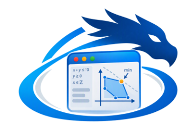

# wdreka - Step-by-step user guide

*A guide for beginners. Every interface label is quoted **exactly as it appears on screen**.*

---

## Contents

1. [What is wdreka for?](#1-what-is-wdreka-for)
2. [The basic ideas in five minutes](#2-the-basic-ideas-in-five-minutes)
3. [Installing and starting the software](#3-installing-and-starting-the-software)
4. [Guided tour of the interface](#4-guided-tour-of-the-interface)
5. [Working with the canvas](#5-working-with-the-canvas)
6. [Case 1 - A single task](#case-1--a-single-task)
7. [Case 2 - Two tasks in a row](#case-2--two-tasks-in-a-row)
8. [Case 3 - One oven, two bakes](#case-3--one-oven-two-bakes)
9. [Case 4 - Respecting working hours](#case-4--respecting-working-hours)
10. [Case 5 - A team of several people](#case-5--a-team-of-several-people)
11. [Case 6 - Producing and consuming a stock](#case-6--producing-and-consuming-a-stock)
12. [Case 7 - A meeting room](#case-7--a-meeting-room)
13. [Case 8 - A custom rule built with logic](#case-8--a-custom-rule-built-with-logic)
14. [Case 9 - Understanding errors and infeasibility](#case-9--understanding-errors-and-infeasibility)
15. [Case 10 - From the visual to the text (and back)](#case-10--from-the-visual-to-the-text-and-back)
16. [Case 11 - Creating your own component](#case-11--creating-your-own-component)
17. [Case 12 - Saving, opening, exporting](#case-12--saving-opening-exporting)
18. [The NCP language for beginners](#18-the-ncp-language-for-beginners)
19. [Component reference](#19-component-reference)
20. [Keyboard and mouse shortcuts](#20-keyboard-and-mouse-shortcuts)
21. [FAQ and troubleshooting](#21-faq-and-troubleshooting)
22. [Glossary](#22-glossary)

---

## 1. What is wdreka for?

wdreka helps you **organize activities over time** while respecting rules:

- these two tasks cannot happen at the same time;
- there is only one oven;
- the team only works from 8 to 12;
- the dough must be kneaded before it is baked;
- the flour stock must never go negative.

You do not compute anything yourself: you **describe** the situation by assembling **blocks** connected by **wires**, like a diagram. wdreka then turns this diagram into a small program, the **model**. A **solver** looks for a schedule that respects every rule. If you give it a goal ("finish as early as possible"), it looks for the **best** possible schedule.

This kind of tool is called a **constraint programming** solver. The solver in wdreka belongs to the "CP-SAT" family.

> **Examples of problems wdreka can handle**
> - Planning a bakery's day (kneading, baking, oven, bakers).
> - Scheduling meetings in a single room, during opening hours.
> - Scheduling a workshop: machines, operators, stocks of raw and machined parts.

---

## 2. The basic ideas in five minutes

Read this section once; the rest of the guide builds on it.

### 2.1 Time is a whole number

wdreka counts time in **units**: hours, minutes, days… You choose the unit, which is only a label; the solver itself only handles whole numbers.

- A task that **starts at 8** and **lasts 2** **ends at 10**.
- The **horizon** is the latest date of your schedule. By default it is **48** (two days if the unit is the hour). No task can end after the horizon.

### 2.2 Nodes

A **node** is a rectangular block placed on the drawing area. Each node represents one element of your problem: a task, a team, a stock, a schedule, a rule, a goal…

A node has:
- a **colored title bar**, with a dot containing a letter (the *glyph*), its title and its identifier (`n1`, `n2`…);
- **inputs**, small dots on the **left edge**;
- **outputs**, small dots on the **right edge**;
- **parameters**, adjustable values such as a duration or a capacity, summarized at the bottom of the node.

### 2.3 Links

A **link** is a wire that starts from an **output** and ends on an **input**. It means: "this node uses the information of that node". For example, a **task** linked to a **Uses** node means that the task takes up something.

### 2.4 Types and their colors

Each dot has a **type**, recognizable by its color. Only **compatible** dots can be linked. The legend is shown in the bottom-left corner of the canvas.

| Color | Displayed type | Meaning |
|---|---|---|
| blue | `task` | a task (start, duration, end) |
| orange | `usage` | the use of an agent or a place by a task |
| magenta | `flow` | a flow: an entry into or out of a stock |
| green | `schedule` | a schedule, i.e. availability windows |
| purple | `agent` | an agent |
| yellow | `stock` | a stock |
| cyan | `integer` | a whole number |
| red | `boolean` | a true/false condition |

Two rules complete this table:
- a **boolean** output can go into an **integer** input (true = 1, false = 0);
- an `any` input accepts everything.

### 2.5 Solving

When the diagram is ready, you click **▶ Solve**. The solver answers with one of these results:

| Result | Meaning |
|---|---|
| **Solution found** | a solution was found |
| **Proven optimal** | the best solution, and it is proven |
| **Infeasible** | impossible: the rules contradict each other |
| **Time limit reached** | the maximum time has elapsed |

---

## 3. Installing and starting the software

wdreka is a demonstration application of the **wdgui** graphics library, written in the **Nim** language.

1. Install **Nim** (version 2 recommended) and the **SDL3** library (with SDL3_ttf), as described in the wdgui README.
2. Get the **wdgui** repository.
3. Copy the `apps/wdreka` folder into the repository's `apps/` folder.
4. Add the `wdreka` task to the `wdgui.nimble` file (see the provided `wdgui.nimble.patch` file).
5. Open a terminal **at the root of the wdgui repository** and type:

```sh
nimble wdreka
```

or, without nimble:

```sh
nim c -r --threads:on --mm:atomicArc -d:sdlttf -o:apps/wdreka/wdreka apps/wdreka/wdreka.nim
```

6. The **wdreka · CP-SAT constraints** window opens. On first start it already shows a complete example: **Manufacturing workshop**. You can explore it freely: nothing is saved until you ask for it.

> **Tip.** To start each case on a blank page, click **New** in the toolbar. If the current model was modified, wdreka asks for confirmation: *The current model is not saved. Continue without saving?*

---

## 4. Guided tour of the interface

```
┌──────────────────────────────────────────────────────────────────────────────┐
│ File  Edit  Model  Library  View  Help                              ← menu bar │
├──────────────────────────────────────────────────────────────────────────────┤
│ New Open Save │ Visual → NCP  NCP → Visual │ ▶ Solve ■ Stop │ − + Fit   wdreka │ ← toolbar
├────────────┬───────────────────────────────────────────────┬─────────────────┤
│ Library    │                                               │ Properties      │
│ [Search…]  │            CANVAS (drawing area)              │  node title     │
│ ▸ Schedules│                                               │  description    │
│ ▸ Tasks    │                                               │  Parameter|Value│
│ ▸ Agents   │                                               │  Node NCP code  │
│ ...        ├───────────────────────────────────────────────┤                 │
│ description│ NCP model │ Solving │ Variables │ Log          │                 │
│ +Component │  (bottom tabs)                                │ Duplicate Delete│
│ Edit…      │                                               │ Original code   │
├────────────┴───────────────────────────────────────────────┴─────────────────┤
│ status message                                        [progress bar]  100 %  │ ← status bar
└──────────────────────────────────────────────────────────────────────────────┘
```

### 4.1 The menu bar

**File**:

| Label | Action |
|---|---|
| New | new empty model |
| Open… | open a `.wdreka` or `.ncp` file |
| Open the "Workshop" example | reopen the workshop example |
| Save | save |
| Save as… | save under another name |
| Export NCP model… | export the text model |
| Quit | quit |

**Edit**:

| Label | Action |
|---|---|
| Duplicate | duplicate the selection |
| Delete | delete the selection |
| Select all | select everything |
| Reset node code | restore the node's original code |

**Model**:

| Label | Action |
|---|---|
| Compile visual → text | compile the diagram into text |
| Import text → visual | rebuild the diagram from the text |
| Solve | solve |
| Stop solving | stop solving |

**Library**:

| Label | Action |
|---|---|
| New component… | create a new component |
| Edit / duplicate component… | edit or duplicate a component |
| Reload library | reload the library |

**View**:

| Label | Action |
|---|---|
| Fit view | frame the whole diagram |
| Zoom in | zoom in |
| Zoom out | zoom out |
| Light / dark theme | light or dark theme |

**Help**: **About wdreka**.

### 4.2 The toolbar

| Button | Effect |
|---|---|
| **New** | creates an empty model |
| **Open** | opens a model |
| **Save** | saves the model |
| **Visual → NCP** | translates the diagram into NCP text |
| **NCP → Visual** | rebuilds the diagram from the text |
| **▶ Solve** | runs the solver (purple button) |
| **■ Stop** | interrupts the search (red button, only active while solving) |
| **−** / **+** | changes the canvas zoom |
| **Fit** | frames the whole diagram in the window |

### 4.3 The "Library" panel (left)

This panel holds every component you can place on the canvas.

- **Search a component…**: type a word, for example `stock` or `task`, to filter the list.
- **The category tree**: the categories are described in the table below. Components marked **★** are **user** components.
- **The description area**, below the tree: when you click a component, its role, its *Inputs* and its *Outputs* are explained there.
- **+ Component** and **Edit…**: create a new component or edit one (see case 11).

| Category | Contents |
|---|---|
| **Schedules** | time windows |
| **Tasks** | tasks |
| **Agents** | staff and equipment |
| **Resources** | places and stocks |
| **Logic** | logic |
| **Arithmetic** | calculations |
| **Objectives** | goals |
| **Outputs** | displays |
| **Advanced** | free code |
| **My components** | your components |

### 4.4 The canvas (center)

This is your **drawing sheet**, with a grid.

- **Top left**: the document title and the zoom level (for example `100 %`). A **•** after the title means there are unsaved changes.
- **Bottom left**: the legend of the type colors.
- **In the center, when the canvas is empty**, a welcome message guides you: *Build your constraint model*.

### 4.5 The "Properties" panel (right)

**When a node is selected**, the panel shows:
1. at the top, the node title, the component name and the identifier (`n3`…);
2. the component description;
3. a three-column grid, **Parameter**, **Value** (editable) and **Type** (`int`: whole number; `expr`: expression; `text`: text). The first line, **Title**, is the free title of the node;
4. **Node NCP code (editable)**: the code produced by this node, editable;
5. three buttons:
   - **Duplicate**: duplicate the node;
   - **Delete**: delete it;
   - **Original code**: restore the original code if you edited it.

**When nothing is selected**, the grid shows the **document settings**:

| Line | Meaning | Default |
|---|---|---|
| **Title** | document title | `Untitled` |
| **Horizon** | latest date | 48 |
| **Time unit** | time unit (just a label) | `h` |
| **Time limit (s)** | maximum search time, in seconds | 30 |
| **Max solutions (0 = all)** | maximum number of solutions (0 = all) | 0 |

### 4.6 The bottom tabs

| Tab | Contents |
|---|---|
| **NCP model** | the model text, with the buttons **⬇ Compile the visual** and **⬆ Text → visual**, and the **Automatic compilation** checkbox |
| **Solving** | the search dashboard and the resulting schedule |
| **Variables** | every value found (columns **Node**, **NCP name**, **Value**) |
| **Log** | the time-stamped history of actions and messages |

### 4.7 The status bar (bottom)

On the left, the latest message (for example *Visual compiled to NCP (24 lines)*). On the right, a progress bar and the zoom level.

---

## 5. Working with the canvas

Take ten minutes to practice these gestures: they are used in every case.

### 5.1 Placing a node

**Method 1 (precise)**
1. In the library, **click once** on a component, for example **Tasks › Task**.
2. A colored banner appears at the top of the canvas: *Click on the canvas to place "Task" - Esc: cancel*.
3. **Click** where you want it on the canvas: the node appears there.

**Method 2 (quick).** **Double-click** the component in the library: it appears in the center of the view.

### 5.2 Selecting

- **Click** a node: it gets a purple glow.
- **Shift + click**: adds a node to the selection, or removes it.
- **Shift + drag** on an empty area: draws a selection rectangle.
- **Click a wire**: selects that link (it becomes thicker and brighter).
- **Click an empty area**: deselects everything. The Properties panel then shows the document settings.

### 5.3 Moving

- **Drag a node**: moves it, together with all selected nodes. At the end of the gesture, the nodes snap to an invisible grid.
- **Drag the background** (an empty area): scrolls the whole view.

### 5.4 Linking two nodes

1. Hover over an **output dot**, on the **right edge** of a node. It grows under the mouse.
2. **Hold the button** and **drag**: a wire in the color of the type follows the mouse.
3. **Release on an input dot**, on the **left edge** of another node.

The wire ends with a small arrow. The input dot, which was hollow, becomes **solid**.

Two details:
- An input surrounded by a **ring** is a **multiple input**: it accepts several wires. A plain input only keeps the last wire connected to it.
- If the types are incompatible, a red message is shown for a few seconds, for example *incompatible types: task → schedule*. It is also recorded in the **Log** tab.

### 5.5 Unplugging or re-plugging a wire

- **Drag from an input that is already linked**: the wire detaches from that input and follows the mouse. Drop it on another input, or in an empty area to delete it.
- **Select the wire** (click it) then press **Del**, or right-click then **Delete**.

### 5.6 Deleting, duplicating

- **Del** or **Backspace** (when the canvas has the focus): deletes the selection.
- **Ctrl + D** (Cmd + D on Mac): duplicates the selection, with a small offset.
- **Right-click** a node: context menu with **Duplicate**, **Delete**, **Reset node code**, **Compile visual → text**, **Solve**.
- **Right-click** an empty area: **Select all**, **Fit view**, **Compile visual → text**, **Solve**.

### 5.7 Zooming

- Mouse **wheel**, or the **−** and **+** toolbar buttons.
- **Fit**: frames the whole diagram in the window.

At very low zoom levels, the texts are hidden to keep the diagram readable.

### 5.8 Changing a parameter

1. Select the node.
2. In **Properties**, click (or double-click) in the **Value** column of the line you want.
3. Type the new value and confirm with **Enter**.

The summary at the bottom of the node is updated, as is the **Node NCP code** area.

---

## Case 1 - A single task

> **Goal:** go through the full cycle: place, set up, solve, read the result.
> **Situation:** a pastry chef must **bake a cake**. Baking lasts **2 hours** and cannot start before **8 o'clock**.

### Step 1 - Start from a blank page

1. Click **New** in the toolbar.
2. Confirm if wdreka asks you to.

The canvas is empty and shows the welcome message.

### Step 2 - Set up the document

1. Click an empty area of the canvas.
2. In **Properties**, set **Title** to `Cake` and check that **Time unit** is `h` and **Horizon** is `48`.

### Step 3 - Place the task

1. In the library, open the **Tasks** category and click **Task**.
2. Click in the middle of the canvas.

A blue node appears, with the **T** dot, the title *Task* and the identifier **n1**. It has:
- two inputs on the left: **After** (multiple input, with a ring) and **Schedule**;
- one output on the right: **Task**.

### Step 4 - Set up the task

Select the node and fill in the **Properties** grid:

| Parameter | Meaning | Value to enter |
|---|---|---|
| **Title** | free title | `Bake the cake` |
| **Duration** | duration | `2` |
| **Earliest start** | earliest start date | `8` |
| **Latest end** | latest end date | `HORIZON` (leave as is) |

> **Good to know.** Values of type `expr` accept **expressions**: `HORIZON`, `HORIZON - 2`, `3 * 4`… `HORIZON` is the document horizon (48 here).

### Step 5 - Solve

Click **▶ Solve**. Here is what happens:

1. wdreka **compiles** the diagram into text. The **NCP model** tab is filled in, and the status bar shows *Visual compiled to NCP…*.
2. The **Solving** tab opens.
3. The status ring spins (*Searching…*), then stops on **Solution found**.

### Step 6 - Read the result

- **On the canvas**: the node shows a green badge, for example **start 8 · end 10**.
- **In the Solving tab**:
  - the **Solutions** card shows `1`;
  - the schedule, **TASKS** section, shows a bar *Bake the cake* from 8 to 10.
- **In the Variables tab**, you find:

| Node | NCP name | Value |
|---|---|---|
| Bake the cake (n1) | `n1_task_s` | 8 |
| Bake the cake (n1) | `n1_task_e` | 10 |

- **In the Log tab**: *Solution 1 (0.00 s)*, then *End: Solution found…*.

> **Why 8 and not 15?** Without a goal, the solver stops at the **first** valid solution. Any start date between 8 and 46 respects the rules; case 2 shows how to ask for the **best** solution.

### Step 7 - Add a goal

1. In the **Objectives** category, place **Minimize the end** to the right of the task.
2. Link the task's **Task** output to the **Tasks** input (multiple input) of this new node.
3. Click **▶ Solve**.

The status becomes **Proven optimal**. The **Objective** card shows `10`, the **Bound** card `10`, and the badge of the objective node reads **objective = 10**.

✅ **You have gone through the whole cycle: describe → solve → read.**

---

## Case 2 - Two tasks in a row

> **Goal:** impose an order between tasks.
> **Situation:** before baking the bread (2 h), the **dough must be prepared** (1 h).

### Step 1 - Create the two tasks

1. Click **New**.
2. Place a **Task** on the left, with **Title** `Prepare the dough` and **Duration** `1`.
3. Place a second **Task** on the right, with **Title** `Bake the bread` and **Duration** `2`.

### Step 2 - Specify the order

Link the **Task** output of *Prepare the dough* to the **After** input of *Bake the bread*.

**This link means: "Bake the bread starts after Prepare the dough ends".**

### Step 3 - Goal and solving

1. Place **Minimize the end** and link **both** tasks to it: the **Tasks** input is multiple.
2. Click **▶ Solve**.

Expected result, **Proven optimal** with an objective of `3`:
- *Prepare the dough*: **start 0 · end 1**;
- *Bake the bread*: **start 1 · end 3**.

### Step 4 - Add a resting time (variant with "Precedence")

The dough must now **rest for 1 hour** before baking.

1. **Unplug** the wire arriving on the **After** input: drag from that input to an empty area, then release.
2. Place **Tasks › Precedence** between the two tasks.
3. Link *Prepare the dough* to the **Before** input of the Precedence node.
4. Link *Bake the bread* to its **After** input.
5. Set **Minimum delay** to `1`.
6. Click **▶ Solve**.

Result: *Bake the bread* moves to **start 2 · end 4**, and the objective becomes `4`.

> **Why two ways of doing it?** A task's **After** input is the quick way ("after the end of…"). The **Precedence** node is more complete: it adds a **delay**, and it makes the rule visible as a node of its own in the diagram.

---

## Case 3 - One oven, two bakes

> **Goal:** share a piece of **equipment** between several tasks.
> **Situation:** a cake (2 h) and a bread (3 h) must be baked, but there is **only one oven**.

### Step 1 - The tasks

1. Click **New**.
2. Create two **Task** nodes: *Bake the cake* (**Duration** `2`) and *Bake the bread* (**Duration** `3`).
3. Add **Minimize the end** and link both tasks to it.

### Step 2 - The equipment

1. Place **Agents › Equipment** on the right.
2. Set its **Title** to `Oven` and **Number of units** to `1`.

The **Equipment** node has a **Usages** input (multiple) and an optional **Schedule** input.

### Step 3 - Say who uses the oven

A task is never linked **directly** to a piece of equipment. You go through a small **Uses** node, which states **how many** units the task takes up.

1. Place **Agents › Uses** between *Bake the cake* and the oven.
2. Link the cake's **Task** output to the **Task** input of Uses.
3. Link the **Usage** output of Uses to the **Usages** input of the oven.
4. Leave **Quantity** at `1`.
5. Do the same for *Bake the bread*, with a **second** **Uses** node.

The diagram then looks like this:

```
[Bake the cake]  ─task─▶ [Uses] ─usage─▶ ┐
                                          ├─▶ [Oven  (Equipment, 1)]
[Bake the bread] ─task─▶ [Uses] ─usage─▶ ┘
```

### Step 4 - Solve and read

Click **▶ Solve**. Result: **Proven optimal**, objective `5`, because the two bakes happen one after the other.

In the **Solving** tab, scroll through the schedule:
- **TASKS** section: the two bars follow each other without overlapping;
- **AGENTS AND PLACES - load / capacity** section: the *Oven* line shows a load profile that always equals 1, with **capacity 1** and **peak 1/1**.

### Step 5 - Experiment

Set **Number of units** to `2` (two ovens) and solve again. The objective drops to `3`: both bakes happen at the same time, and the load peak becomes **2/2**.

---

## Case 4 - Respecting working hours

> **Goal:** restrict work to certain **time windows**.
> **Situation:** a baker works **from 8 to 12**, two days in a row. He has to do two tasks of **3 hours** each.

### Step 1 - The tasks and the baker

1. Click **New**.
2. Create two **Task** nodes: *Task A* and *Task B*, with **Duration** `3` each.
3. Place **Agents › Staff**, with **Title** `Baker` and **Headcount** `1`.
4. Link each task to the baker through a **Uses** node, as in case 3.
5. Add **Minimize the end** and link both tasks to it.

### Step 2 - The schedule

1. Place **Schedules › Daily schedule**.
2. Set it up:

| Parameter | Meaning | Value |
|---|---|---|
| **Number of days** | number of days | `2` |
| **Window start** | start of the window | `8` |
| **Window end** | end of the window | `12` |
| **Period** | period (24 h = one day) | `24` |

3. Link its **Schedule** output (green) to the **Schedule** input of the **Staff** node.

This schedule creates two windows: **[8, 12]** on the first day and **[32, 36]** on the second, since 24 + 8 = 32.

### Step 3 - Solve

Result: **Proven optimal**, objective `35`.
- The first task is placed **from 8 to 11**: 3 h fit in the 8–12 window.
- The second one **does not fit** in what is left of the morning (11–12): it moves to the next day, **from 32 to 35**.

In the schedule, the *Baker* line shows the **available windows shaded in green** and the baker's load within those windows.

> **Remember.** A task linked (through **Uses**) to an agent that has a schedule must fit **entirely** inside one window. It cannot be split in two.

> **Variant.** A task's **Schedule** input can also impose a schedule on **that task alone**, without going through an agent.

---

## Case 5 - A team of several people

> **Goal:** handle a **headcount** and different staffing needs per task.
> **Situation:** three tasks of **2 h** each; a team of **2 people**; each task needs 1 person.

### Step 1 - Build

1. Click **New**.
2. Create three **Task** nodes (*T1*, *T2*, *T3*), with **Duration** `2`.
3. Place a **Staff** node, with **Title** `Team` and **Headcount** `2`.
4. Link each task to the team through a **Uses** node, with **Quantity** `1`.
5. Add **Minimize the end**, linked to the three tasks.

### Step 2 - Solve

Result: objective `4`. Two tasks run together from 0 to 2, the third from 2 to 4. The team profile shows a load of 2, then 1: **peak 2 / 2**.

### Step 3 - A task that needs two people

Select the **Uses** node of *T1* and set **Quantity** to `2`, then solve. During *T1*, the whole team is busy. The other two tasks can run in parallel before or after it: the objective stays at `4`.

### Step 4 - A bigger team

Set **Quantity** back to `1` for *T1* and set **Headcount** to `3`. The objective becomes `2`: everyone works at the same time.

---

## Case 6 - Producing and consuming a stock

> **Goal:** model a **material** that some tasks produce and others consume.
> **Situation:** in a bakery,
> - *Knead* (1 h) **produces** dough balls;
> - *Bake batch 1* (2 h) and *Bake batch 2* (2 h) **each consume 3 dough balls**;
> - at the start, there are **no** dough balls.

### Step 1 - The tasks and the stock

1. Click **New**.
2. Create three **Task** nodes: *Knead* (**Duration** `1`), *Bake batch 1* (`2`) and *Bake batch 2* (`2`).
3. Place **Resources › Material (stock)**, set up as follows:

| Parameter | Meaning | Value |
|---|---|---|
| **Title** | title | `Dough balls` |
| **Initial stock** | initial stock | `0` |
| **Minimum stock** | minimum stock | `0` |
| **Maximum stock** | maximum stock | `10` |

### Step 2 - Production

1. Place **Resources › Produces**.
2. Link *Knead* to its **Task** input, and its **Flow** output (magenta) to the **Flows** input of the *Dough balls* stock.
3. Set **Quantity produced** to `4`.

> Production is added to the stock **at the end** of the task.

### Step 3 - Consumption

1. Place two **Resources › Consumes** nodes.
2. Link each bake to one of them, then each **Flow** to the *Dough balls* stock.
3. Set **Quantity consumed** to `3` for both.

> Consumption is removed from the stock **at the start** of the task.

### Step 4 - Add the goal and solve: first attempt

Add **Minimize the end**, linked to the three tasks, then click **▶ Solve**.

Result: **Infeasible**. The log says *the constraints are contradictory*.

**Why?** 4 dough balls are produced but 6 are consumed: the stock would become negative, which **Minimum stock** = 0 forbids.

### Step 5 - Fix it

Set **Quantity produced** to `6`, then solve. Result: **Proven optimal**, objective `3`.
- *Knead* from 0 to 1.
- Both bakes from 1 to 3, at the same time: no oven was defined.

In the schedule, the **STOCKS - level over time** section shows the *Dough balls* curve: it stays at 0, then the level is recomputed at time 1 (+6, −3, −3). The min and max bounds are drawn as red dashed lines. The stock badge reads **final level 0**.

> **Simultaneous events.** When a production and some consumptions happen at the same instant, wdreka counts them **together**. That is why the bakes can start exactly when kneading ends.

### Step 6 - A consumable

We now want to add **flour**: 5 kg available, of which *Knead* consumes 5.

1. Place **Resources › Consumable**, with **Title** `Flour` and **Available quantity** `5`.
2. Add a **Consumes** node linked to *Knead*, with **Quantity consumed** `5`, and link its **Flow** to the **Consumptions** input of *Flour*.

Solve: everything works. If you enter `6` in **Quantity consumed**, the problem becomes infeasible.

> **Material or Consumable?** A **Material** is a stock that goes up and down, with a minimum and a maximum. A **Consumable** only goes down and must never become negative.

---

## Case 7 - A meeting room

> **Goal:** use a **place** with a limited capacity and opening hours.
> **Situation:** two meetings of **1 hour**, a **single room**, open **from 9 to 12**.

1. Click **New**.
2. Create two **Task** nodes: *Meeting A* and *Meeting B*, with **Duration** `1`.
3. Place **Resources › Place**, with **Title** `Blue room` and **Capacity** `1`.
4. Link each meeting to the room through a **Uses** node. On the room side, the input is called **Occupations**.
5. Place **Schedules › Time windows** and set:

| Parameter | Meaning | Value |
|---|---|---|
| **Window starts** | window start times | `[9]` |
| **Window ends** | window end times | `[12]` |

6. Link its **Schedule** output to the **Opening schedule** input of the room.
7. Add **Minimize the end**, linked to both meetings, then click **▶ Solve**.

Result: objective `11`. The meetings take place from 9 to 10 and from 10 to 11.

> **Several windows.** Square brackets `[ ]` denote **lists**. For a room open from 9 to 12 and from 14 to 18, enter **Window starts** = `[9, 14]` and **Window ends** = `[12, 18]`. Both lists must have the same number of elements.

---

## Case 8 - A custom rule built with logic

> **Goal:** express a rule that does not exist ready-made, using the **Logic** and **Arithmetic** nodes.
> **Situation:** *Task B* must start **at least 3 hours after the start** of *Task A*. This is about the start, not the end.

### Step 1 - The tasks

1. Click **New**.
2. Create *Task A* (**Duration** `1`) and *Task B* (**Duration** `1`).
3. Add **Minimize the end**, linked to both tasks.

### Step 2 - Extract the start dates

1. Place **Tasks › Start of** and link *Task A* to it. Its **Start** output (cyan, integer) holds the start date of A.
2. Place a second **Start of**, linked to *Task B*.

### Step 3 - Compute the gap

1. Place **Arithmetic › Expression**.
2. Link A's **Start** to input **a**, and B's **Start** to input **b**.
3. In **Expression**, type `b - a`.

### Step 4 - Compare and enforce

1. Place **Arithmetic › Constant**, with **Value** `3`.
2. Place **Logic › Comparison**:
   - link the **Result** output of the Expression to input **A**;
   - link the **Value** output of the Constant to input **B**;
   - set **Operator** to `>=`.
3. Place **Logic › Constraint** and link the comparison's **Result** output (red, boolean) to its **Condition** input.

```
[Task A]─▶[Start of]─▶ a ┐
                         [Expression b - a]─▶ A ┐
[Task B]─▶[Start of]─▶ b ┘                       [Comparison >=]─▶[Constraint]
                         [Constant 3]──────────▶ B ┘
```

### Step 5 - Solve

Result: *Task A* **start 0**, *Task B* **start 3**, objective `4`.

> **Why a "Constraint" node?** A comparison on its own only computes "true or false"; it does not enforce anything. The **Constraint** node is what **forces** it to be true. This split lets you combine conditions with **AND**, **OR**, **NOT** and **Implies** ("if… then…").

> **Shortcut.** The Expression accepts any NCP formula using `a`, `b` and `c`: `2*a + b`, `max(a, b)`, `abs(a - c)`…

---

## Case 9 - Understanding errors and infeasibility

> **Goal:** know what to do when "it doesn't work".

There are **three** different situations, which should not be confused.

### 9.1 The diagram is incomplete: node outlined in red

1. Start from a model containing a **Precedence**.
2. Unplug its **Before** input, then click **Visual → NCP**.

The Precedence node is outlined in **red**. A message is shown below the node, and also in the log and the status bar, for example:

> `n3 (Precedence): input "avant" must be linked`

**Fix:** re-plug the input mentioned.

> **Note.** Messages use the **internal name** of the port (`avant`, `apres`, `tache`…), which is in French. The label shown on screen is in English (**Before**, **After**, **Task**…). See the reference in § 19.

### 9.2 The model is contradictory: "Infeasible"

1. Go back to case 2 (prepare for 1 h, then bake for 2 h).
2. Set the **Latest end** of *Bake the bread* to `2`, then solve.

The status shows **Infeasible**: at least 3 h are needed to do everything, which exceeds the deadline of 2.

**Fix:** relax a rule. Here, raise the deadline, the capacity or the time windows.

> **Diagnosis tip.** Delete or unplug the rules **one at a time** until the problem becomes feasible again. The last rule you removed is part of the conflict.

### 9.3 The model text contains an error: "Error" status

Example: two objective nodes, such as **Minimize the end** and **Maximize**, in the same diagram. Solving stops with the **Error** status and this message:

> `line 31: only one 'solve' statement is allowed`

wdreka finds **the node concerned** from the line number, outlines it in red and names it in the message. **Fix:** keep only one objective.

### 9.4 "Time limit reached": time has run out

If a problem is very large, the search may reach the limit set by **Time limit (s)** in the document settings. wdreka then keeps **the best solution found**. The **Bound** card and the **gap** show how far, at worst, you are from the optimum. You can also interrupt the search yourself with **■ Stop**: the status becomes **Stopped**.

---

## Case 10 - From the visual to the text (and back)

> **Goal:** understand the **NCP text** that wdreka produces, and edit it.

### Step 1 - See the text

Go back to case 2, then click **Visual → NCP** and open the **NCP model** tab. You see three parts:

1. Lines starting with `//@`: this is the **diagram description** (nodes, positions, parameters, links). The solver ignores them; they are used to rebuild the drawing.
2. The line `const HORIZON = 48;`, which defines the horizon.
3. **One block per node**, between `//@begin n1 tache` and `//@end n1`, which contains the rules produced by that node.

§ 18 explains this text line by line.

### Step 2 - Automatic compilation

Check **Automatic compilation**. From now on, every change to the diagram updates the text immediately.

### Step 3 - Edit the code of a single node

1. Select *Bake the bread*.
2. In **Node NCP code (editable)**, add this line at the end:
   ```
   constraint n2_task_s >= 5;
   ```
   (replace `n2` with the actual identifier of your node).
3. The node then shows the yellow **`</>`** badge, which means "custom code".
4. Solve: baking starts at 5 at the earliest.
5. To go back to the original code, click **Original code** or use **Edit › Reset node code**.

### Step 4 - Edit the full text, then import it back

1. In the **NCP model** tab, change a value. For example, in the line `//@node … duree="2"`, replace `2` with `4`.
2. The status bar says *NCP text modified - use "Text → visual" to import it, or solve directly*.
3. Click **⬆ Text → visual**. The diagram is rebuilt with the new duration.

> **Import rules**
> - A `//@begin … //@end` block edited by hand becomes **custom code** of the node (`</>` badge).
> - Code written **outside** the blocks is gathered into an **NCP block** node.
> - An NCP model written entirely by hand, without `//@` lines, becomes **a single** *Imported model* node.

> **Solving the text directly.** If you edit the text without importing it, **▶ Solve** solves **the text as it is**. Handy for a quick test.

---

## Case 11 - Creating your own component

> **Goal:** add a new reusable block to the library.
> **Situation:** we want a **"Fixed start"** component that forces a task to start at a precise date.

### Step 1 - Open the editor

Click **+ Component** below the library, or **Library › New component…**. A window opens in three parts.

**Top part, *Component identity***

| Field | Meaning | Value |
|---|---|---|
| **Identifier** | technical identifier: letters, digits and `_` | `fixed_start` |
| **Label** | displayed label | `Fixed start` |
| **Category** | category | `My components` |
| **Glyph** | letter shown in the dot | `F` |
| **Color** | color; **Choose…** opens a color picker | `#E2725B` |
| **Documentation** | description | `Forces the task to start at the given instant.` |

**Left part, *Inputs / outputs*.** One line already exists: **Direction** = `input`, **Name** = `task`, **Type** = `task`, **Label** = `Task`. Keep it as is.

The **+ Port** and **− Port** buttons add or remove a line. The columns are:
- **Direction**: `input` or `output`;
- **Name**: the internal name of the port;
- **Type**: the type of the port;
- **Label**: the displayed label;
- **Multiple**: check the box for an input that accepts several wires.

**Left part, *Parameters*.** A line `instant` already exists, of type `expr`, with default value `0`. Change its **Label** to `Instant`.

**Right part, *CP-SAT code (NCP template)*.** Replace the content with:

```
constraint {{in:task}}_s == {{p:instant}};
```

This template reads as follows:
- `{{in:task}}` will be replaced by the name of the task linked to the `task` input (for example `n4_task`);
- `_s` is its **start**;
- `{{p:instant}}` will be replaced by the value of the parameter.

The help text below the code lists every available tag.

### Step 2 - Test

Click **Test the template**. wdreka makes up a stub task, generates the code and has the solver check it. If everything is fine, the message is *Valid template: the generated code compiles*, followed by the generated code. Otherwise the error and the offending line are shown.

### Step 3 - Save

Click **Save to the library**. The component appears in **My components**, marked **★**. It is saved in the `library/user.wdrk` file.

### Step 4 - Use it

Place **Fixed start**, link a task to it, set **Instant** to `10` and solve: the task starts at 10.

> **Editing an existing component.** Select it in the library, then click **Edit…**.
> - A **★** (user) component opens directly for editing.
> - A **base** component cannot be edited. wdreka offers to create a **customized copy** instead: *Create a new user component from it?*

---

## Case 12 - Saving, opening, exporting

### Saving

1. Click **Save**, or use **Ctrl + S**.
2. The first time, choose a name: the `.wdreka` extension is added automatically.

The saved file is **the complete NCP text**, diagram description included. If the diagram is incomplete, wdreka still saves its description, followed by an *Incomplete model* comment.

> **Text edited by hand.** If you edited the text without importing it, wdreka first asks: *Import it into the visual before saving?* Answer **OK** so that your changes are not lost.

### Opening

Click **Open**, then choose a `.wdreka` or `.ncp` file. The diagram is rebuilt and the view is framed.

### Exporting the model

**File › Export NCP model…** saves the text to a `.ncp` file. That file can be solved **without the interface**, with the command-line solver:

```sh
cpsat my_model.ncp
```

The command line is where the **Display** and **Display a task** nodes make sense: they print lines of text in the terminal. In wdreka, the values are read in the **Solving** and **Variables** tabs.

---

## 18. The NCP language for beginners

**NCP** (*Nim Constraint Programming*) is the language that wdreka produces and that the solver reads. You do not have to write it yourself, but being able to **read** it helps a lot.

### 18.1 The code of case 2, line by line

```
const HORIZON = 48;
```
`const` defines a **constant**: a fixed value, known in advance.

```
var n1_task_s : 0..HORIZON;
```
`var` creates a **decision variable**: an unknown that the solver must choose. Here, `n1_task_s` is the **s**tart of task `n1`, between 0 and 48.

```
let n1_task_d = 1;
let n1_task_e = n1_task_s + n1_task_d;
```
`let` gives a **name** to a value or a calculation. The duration (`_d`) is 1, and the end (`_e`) is start + duration.

```
constraint n1_task_e <= HORIZON;
```
`constraint` sets a **rule** that the solution must respect: the task must end before the horizon.

```
let n2_pred = [n1_task_e];
constraint forall(i in 0..length(n2_pred) - 1)(n2_pred[i] <= n2_task_s);
```
`[ … ]` is a **list**, and `forall(i in …)(…)` means "for each element". Together: every task linked to the **After** input must be finished before `n2` starts.

```
solve minimize max([n1_task_e, n2_task_e]);
```
`solve` states **what we are looking for**: here, minimize the largest of the end dates.

### 18.2 The names produced by nodes

Each node names its values with its identifier followed by the name of its output. For a task `n4`:

| Name | Meaning |
|---|---|
| `n4_task_s` | start |
| `n4_task_d` | duration |
| `n4_task_e` | end |

These are the names shown in the **Variables** tab.

### 18.3 Essential statements

| Statement | Role | Example |
|---|---|---|
| `//` | comment (ignored) | `// this is a note` |
| `const` | constant | `const N = 5;` |
| `var` | integer unknown | `var x : 0..10;` |
| `var … : bool` | true/false unknown | `var open : bool;` |
| `let` | name given to a calculation | `let total = x + y;` |
| `constraint` | rule to respect | `constraint x + y <= 8;` |
| `solve satisfy` | find one solution | `solve satisfy;` |
| `solve minimize` | minimize | `solve minimize total;` |
| `solve maximize` | maximize | `solve maximize total;` |
| `solve all` | all solutions | `solve all;` |
| `output` | display (command line) | `output "x = ", x, "\n";` |
| `forall … { }` | repeat statements | `forall i in 0..3 { constraint t[i] >= i; }` |

### 18.4 Operators

| Family | Operators |
|---|---|
| Arithmetic | `+  -  *  div  mod` |
| Comparison | `==  !=  <  <=  >  >=` |
| Logic | `and  or  not  xor  ->` (implies)  `<->` (is equivalent to) |

### 18.5 Scheduling constraints

These are the constraints used by the wdreka components. You can also write them directly in an **NCP block**.

| Constraint | Meaning | Component that uses it |
|---|---|---|
| `cumulative(S, D, Q, cap)` | at any time, the sum of the quantities `Q` of the running tasks does not exceed `cap` | Staff, Equipment, Place |
| `disjunctive(S, D)` | the tasks never overlap | No overlap |
| `reservoir(T, DQ, init, min, max)` | a stock changes by `DQ` at times `T` and stays between `min` and `max` | Material, Consumable |
| `windows(S, D, A, B)` | each task fits in a window `[A, B]` | Schedule inputs |
| `alldifferent(list)` | all values are different | (NCP block) |

`S` = starts, `D` = durations, `Q` = quantities, `T` = times, `DQ` = changes, `A` / `B` = window starts and ends.

**NCP block example:** two tasks that cannot happen at the same time.

```
constraint disjunctive([n1_task_s, n2_task_s], [n1_task_d, n2_task_d]);
```

> The full documentation of the NCP language is in the `DOC.md` file of the `cpsat` solver.

---

## 19. Component reference

In the tables below, the label is what is shown on screen. The internal name, in parentheses, is the one used in the code and in some error messages.

### Schedules

| Component | Parameters | Inputs | Outputs |
|---|---|---|---|
| **Time windows** | Window starts (`debuts`) `[8, 14]`, Window ends (`fins`) `[12, 18]` | - | Schedule (`h`) |
| **Daily schedule** | Number of days `2`, Window start `8`, Window end `17`, Period `24` | - | Schedule (`h`) |

### Tasks

| Component | Parameters | Inputs | Outputs |
|---|---|---|---|
| **Task** | Duration `2`, Earliest start `0`, Latest end `HORIZON` | After (`apres`, multiple), Schedule (`horaire`) | Task (`task`) |
| **Variable-duration task** | Minimum duration `1`, Maximum duration `4`, Earliest start, Latest end | After, Schedule | Task |
| **Precedence** | Minimum delay `0` | Before (`avant`), After (`apres`) | - |
| **No overlap** | - | Tasks (`taches`, multiple) | - |
| **Start of** / **End of** | - | Task (`tache`) | Start / End (integer) |

### Agents

| Component | Parameters | Inputs | Outputs |
|---|---|---|---|
| **Uses** | Quantity `1` | Task (`tache`) | Usage (`u`) |
| **Staff** | Headcount `2` | Usages (multiple), Schedule | - |
| **Equipment** | Number of units `1` | Usages (multiple), Schedule | - |

### Resources

| Component | Parameters | Inputs | Outputs |
|---|---|---|---|
| **Place** | Capacity `1` | Occupations (multiple), Opening schedule | - |
| **Produces** (at the end of the task) | Quantity produced `1` | Task | Flow (`f`) |
| **Consumes** (at the start of the task) | Quantity consumed `1` | Task | Flow (`f`) |
| **Material (stock)** | Initial stock `0`, Minimum stock `0`, Maximum stock `10` | Flows (`flux`, multiple) | - |
| **Consumable** | Available quantity `10` | Consumptions (multiple) | - |

### Logic

| Component | Parameters | Inputs | Outputs |
|---|---|---|---|
| **Constraint** (forces "true") | - | Condition | - |
| **Comparison** | Operator `<=` | A, B (integers) | Result (boolean) |
| **AND** / **OR** | - | Terms (multiple, booleans) | Result |
| **NOT** | - | A | Result |
| **Implies** | - | If, Then | Result |

### Arithmetic

| Component | Parameters | Inputs | Outputs |
|---|---|---|---|
| **Constant** | Value `0` | - | Value |
| **Integer variable** | Minimum `0`, Maximum `10` | - | Value |
| **Sum** | - | Terms (multiple) | Sum |
| **Maximum** | - | Terms (multiple) | Maximum |
| **Expression** | Expression `a + b` | a, b, c | Result |

### Objectives (only one per model)

| Component | Role | Inputs |
|---|---|---|
| **Minimize the end** | finish as early as possible (end date of the last task) | Tasks (multiple) |
| **Minimize the sum of ends** | minimize the sum of the end dates | Tasks (multiple) |
| **Minimize** / **Maximize** | minimize or maximize an integer | Value |
| **All solutions** | list every solution (see *Max solutions*) | - |

If there is **no** objective, wdreka looks for a single valid solution.

### Outputs (useful on the command line)

| Component | Parameters | Inputs |
|---|---|---|
| **Display** | Label | Value (any type) |
| **Display a task** | - | Task |

### Advanced

| Component | Parameters | Role |
|---|---|---|
| **NCP block** | Code | free NCP code, inserted as is into the model; edited in **Node NCP code** |

### My components

| Component | Role |
|---|---|
| **Bounded delay** ★ (provided as an example) | *After* starts between `min` and `max` units after *Before* ends |

---

## 20. Keyboard and mouse shortcuts

| Action | Gesture |
|---|---|
| Place a component | click in the library, then click on the canvas, or double-click in the library |
| Cancel a placement / deselect everything | **Esc** (canvas active) |
| Link | drag from an output (right) to an input (left) |
| Pick up a wire | drag from a linked input |
| Multiple selection | **Shift + click**, or **Shift + drag** on the background |
| Pan the view | drag the background |
| Zoom | wheel, or **−**, **+**, **Fit** buttons |
| Delete | **Del** / **Backspace** (canvas active), right-click › **Delete** |
| Duplicate | **Ctrl + D** (canvas active), right-click › **Duplicate** |
| Save | **Ctrl + S** |
| Solve | **Ctrl + R** |
| Context menu | right-click on the canvas |

On Mac, **Cmd** replaces **Ctrl**.

---

## 21. FAQ and troubleshooting

**The link is refused.**
The types are not compatible: check the colors. A task (blue) cannot be linked directly to an agent or a stock: go through **Uses**, **Produces** or **Consumes**.

**My node is outlined in red.**
A required input is not linked, or a parameter is empty. Read the message shown below the node.

**The result is "Infeasible".**
The rules contradict each other. Check, in this order:
1. the deadlines (**Latest end**);
2. the capacities (**Headcount**, **Number of units**, **Capacity**);
3. the time windows, which must be long enough for each task;
4. the stocks: enough production, minimum and maximum.

**The search takes a long time.**
Reduce the **Horizon** to what is strictly needed, then set **Time limit (s)**. The **■ Stop** button keeps the best solution found.

**I don't see my results on the canvas.**
The green badges only appear after a successful solve. They are cleared when a new solve starts.

**My "Display" nodes show nothing.**
That is expected in wdreka: they are meant for the `cpsat` command line. Look at the **Variables** tab.

**Why don't the identifiers (`n1`, `n2`…) follow the order of the diagram?**
They are assigned in the order in which nodes are created and never change. Give your nodes meaningful **Title**s to find your way around.

**How do I get back to the initial example?**
**File › Open the "Workshop" example**.

**The dark theme tires my eyes.**
**View › Light / dark theme**.

---

## 22. Glossary

| Term | Meaning |
|---|---|
| Agent | someone or something that does the work: staff, equipment |
| Bound | the best value that is theoretically possible; when it equals the objective, the solution is optimal |
| Capacity / Headcount / Number of units | how many uses can happen at the same time |
| Component | a type of block available in the library |
| Conflicts / Decisions | solver statistics: dead ends met and choices made |
| Constraint | a rule that the solution must respect |
| Feasible / Infeasible | a solution exists / no solution can exist |
| Flow | an entry into or out of a stock |
| Gap | the relative distance between the solution found and the bound |
| Horizon | the latest possible date of the schedule |
| Link | a wire from an output to an input |
| Model | the description of the problem, as a diagram or as NCP text |
| NCP | the text language read by the solver |
| Node | a block placed on the canvas |
| Objective | what the solver optimizes (minimizes or maximizes) |
| Peak | the maximum load reached by an agent or a place |
| Proven optimal | no better solution exists, and the solver has proven it |
| Schedule | (1) availability windows; (2) the resulting timetable |
| Solver | the engine that looks for solutions |
| Time windows | periods during which something is available |

---

*Happy modeling!*

### One more thing!
A small gesture that can - greatly - help us... \[Caffeine matters a lot for a team of neurodivergent folks: ASD, ADHD, GAD, HPI and/or THPI (members of **mensa.fr** and **triplenine.org**).\]

[](https://buymeacoffee.com/sonaliwan.fr)
